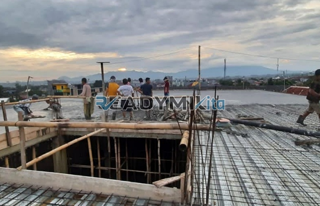

**Jasa Cor Readymix di Bungur Jakarta Murah** - Hai Mitra Readymix Kita! Sedang merencanakan pembangunan di Bungur Jakarta? Mencari solusi pengecoran yang cepat, kuat, dan terpercaya? Nah, Anda berada di tempat yang tepat! Kami, Readymix Kita, hadir sebagai penyedia beton cor readymix berkualitas tinggi dan layanan sewa concrete pump terpercaya di Bungur Jakarta dan sekitarnya. Yuk, simak bagaimana kami bisa membantu mewujudkan proyek impian Anda!



## Kenapa Memilih Beton Readymix untuk Proyek Anda?

Pernahkah Anda membayangkan proses pengecoran yang lebih efisien dan menghasilkan beton berkualitas konsisten? Itulah keunggulan beton cor readymix. Beton Cor Readymix adalah campuran beton siap pakai yang diformulasikan secara presisi di pabrik modern, menggunakan bahan baku pilihan. Material ini kemudian diangkut menggunakan truk mixer khusus ke lokasi proyek Anda di Bungur Jakarta, siap langsung dituangkan. Berikut beberapa keuntungan signifikan yang bisa Anda rasakan:

1. **Hemat Waktu dan Tenaga Kerja**

   Pengecoran manual di lokasi proyek seringkali memakan waktu dan membutuhkan banyak tenaga. Dengan beton Cor Readymix, proses pengecoran menjadi lebih cepat karena pencampuran sudah dilakukan secara optimal di pabrik.

2. **Kualitas Terjamin dan Konsisten**

   Beton Cor Readymix dirancang dengan takaran yang akurat dan menggunakan teknologi modern. Ini menjamin kualitas beton yang konsisten, mengurangi risiko kegagalan konstruksi akibat kesalahan pencampuran.

3. **Fleksibilitas Kapasitas Produksi**

   Kami memiliki kemampuan memproduksi beton dalam jumlah besar dalam waktu singkat, sangat ideal untuk proyek konstruksi skala kecil maupun besar di Bungur Jakarta.

4. **Komitmen Pada Lingkungan**

   Proses manufaktur beton Cor Readymix yang terkelola dengan baik meminimalkan limbah material di lokasi proyek, mendukung praktik konstruksi berkelanjutan.

## Apa yang Membuat ReadymixKita Unggul di Bungur Jakarta?

Di antara banyaknya pilihan penyedia jasa cor beton di Bungur Jakarta, **ReadymixKita** menawarkan keunggulan kompetitif yang akan mempermudah proyek Anda:

1. **Pengalaman dan Reputasi Terpercaya**

   Bertahun-tahun pengalaman di industri konstruksi membuat kami memahami seluk-beluk kebutuhan proyek Anda – mulai dari pembangunan rumah tinggal, gedung komersial, hingga proyek infrastruktur berskala besar.

2. **Beragam Pilihan Mutu Beton Sesuai Kebutuhan**

   Kami menyediakan berbagai pilihan mutu beton, termasuk K-225 untuk kebutuhan standar hingga K-500 untuk proyek yang membutuhkan kekuatan ekstra. Pilihan ini memungkinkan Anda menyesuaikan mutu beton dengan spesifikasi proyek.

3. **Didukung Peralatan Pengecoran Modern**

   Kami dilengkapi dengan peralatan mutakhir, termasuk concrete pump (pompa beton) yang memungkinkan proses pengecoran berlangsung lebih cepat, efisien, dan merata.

4. **Tim Profesional yang Siap Membantu**

   Tim ahli kami siap memberikan panduan teknis dari tahap perencanaan hingga pelaksanaan pengecoran di lapangan. Kami juga menawarkan fleksibilitas dalam menyesuaikan jadwal pengiriman dengan kebutuhan proyek Anda.

## Layanan Kami yang Dipersonalisasi untuk Kondisi Bungur Jakarta

Sebagai penyedia jasa lokal, kami sangat memahami tantangan konstruksi spesifik di Bungur Jakarta. Wilayah ini memiliki beragam kondisi medan, mulai dari area padat perkotaan hingga kawasan dengan kontur tanah yang berbeda. **ReadymixKita** siap mengatasi tantangan tersebut dengan:

1. **Pengiriman Tepat Waktu**

   Lokasi pabrik kami yang strategis memungkinkan kami menjamin pengiriman beton yang tepat waktu ke lokasi proyek Anda di Bungur Jakarta dan sekitarnya.

2. **Konsultasi Proyek Gratis**

   Kami menyediakan layanan konsultasi gratis untuk membantu Anda memilih jenis beton yang paling sesuai dengan kebutuhan proyek dan metode pengecoran yang optimal.

3. **Penawaran Khusus Warga Bungur Jakarta**

   Sebagai wujud komitmen kami, pelanggan di Bungur Jakarta dapat menikmati tarif spesial dan diskon menarik untuk proyek-proyek besar.

## Harga Bersaing dan Promo Menarik di Bungur Jakarta

Kami memahami bahwa anggaran proyek adalah pertimbangan penting. Oleh karena itu, **ReadymixKita** menawarkan:

1. **Harga yang Kompetitif**

   Kami menawarkan harga beton readymix yang bersaing tanpa mengorbankan kualitas. Informasi harga lengkap, termasuk biaya pengiriman dan penggunaan concrete pump, tersedia secara transparan.

2. **Promo dan Diskon Spesial**

   Nikmati berbagai promo menarik, seperti diskon untuk pemesanan volume besar atau proyek jangka panjang.

3. **Jaminan Kepuasan Pelanggan**

   Kami berkomitmen untuk memberikan layanan terbaik. Jika ada kendala dalam proses pengecoran, tim kami akan segera membantu sampai proyek Anda selesai dengan sempurna.

## Informasi Harga Jasa Cor Readymix di Bungur Jakarta



Jangan tunda lagi! Wujudkan proyek Anda dengan beton readymix berkualitas dari **ReadymixKita**! Hubungi kami sekarang untuk mendapatkan solusi pengecoran terbaik di Bungur Jakarta!

Kami juga menyediakan layanan survei lokasi gratis dan konsultasi teknis yang komprehensif. Pesan sekarang dan rasakan pengalaman konstruksi yang lebih mudah, cepat, dan memuaskan. 

Dengan memilih jasa Pengecoran dg Cor Readymix dari ReadymixKita, Anda akan mendapatkan kombinasi yang ideal antara kecepatan pengerjaan, kualitas beton yang terjamin, dan layanan profesional. Hubungi kami hari ini dan pastikan proyek Anda di Bungur Jakarta dibangun di atas fondasi yang kokoh dan tahan lama! [Jasa Cor Readymix di Bale Kambang Jakarta Murah](/readymix/jasa-cor-readymix-di-bale-kambang-jakarta-murah/) – yuk, simak juga layanan kami di wilayah Jakarta lainnya!