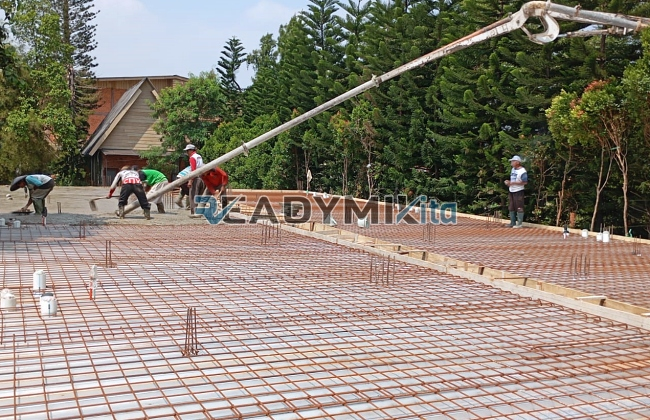

**Jasa Cor Readymix di Cakung Jakarta Murah** - Hai Mitra Readymix Kita! Apakah Anda tengah merencanakan pembangunan di Cakung Jakarta? Mencari material konstruksi yang berkualitas, praktis, dan terjangkau? Nah, Anda sudah berada di tempat yang tepat! Kami dari Readymix Kita adalah penyedia jasa cor readymix terpercaya di Cakung Jakarta, siap mendukung proyek konstruksi Anda dari awal hingga akhir. Pengerjaan cepat, mutu terjamin, dan harga bersaing – itulah komitmen kami. Yuk, simak lebih lanjut bagaimana Readymix Kita bisa menjadi solusi terbaik untuk kebutuhan pengecoran Anda!



## Mengapa Memilih Beton Readymix untuk Proyek Anda?

Beton readymix adalah campuran beton yang dibuat di pabrik, dengan formula dan takaran yang presisi. Kemudian, beton ini diangkut menggunakan truk mixer langsung ke lokasi proyek Anda. Penggunaan beton readymix ini memberikan sejumlah keuntungan signifikan dibandingkan dengan metode pencampuran manual konvensional. Berikut beberapa alasannya:

1. **Efisiensi Waktu & Biaya**

   Pencampuran manual membutuhkan waktu dan tenaga kerja yang signifikan. Dengan readymix, Anda menghemat waktu dan biaya karena proses pencampuran sudah dilakukan di pabrik.

2. **Konsistensi Kualitas Terjamin**

   Proses produksi yang terkontrol kualitasnya memastikan setiap batch beton readymix memiliki mutu yang konsisten, meminimalkan potensi kegagalan konstruksi.

3. **Kapasitas Produksi Fleksibel**

   Beton readymix mampu memenuhi kebutuhan volume besar dengan cepat, cocok untuk proyek kecil maupun skala besar.

4. **Dukungan Ramah Lingkungan**

   Proses produksi yang terkelola dengan baik mengurangi limbah material di lokasi proyek, berkontribusi pada praktik pembangunan berkelanjutan.

## Keunggulan ReadymixKita di Cakung Jakarta

Diantara banyak penyedia layanan pengecoran di Jakarta, **ReadymixKita** hadir untuk memberikan solusi terbaik bagi proyek Anda di Cakung Jakarta. Apa saja keunggulannya?

1. **Pengalaman & Reputasi Teruji**

   Bertahun-tahun berkecimpung di industri konstruksi menjadikan kami ahli dalam memahami setiap kebutuhan proyek Anda, mulai dari bangunan perumahan hingga infrastruktur kompleks.

2. **Pilihan Mutu Beton yang Lengkap**

   Kami menyediakan beragam pilihan mutu beton, mulai dari K-225 hingga K-500, disesuaikan dengan spesifikasi dan kebutuhan proyek Anda.

3. **Didukung Teknologi Modern**

   Kami menggunakan peralatan pengecoran mutakhir, termasuk concrete pump, yang menjamin proses pengecoran lebih cepat, efisien, dan merata.

4. **Tim Profesional & Responsif**

   Tim kami yang berpengalaman siap memberikan pendampingan ahli dari tahap perencanaan hingga eksekusi di lapangan, serta fleksibel menyesuaikan jadwal proyek Anda.

## Layanan Kami yang Terfokus di Cakung Jakarta

Menyesuaikan dengan kebutuhan konstruksi di Cakung Jakarta adalah prioritas kami. Kami memahami tantangan spesifik yang mungkin dihadapi di wilayah ini:

1. **Pengiriman Tepat Waktu**

   Lokasi pabrik kami yang strategis di sekitar Cakung Jakarta memungkinkan kami menjamin pengiriman beton readymix tepat waktu, sesuai jadwal proyek Anda.

2. **Konsultasi Ahli Gratis**

   Tim ahli kami siap memberikan konsultasi gratis untuk membantu Anda menentukan jenis beton dan metode pengecoran yang paling sesuai dengan kebutuhan proyek Anda.

3. **Penawaran Spesial untuk Proyek Lokal**

   Kami menawarkan harga khusus dan diskon menarik bagi proyek konstruksi yang berlokasi di wilayah Cakung Jakarta dan sekitarnya.

## Harga Terjangkau dan Penawaran Menarik

Kami percaya bahwa kualitas tidak harus mahal. **ReadymixKita** berkomitmen untuk memberikan harga yang kompetitif tanpa mengorbankan mutu beton readymix kami. 

1. **Harga Bersaing & Transparan**

   Kami menawarkan harga yang kompetitif dan transparan, termasuk biaya pengiriman dan penggunaan alat tambahan seperti pompa beton.

2. **Promo & Diskon Eksklusif**

   Nikmati berbagai promo menarik untuk pemesanan dalam jumlah besar atau proyek jangka panjang.

3. **Kepuasan Pelanggan Terjamin**

   Kami memberikan garansi kepuasan untuk setiap layanan yang kami berikan. Jika terjadi kendala, tim kami siap memberikan solusi hingga proyek Anda selesai dengan sempurna.

## Informasi Harga Jasa Cor Readymix di Cakung Jakarta



Jangan tunda lagi! Dapatkan penawaran terbaik untuk kebutuhan beton readymix Anda di Cakung Jakarta. Kami juga menyediakan layanan survei lokasi dan konsultasi gratis—pastikan proyek Anda berjalan lancar dan sesuai anggaran.

Hubungi kami sekarang juga untuk mendapatkan solusi pengecoran yang andal, berkualitas, dan terjangkau! Dengan **ReadymixKita**, fondasi bangunan Anda akan kokoh dan tahan lama. [Jasa Cor Readymix di Abadijaya Depok Murah](/readymix/jasa-cor-readymix-di-abadijaya-depok-murah/) bisa menjadi referensi tambahan bagi Anda yang ingin melihat layanan serupa di wilayah Depok.