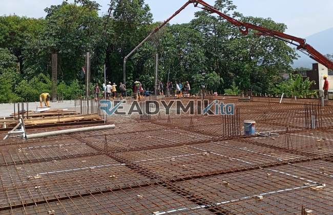

**Jasa Cor Readymix di Caringin Sukabumi Murah** - Hai Mitra Readymix Kita! Sedang berencana membangun atau mengembangkan proyek di Caringin Sukabumi? Kualitas material jadi perhatian utama? Nah, Anda sudah berada di tempat yang tepat! Kami dari ReadymixKita hadir sebagai solusi pengecoran readymix yang cepat, efisien, dan terpercaya untuk berbagai kebutuhan konstruksi Anda di Caringin Sukabumi Murah. Pilihan cerdas untuk membangun fondasi yang kuat dan tahan lama!



## Mengapa Beton Readymix Jadi Pilihan Tepat?

Di dunia konstruksi modern, penggunaan beton readymix semakin populer. Tapi, apa sebenarnya beton readymix itu? Singkatnya, beton readymix adalah campuran beton siap pakai yang diproduksi di pabrik dengan standar kualitas yang ketat. Kemudian, beton ini diantarkan langsung ke lokasi proyek menggunakan truk mixer. Nah, dibandingkan dengan metode konvensional, beton readymix menawarkan segudang keuntungan, lho:

1. **Efisiensi Waktu dan Biaya**

   Dengan beton readymix, Anda tak perlu lagi repot mencampur material di lokasi proyek. Ini menghemat waktu dan tenaga kerja, sehingga biaya konstruksi pun lebih efisien.

2. **Kualitas yang Terjamin**

   Proses produksi di pabrik beton readymix dilakukan dengan presisi tinggi, memastikan kualitas beton yang konsisten dan sesuai standar. Hal ini meminimalkan risiko kegagalan struktur.

3. **Fleksibilitas Produksi**

   Beton readymix dapat diproduksi dalam jumlah besar atau kecil sesuai kebutuhan proyek Anda. Ini sangat ideal untuk berbagai skala pekerjaan, mulai dari pembangunan rumah hingga proyek infrastruktur besar.

4. **Dampak Lingkungan yang Lebih Rendah**

   Penggunaan beton readymix yang terukur dapat mengurangi limbah material di lokasi proyek, sehingga lebih ramah lingkungan.

## Mengapa Harus Memilih ReadymixKita di Caringin Sukabumi?

Banyak penyedia jasa readymix di Caringin Sukabumi, tapi kenapa Anda harus memilih ReadymixKita? Jawabannya sederhana: kami berkomitmen untuk memberikan yang terbaik bagi Mitra! Ini dia keunggulan kami:

1. **Pengalaman & Keandalan**

   Selama bertahun-tahun, kami telah sukses melayani berbagai proyek konstruksi di Caringin Sukabumi dan sekitarnya. Pengalaman ini memungkinkan kami memahami tantangan di lapangan dan memberikan solusi terbaik.

2. **Pilihan Mutu Beton yang Lengkap**

   Kami menyediakan beragam kelas mutu beton, mulai dari K-225 hingga K-500, sesuai dengan kebutuhan spesifik proyek Anda. Konsultasikan dengan tim kami untuk menentukan mutu yang paling tepat!

3. **Dilengkapi Peralatan Modern**

   Kami menggunakan peralatan pengecoran modern, termasuk concrete pump, untuk memastikan proses pengecoran berjalan cepat, presisi, dan merata.

4. **Tim Ahli yang Siap Membantu**

   Tim kami terdiri dari para profesional yang berpengalaman, siap memberikan konsultasi dan dukungan teknis dari tahap perencanaan hingga penyelesaian proyek.

## Layanan Kami yang Disesuaikan untuk Caringin Sukabumi

Sebagai perusahaan lokal, kami memahami betul karakteristik wilayah Caringin Sukabumi. Dengan kondisi geografis yang bervariasi—mulai dari area padat penduduk hingga lahan perbukitan—kami siap memberikan solusi yang tepat:

1. **Pengiriman Tepat Waktu**

   Kami menjamin pengiriman beton readymix tepat waktu, berkat jaringan distribusi yang efisien dan armada truk yang handal.

2. **Konsultasi Gratis**

   Tim ahli kami siap memberikan konsultasi gratis untuk membantu Anda memilih jenis beton dan metode pengecoran yang paling sesuai dengan proyek Anda.

3. **Penawaran Khusus untuk Proyek Lokal**

   Khusus untuk pelanggan di Caringin Sukabumi, kami menawarkan harga spesial dan diskon menarik untuk proyek-proyek lokal.

## Harga Readymix yang Bersaing di Caringin Sukabumi

Kami percaya bahwa kualitas tidak harus mahal. **ReadymixKita** menawarkan harga readymix yang kompetitif di Caringin Sukabumi, tanpa mengorbankan mutu dan layanan.

1. **Harga Transparan**

   Kami memberikan informasi harga yang jelas dan transparan, termasuk biaya pengiriman dan biaya tambahan (jika ada).

2. **Promo Menarik**

   Nikmati diskon eksklusif untuk pemesanan dalam jumlah besar atau proyek jangka panjang.

3. **Jaminan Kepuasan**

   Kami berkomitmen untuk memberikan layanan terbaik dan memastikan kepuasan pelanggan. Jika ada masalah, tim kami akan segera menyelesaikannya.

## Informasi Harga Jasa Cor Readymix di Caringin Sukabumi



Jangan tunda lagi! Dapatkan penawaran terbaik untuk kebutuhan readymix Anda di Caringin Sukabumi. Hubungi kami sekarang juga untuk konsultasi gratis dan penawaran harga yang menarik!

Kami siap membantu mewujudkan proyek impian Anda dengan beton readymix berkualitas tinggi dan layanan yang prima. Percayakan pengecoran Anda pada ahlinya: ReadymixKita! Bangun kuat, bangun bersama kami di Caringin Sukabumi Murah!