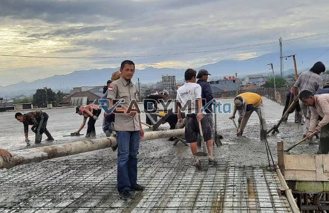

**Jasa Cor Readymix di Ceger Jakarta Murah** - Hai Mitra Readymix Kita! Apakah Anda tengah merencanakan proyek konstruksi di Ceger Jakarta? Mencari beton cor berkualitas tinggi yang bisa diandalkan? Kami hadir sebagai solusi pengecoran readymix terpercaya, siap mendukung kesuksesan proyek Anda. Pengecoran berkualitas bukan lagi impian, tapi kenyataan yang bisa Anda dapatkan dengan mudah!



## Mengapa Memilih Layanan Readymix untuk Proyek Anda?

Pertimbangkan tantangan yang sering dihadapi dalam konstruksi: kualitas beton yang bervariasi, keterlambatan penyelesaian, dan biaya operasional yang membengkak. Nah, beton Cor Readymix adalah jawabannya! Definisi beton Cor Readymix sederhana: campuran beton siap pakai yang diproduksi secara presisi di pabrik modern, menggunakan bahan baku terbaik. Kemudian, campuran ini diantarkan langsung ke lokasi proyek Anda menggunakan truk mixer khusus. Berikut ini beberapa alasan utama mengapa beton readymix menjadi pilihan cerdas:

1. **Efisiensi Tingkat Tinggi**

   Lupakan proses pencampuran manual yang memakan waktu dan tenaga. Beton readymix hadir siap pakai, mempercepat proses pengecoran dan menghemat sumber daya Anda.

2. **Kualitas Terjamin dan Konsisten**

   Dengan takaran yang akurat dan pengawasan mutu ketat, beton Cor Readymix menjamin kualitas yang konsisten setiap kali. Risiko kegagalan struktur akibat kesalahan pencampuran? Minimal!

3. **Skalabilitas Produksi**

   Butuh beton dalam jumlah besar untuk proyek berskala besar? Atau hanya sedikit untuk perbaikan kecil? Beton Cor Readymix siap memenuhi kebutuhan volume apa pun dengan cepat dan efisien.

4. **Komitmen terhadap Lingkungan**

   Proses produksi beton readymix yang terkontrol menghasilkan lebih sedikit limbah dan dampak lingkungan yang lebih rendah, sejalan dengan prinsip pembangunan berkelanjutan.

## Mengapa Memilih ReadymixKita di Ceger Jakarta?

Di antara banyaknya penyedia jasa pengecoran di Ceger Jakarta, **ReadymixKita** hadir dengan keunggulan yang membedakan kami: komitmen pada kualitas, pelayanan prima, dan pemahaman mendalam tentang kebutuhan konstruksi lokal.

1. **Pengalaman dan Kepercayaan Pelanggan**

   Bertahun-tahun berkiprah di industri konstruksi telah mengasah keahlian kami dan membangun reputasi sebagai mitra yang terpercaya dan andal.

2. **Pilihan Mutu Beton yang Lengkap**

   Kami menyediakan beragam kelas mutu beton, mulai dari K-225 untuk aplikasi standar hingga K-500 untuk konstruksi berat. Pemilihan mutu beton yang tepat menjamin ketahanan dan keamanan struktur Anda.

3. **Teknologi Modern untuk Hasil Optimal**

   Kami menggunakan peralatan pengecoran modern, termasuk *concrete pump*, untuk memastikan pengecoran yang cepat, merata, dan efisien.

4. **Tim Ahli yang Siap Membantu**

   Tim profesional kami siap memberikan panduan ahli, mulai dari perencanaan hingga pelaksanaan di lapangan. Kami juga fleksibel dan siap menyesuaikan dengan jadwal proyek Anda.

## Layanan Kami yang Dirancang untuk Ceger Jakarta

Sebagai penyedia lokal yang berbasis di Ceger Jakarta, kami memahami betul tantangan dan kebutuhan unik kawasan ini. Kondisi geografis yang bervariasi memerlukan solusi yang tepat dan efisien.

1. **Pengiriman Tepat Waktu**

   Lokasi pabrik kami yang strategis di Ceger Jakarta dan sekitarnya memungkinkan kami menjamin pengiriman beton tepat waktu, menghindari penundaan proyek.

2. **Konsultasi Proyek Gratis**

   Kami menawarkan layanan konsultasi gratis untuk membantu Anda menentukan jenis beton dan metode pengecoran yang paling sesuai dengan kebutuhan proyek Anda.

3. **Penawaran Spesial untuk Pelanggan Lokal**

   Nikmati tarif khusus dan diskon menarik untuk proyek-proyek yang berlokasi di wilayah Ceger Jakarta.

## Investasi Cerdas: Harga Terjangkau dengan Kualitas Terbaik di Ceger Jakarta

Kami memahami bahwa anggaran adalah faktor penting dalam setiap proyek konstruksi. Oleh karena itu, **ReadymixKita** menawarkan solusi yang tidak hanya berkualitas, tetapi juga ekonomis:

1. **Harga yang Bersaing**

   Kami berkomitmen untuk memberikan harga yang kompetitif tanpa mengorbankan kualitas beton dan layanan yang kami berikan. Kami siap memberikan transparansi harga.

2. **Promo dan Diskon Menarik**

   Dapatkan diskon khusus untuk pemesanan dalam jumlah besar atau proyek jangka panjang. Manfaatkan kesempatan ini untuk menghemat biaya konstruksi Anda.

3. **Garansi Kepuasan Pelanggan**

   Kami yakin dengan kualitas layanan kami. Jika Anda mengalami kendala, tim kami siap memberikan solusi hingga proyek Anda selesai dengan sempurna.

## Informasi Harga Jasa Cor Readymix di Ceger Jakarta



Jangan biarkan proyek Anda terhambat karena kualitas beton yang meragukan. Percayakan pengecoran Anda pada ahlinya! Segera hubungi kami untuk mendapatkan solusi terbaik di Ceger Jakarta.

Kami juga menyediakan layanan survei lokasi komprehensif dan konsultasi gratis untuk memastikan kebutuhan Anda terpenuhi secara optimal. Jangan tunda lagi, pesan sekarang dan rasakan kualitas beton readymix yang unggul dari ReadymixKita! [Jasa Cor Readymix di Balaraja Tangerang Murah](/readymix/jasa-cor-readymix-di-balaraja-tangerang-murah/) – solusi pengecoran terpercaya untuk proyek Anda di wilayah sekitarnya. ReadymixKita berkomitmen menjadi mitra terpercaya Anda. Bersama kami, wujudkan proyek impian Anda dengan fondasi yang kuat dan tahan lama! Segera hubungi tim kami untuk konsultasi dan penawaran terbaik.