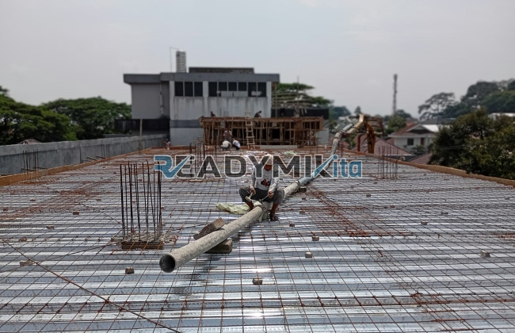

**Jasa Cor Readymix di Cempaka Jakarta Murah** - Hai Mitra Readymix Kita! Proyek konstruksi di Cempaka Jakarta sedang berjalan? Atau baru dalam tahap perencanaan? Nah, Anda sudah berada di tempat yang tepat! Kami dari Readymix Kita hadir sebagai solusi pengecoran readymix terpercaya, menawarkan kemudahan dan kualitas terbaik untuk setiap proyek Anda. Dengan layanan yang cepat dan terjangkau, kami siap mendukung kesuksesan konstruksi Anda di Cempaka Jakarta Murah.



## Mengapa Memilih Beton Readymix untuk Proyek Anda?

Mungkin Anda bertanya-tanya, apa sih kelebihan beton *readymix* dibandingkan dengan cara tradisional? Beton Cor Readymix adalah campuran beton yang diproduksi secara presisi di pabrik modern, menggunakan bahan baku berkualitas tinggi. Lalu, campuran ini langsung dikirimkan ke lokasi proyek Anda menggunakan truk mixer khusus. Ada beberapa keuntungan signifikan yang bisa Anda dapatkan:

1. **Efisiensi Waktu dan Biaya**

   Pengecoran dengan metode konvensional seringkali memakan waktu dan tenaga yang signifikan. Nah, dengan beton readymix, Anda bisa menghemat keduanya! Proses pencampuran sudah dilakukan sebelumnya, sehingga mempercepat waktu pengerjaan proyek Anda.

2. **Kualitas Terjamin Konsisten**

   Beton readymix diproduksi dengan takaran yang akurat dan peralatan canggih, memastikan kualitas yang seragam dan handal. Dengan begitu, risiko kegagalan struktur karena campuran yang tidak tepat bisa diminimalkan secara efektif.

3. **Kapasitas Produksi Fleksibel**

   Butuh beton dalam jumlah besar untuk proyek besar? Atau hanya sedikit untuk pekerjaan kecil? Beton readymix bisa mengakomodasi kebutuhan volume apa pun, dari skala kecil hingga besar, dengan cepat dan efisien. 

4. **Pilihan yang Lebih Ramah Lingkungan**

   Proses produksi beton readymix yang terkontrol membantu mengurangi limbah material konstruksi, menjadikannya pilihan yang lebih berkelanjutan. 

## Apa yang Membuat ReadymixKita Unggul di Cempaka Jakarta?

Di antara banyaknya penyedia jasa pengecoran di Cempaka Jakarta, **ReadymixKita** menawarkan keunggulan yang membedakan kami dari yang lain:

1. **Pengalaman dan Kepercayaan Pelanggan**

   Kami telah berpengalaman dalam menangani berbagai macam proyek konstruksi, mulai dari perumahan, bangunan komersial, hingga infrastruktur skala besar. Kepercayaan pelanggan adalah prioritas utama kami.

2. **Pilihan Mutu Beton yang Lengkap**

   Kami menyediakan berbagai kelas mutu beton, termasuk K-225 untuk keperluan umum, K-300 untuk kekuatan standar, hingga K-500 untuk konstruksi yang membutuhkan kekuatan ekstra. Semua bisa disesuaikan dengan spesifikasi proyek Anda.

3. **Dilengkapi dengan Peralatan Canggih**

   Kami menggunakan peralatan modern seperti *concrete pump* atau pompa beton, yang menjamin pengecoran cepat, merata, dan efisien, bahkan di area yang sulit dijangkau.

4. **Didukung Tim Profesional**

   Tim ahli kami siap memberikan pendampingan dari tahap perencanaan hingga pelaksanaan di lapangan. Kami fleksibel dan bisa menyesuaikan layanan dengan jadwal proyek Anda.

## Layanan Kami yang Dirancang untuk Kebutuhan Cempaka Jakarta

Kami memahami betul karakteristik konstruksi di Cempaka Jakarta. Mulai dari kepadatan lingkungan kota hingga kontur tanah yang bervariasi, kami siap memberikan solusi yang tepat:

1. **Pengiriman Tepat Waktu**

   Kami menjamin pengiriman beton tepat waktu ke lokasi proyek Anda di Cempaka Jakarta dan sekitarnya. Ini berkat lokasi pabrik kami yang strategis dan armada pengiriman yang handal.

2. **Konsultasi Proyek Gratis**

   Butuh saran tentang jenis beton yang cocok untuk proyek Anda? Atau metode pengecoran yang paling efektif? Tim ahli kami siap memberikan konsultasi gratis untuk membantu Anda membuat keputusan yang tepat.

3. **Penawaran Spesial untuk Proyek Lokal**

   Khusus untuk proyek di wilayah Cempaka Jakarta, kami menawarkan harga spesial dan diskon menarik untuk pemesanan dalam jumlah besar atau proyek jangka panjang.

## Harga Terjangkau dan Promo Menarik di Cempaka Jakarta

Kami percaya bahwa kualitas tidak harus mahal. **ReadymixKita** berkomitmen untuk memberikan solusi pengecoran yang terjangkau tanpa mengorbankan kualitas:

1. **Harga Kompetitif**

   Kami menawarkan harga yang kompetitif dan transparan, termasuk biaya pengiriman dan penggunaan peralatan tambahan seperti pompa beton.

2. **Promo Eksklusif**

   Nikmati berbagai promo menarik, seperti diskon untuk pemesanan volume besar atau penawaran khusus untuk proyek berulang.

3. **Kepuasan Pelanggan Dijamin**

   Kami berkomitmen untuk memberikan layanan terbaik dan memastikan Anda puas dengan hasil pengecoran kami. Jika ada masalah, tim kami siap membantu sampai tuntas.

## Info Harga Jasa Cor Readymix di Cempaka Jakarta



Jangan biarkan kualitas material menjadi penghalang keberhasilan proyek Anda! Segera hubungi kami untuk mendapatkan solusi pengecoran terbaik di Cempaka Jakarta Murah. 

Kami menyediakan layanan survei lokasi dan konsultasi gratis. Dapatkan penawaran terbaik sekarang juga dan nikmati hasil konstruksi yang kuat, awet, dan sesuai harapan Anda.

Pilihlah **ReadymixKita** untuk pengecoran yang cepat, berkualitas, dan terpercaya di Cempaka Jakarta. Bersama kami, proyek Anda akan kokoh dan tahan lama! [Jasa Cor Readymix di Babakan Bogor Murah](/readymix/jasa-cor-readymix-di-babakan-bogor-murah/) – Kalau Anda punya proyek di daerah Babakan Bogor, layanan kami juga tersedia di sana!