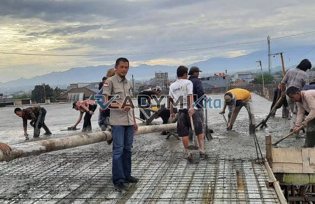

**Jasa Cor Readymix di Ciambar Sukabumi Murah** - Hai Mitra Readymix Kita! Mencari solusi pengecoran yang cepat, berkualitas, dan terjangkau di Ciambar Sukabumi? Anda sudah berada di tempat yang tepat! Kami, Readymix Kita, adalah penyedia jasa cor readymix terpercaya yang siap mendukung kesuksesan proyek konstruksi Anda di Ciambar Sukabumi dan sekitarnya. Yuk, simak bagaimana kami bisa menjadi partner terbaik Anda!



## Mengapa Memilih Pengecoran dengan Readymix?

Beton cor readymix adalah campuran beton siap pakai yang diproduksi secara presisi di pabrik modern, menggunakan bahan baku pilihan. Kemudian, beton ini diangkut menggunakan truk mixer langsung ke lokasi proyek Anda. Apa saja sih keunggulannya dibandingkan cara tradisional? Begini penjelasannya:

1. **Hemat Waktu dan Tenaga Kerja**

   Proses pengecoran konvensional seringkali memakan waktu lama dan membutuhkan banyak tenaga. Dengan readymix, Anda bisa mempercepat pengerjaan proyek secara signifikan karena pencampuran beton sudah dilakukan oleh kami.

2. **Kualitas Terjamin Konsisten**

   Kami menjamin kualitas beton yang seragam dan konsisten setiap kali Anda memesan. Proses pencampuran yang terkontrol dengan takaran yang tepat minimalkan risiko kesalahan yang bisa membahayakan kekuatan struktur.

3. **Kemampuan Produksi Skala Besar**

   Kapasitas produksi kami memungkinkan kami memenuhi kebutuhan beton dalam volume besar, baik untuk proyek kecil maupun proyek berskala megah.

4. **Dukungan Ramah Lingkungan**

   Proses produksi beton readymix kami lebih efisien, mengurangi potensi limbah material di lokasi proyek Anda.

## Apa yang Membuat Kami Unggul di Ciambar Sukabumi?

Diantara banyaknya penyedia jasa pengecoran, **ReadymixKita** hadir dengan keunggulan yang akan mempermudah proyek Anda di Ciambar Sukabumi:

1. **Pengalaman & Kepercayaan Pelanggan**

   Kami telah lama berkecimpung di industri konstruksi, memahami seluk-beluk proyek dari berbagai skala. Pengalaman ini memungkinkan kami memberikan solusi terbaik untuk setiap kebutuhan Anda.

2. **Pilihan Mutu Beton yang Lengkap**

   Kami menyediakan berbagai kelas mutu beton, mulai dari K-225 untuk kebutuhan standar, hingga K-500 untuk proyek konstruksi dengan beban berat. Pastinya, sesuai dengan spesifikasi proyek Anda.

3. **Peralatan Pengecoran Modern**

   Kami didukung oleh peralatan canggih seperti *concrete pump* yang memastikan penyaluran beton cepat, merata, dan efisien, bahkan di area yang sulit dijangkau.

4. **Tim Ahli yang Siap Membantu**

   Tim profesional kami siap mendampingi Anda mulai dari tahap perencanaan hingga penyelesaian pengecoran. Kami fleksibel dan siap menyesuaikan dengan jadwal proyek Anda.

## Layanan Khusus Kami di Ciambar Sukabumi

Sebagai penyedia jasa lokal, kami memahami betul tantangan konstruksi di Ciambar Sukabumi. Kondisi geografis yang beragam – mulai dari area perkotaan padat hingga wilayah perbukitan – membutuhkan solusi khusus. Nah, inilah yang kami tawarkan:

1. **Pengiriman Tepat Waktu**

   Lokasi pabrik kami yang strategis di Ciambar Sukabumi memastikan pengiriman beton tepat waktu, meminimalisir keterlambatan proyek Anda.

2. **Konsultasi Teknis Gratis**

   Bingung memilih jenis beton yang tepat? Tim ahli kami siap memberikan konsultasi gratis untuk membantu Anda menentukan solusi terbaik sesuai kebutuhan proyek.

3. **Penawaran Spesial untuk Proyek Lokal**

   Kami memberikan penawaran khusus dan diskon menarik bagi pelanggan di Ciambar Sukabumi, terutama untuk proyek-proyek berskala besar.

## Investasi Cerdas dengan Harga Terjangkau di Ciambar Sukabumi

Kami menawarkan kualitas terbaik dengan harga yang bersaing. **ReadymixKita** memahami bahwa anggaran adalah pertimbangan penting. Karena itu, kami menyediakan:

1. **Harga Kompetitif dan Transparan**

   Kami berkomitmen memberikan harga yang terjangkau tanpa mengorbankan kualitas. Informasi harga, termasuk biaya pengiriman dan sewa concrete pump, akan kami sampaikan secara jelas.

2. **Program Promosi Menarik**

   Dapatkan diskon khusus untuk pemesanan dalam jumlah besar atau proyek berdurasi panjang.

3. **Jaminan Kepuasan Pelanggan**

   Kami menjamin kualitas layanan dan hasil pengecoran yang memuaskan. Jika ada kendala, tim kami siap memberikan solusi sampai proyek Anda selesai dengan sempurna.

## Informasi Harga Jasa Cor Readymix di Ciambar Sukabumi



Jangan tunda lagi! Pastikan proyek Anda menggunakan material terbaik dan layanan profesional. Hubungi kami segera untuk mendapatkan penawaran terbaik dan solusi pengecoran yang tepat di Ciambar Sukabumi.

Kami siap membantu Anda mewujudkan bangunan yang kuat, tahan lama, dan berkualitas. [Jasa Cor Readymix di Abadijaya Depok Murah](/readymix/jasa-cor-readymix-di-abadijaya-depok-murah/) — untuk referensi layanan kami di area Depok. Pesan sekarang dan rasakan perbedaan kualitas dari **ReadymixKita**!