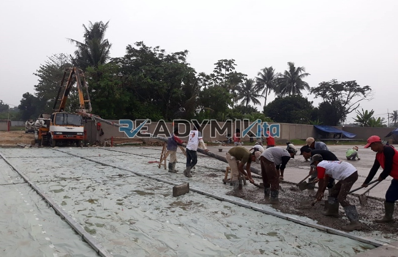

**Jasa Cor Readymix di Cibadak Bogor Murah** - Hai Mitra Readymix Kita! Membangun hunian impian atau proyek komersial di Cibadak Bogor? Tentu saja Anda menginginkan fondasi yang kuat dan hasil pengecoran yang prima. Nah, Anda sudah berada di tempat yang tepat! Kami dari Readymix Kita hadir untuk memberikan solusi beton cor readymix berkualitas, cepat, dan terjangkau. Yuk, simak bagaimana kami bisa membantu mewujudkan proyek Anda!



## Mengapa Memilih Beton Readymix untuk Proyek Anda?

Mungkin Anda bertanya-tanya, apa sih keuntungan menggunakan beton readymix dibandingkan cara tradisional? Beton Cor Readymix adalah campuran beton yang diproduksi di pabrik kami dengan presisi tinggi, menggunakan bahan baku pilihan. Lalu, diangkut langsung ke lokasi proyek Anda dengan truk mixer khusus. Ini dia beberapa keunggulan yang akan Anda rasakan:

1. **Waktu dan Tenaga: Efisiensi Maksimal**

   Proses pencampuran beton di lokasi memakan waktu dan tenaga yang tidak sedikit. Dengan readymix, Anda menghemat keduanya! Kami menyiapkan beton di pabrik, sehingga waktu pengerjaan di lokasi proyek bisa dipangkas secara signifikan.

2. **Kualitas Terjamin: Konsisten dan Andal**

   Di pabrik, setiap batch beton kami diracik dengan takaran yang tepat dan teknologi modern. Ini berarti Anda mendapatkan beton dengan kualitas yang konsisten, meminimalkan risiko kesalahan pencampuran yang bisa membahayakan kekuatan struktur.

3. **Fleksibilitas Produksi: Kapasitas Sesuai Kebutuhan**

   Apapun skala proyek Anda – mulai dari pembangunan rumah pribadi hingga proyek infrastruktur besar – kami siap memenuhi kebutuhan beton Anda. Kapasitas produksi kami cukup besar untuk menjangkau proyek apapun.

4. **Ramah Lingkungan: Pengecoran yang Bertanggung Jawab**

   Proses produksi kami dirancang untuk meminimalkan limbah material di lokasi konstruksi, berkontribusi pada praktik pembangunan yang lebih berkelanjutan.

## Apa yang Membuat ReadymixKita Pilihan Tepat di Cibadak Bogor?

Di antara banyaknya penyedia jasa cor readymix, **ReadymixKita** hadir sebagai solusi terpercaya di Cibadak Bogor. Apa saja keunggulan yang kami tawarkan?

1. **Pengalaman dan Kepercayaan: Fondasi Keahlian Kami**

   Bertahun-tahun berkecimpung di industri konstruksi membuat kami memahami betul seluk-beluk dan kebutuhan setiap proyek, mulai dari skala kecil hingga besar.

2. **Pilihan Mutu Beton: Sesuaikan dengan Kebutuhan Proyek**

   Kami menyediakan beragam mutu beton, mulai dari K-225 untuk aplikasi standar sampai K-500 untuk konstruksi yang membutuhkan kekuatan ekstra. Tim kami akan membantu Anda memilih mutu yang paling sesuai.

3. **Teknologi Modern: Pengecoran Cepat dan Presisi**

   Kami dilengkapi dengan peralatan canggih, termasuk concrete pump, untuk memastikan proses pengecoran berjalan lancar, cepat, dan menghasilkan hasil yang rata sempurna.

4. **Tim Profesional: Solusi Terpadu untuk Proyek Anda**

   Tim ahli kami siap memberikan panduan mulai dari perencanaan hingga eksekusi di lokasi proyek. Kami juga menawarkan fleksibilitas dalam menyesuaikan jadwal pengiriman dengan kebutuhan Anda.

## Layanan Kami yang Dirancang Khusus untuk Cibadak Bogor

Sebagai penyedia jasa lokal di Cibadak Bogor, kami memahami betul kondisi geografis dan tantangan konstruksi di wilayah ini. Inilah layanan khusus yang kami hadirkan:

1. **Pengiriman Tepat Waktu: Efisiensi adalah Prioritas Kami**

   Lokasi pabrik kami yang strategis di Cibadak Bogor memungkinkan kami memastikan pengiriman beton tepat waktu, sesuai jadwal proyek Anda.

2. **Konsultasi Gratis: Ahli Kami Siap Membantu**

   Kami menyediakan layanan konsultasi gratis untuk membantu Anda memilih jenis beton yang tepat serta metode pengecoran yang paling efisien untuk proyek Anda.

3. **Penawaran Spesial: Hemat Biaya untuk Proyek Lokal**

   Klien di wilayah Cibadak Bogor bisa menikmati berbagai penawaran spesial dan diskon menarik, terutama untuk proyek-proyek berskala besar.

## Harga Terjangkau dan Promo Menarik di Cibadak Bogor

Kami memahami bahwa biaya merupakan faktor penting dalam setiap proyek konstruksi. **ReadymixKita** berkomitmen untuk memberikan solusi yang hemat biaya tanpa mengorbankan kualitas:

1. **Harga Kompetitif: Kualitas Terbaik dengan Harga Terbaik**

   Kami menawarkan harga yang bersaing di pasar, dengan transparansi penuh mengenai biaya pengiriman dan penggunaan peralatan tambahan seperti concrete pump.

2. **Promo Eksklusif: Manfaatkan Diskon dan Penawaran Khusus**

   Nikmati diskon menarik untuk pemesanan dalam jumlah besar atau proyek yang berlangsung dalam jangka waktu lama.

3. **Kepuasan Dijamin: Kami Berkomitmen pada Kualitas**

   Apabila terjadi kendala selama proses pengecoran, tim kami akan memberikan solusi dan dukungan penuh hingga proyek Anda selesai dengan sempurna.

## Informasi Harga Jasa Cor Readymix di Cibadak Bogor



Jangan biarkan kualitas bangunan Anda dikompromikan karena material yang kurang berkualitas. Segera hubungi kami untuk mendapatkan solusi pengecoran terbaik di Cibadak Bogor! Layanan survei lokasi dan konsultasi gratis kami siap membantu Anda menentukan kebutuhan material yang tepat.

Pesan sekarang dan rasakan manfaat konstruksi yang kokoh, tahan lama, dan memuaskan. Bersama ReadymixKita, Anda mendapatkan kombinasi kecepatan, kualitas, dan pelayanan profesional yang tak tertandingi. Hubungi kami sekarang untuk mendapatkan penawaran terbaik di Cibadak Bogor! Bersama ReadymixKita, wujudkan bangunan impian Anda! [Jasa Cor Readymix di Babakan Bogor Murah](/readymix/jasa-cor-readymix-di-babakan-bogor-murah/) dapat menjadi referensi tambahan untuk solusi pengecoran readymix terpercaya.