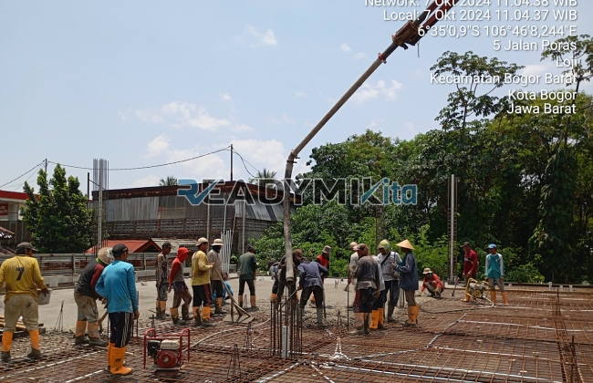

**Jasa Cor Readymix di Cibitung Sukabumi Murah** - Hai Mitra Readymix Kita! Ingin memastikan proyek konstruksi Anda di Cibitung Sukabumi berjalan lancar dan hasilnya tahan lama? Kualitas material adalah kunci utama, dan beton readymix adalah jawabannya. Kami dari ReadymixKita hadir sebagai solusi pengecoran yang praktis, efisien, dan terpercaya untuk berbagai kebutuhan konstruksi Anda di area Cibitung Sukabumi Murah. Yuk, simak bagaimana kami bisa membantu menghadirkan fondasi yang kokoh untuk bangunan impian Anda!



## Mengapa Beton Readymix Jadi Pilihan Terbaik?

Pernahkah Anda bertanya-tanya, apa sebenarnya beton readymix itu? Singkatnya, beton readymix adalah campuran beton yang diproduksi secara presisi di pabrik modern, menggunakan bahan baku berkualitas tinggi. Nah, keuntungan menggunakan beton siap pakai ini sangat banyak, lho! Berikut beberapa alasannya:

1. **Hemat Waktu & Biaya Tenaga Kerja**

   Proses pencampuran beton di lokasi proyek jelas memakan waktu dan juga tenaga kerja. Dengan readymix, Anda langsung mendapatkan campuran yang siap tuang, sehingga mempercepat penyelesaian proyek.

2. **Kualitas Terjamin Konsisten**

   Beton Cor Readymix diproduksi dengan takaran yang akurat menggunakan teknologi canggih, sehingga kualitasnya selalu terjaga dan minim risiko kesalahan. Ini sangat penting untuk kekuatan dan keamanan bangunan Anda.

3. **Kapasitas Produksi Fleksibel**

   Baik untuk proyek kecil maupun besar, beton readymix mampu menyediakan volume yang dibutuhkan dengan cepat dan efisien.

4. **Dukungan Lingkungan**

   Proses produksi beton readymix yang terkontrol meminimalkan limbah material di lokasi konstruksi, menjadikannya pilihan yang lebih ramah lingkungan.

## Apa yang Membuat ReadymixKita Unggul di Cibitung Sukabumi?

Di Cibitung Sukabumi, banyak penyedia jasa pengecoran. Tapi, kenapa harus memilih **ReadymixKita**? Ini dia alasannya:

1. **Pengalaman & Reputasi Teruji**

   Kami telah berpengalaman melayani berbagai proyek konstruksi, dari rumah tinggal hingga gedung-gedung besar. Kami memahami betul seluk-beluk kebutuhan konstruksi di wilayah ini.

2. **Pilihan Mutu Beton yang Lengkap**

   Kami menyediakan beragam kelas mutu beton, mulai dari K-225 yang cocok untuk pekerjaan standar, hingga K-500 untuk struktur yang memerlukan kekuatan ekstra.  Semua bisa disesuaikan dengan spesifikasi proyek Anda.

3. **Didukung Peralatan Modern**

   Kami dilengkapi dengan peralatan pengecoran modern, termasuk concrete pump, untuk memastikan proses pengecoran berjalan cepat, merata, dan efisien.

4. **Tim Ahli yang Profesional**

   Tim kami terdiri dari tenaga ahli yang siap membantu Anda mulai dari perencanaan hingga pelaksanaan di lapangan. Kami selalu memberikan solusi terbaik sesuai dengan kebutuhan proyek Anda.

## Layanan ReadymixKita di Cibitung Sukabumi: Solusi Tepat untuk Setiap Kebutuhan

Sebagai penyedia jasa lokal, kami sangat memahami kondisi dan tantangan konstruksi di Cibitung Sukabumi. Dari kepadatan lalu lintas hingga medan yang beragam, kami siap memberikan solusi terbaik:

1. **Pengiriman Tepat Waktu**

   Kami menjamin pengiriman beton readymix tepat waktu ke lokasi proyek Anda di Cibitung Sukabumi dan sekitarnya, berkat lokasi pabrik yang strategis.

2. **Konsultasi Gratis**

   Bingung memilih jenis beton yang tepat? Jangan khawatir! Kami menawarkan layanan konsultasi gratis untuk membantu Anda menentukan solusi terbaik untuk proyek Anda.

3. **Penawaran Khusus untuk Proyek Lokal Cibitung Sukabumi Murah**

   Dapatkan penawaran harga spesial dan diskon menarik untuk proyek-proyek di wilayah Cibitung Sukabumi.

## Investasi Cerdas dengan Harga Terjangkau di Cibitung Sukabumi

Kami percaya bahwa kualitas tidak harus mahal. **ReadymixKita** menawarkan:

1. **Harga yang Bersaing**

   Kami berkomitmen memberikan harga yang kompetitif tanpa mengurangi kualitas beton readymix yang kami sediakan. Detail harga, termasuk biaya pengiriman dan penggunaan concrete pump, akan kami informasikan secara transparan.

2. **Program Promo Menarik**

   Nikmati diskon khusus untuk pemesanan volume besar atau proyek jangka panjang.

3. **Kepuasan Pelanggan Terjamin**

   Kami akan memberikan solusi terbaik jika ada kendala selama proses pengecoran, memastikan proyek Anda selesai dengan memuaskan.

## Informasi Harga Jasa Cor Readymix Cibitung Sukabumi



Jangan biarkan kualitas bangunan Anda terganggu karena material yang kurang tepat. Percayakan pengecoran Anda pada ahlinya! Hubungi kami sekarang juga untuk mendapatkan penawaran terbaik dan solusi pengecoran yang optimal di Cibitung Sukabumi Murah!

Kami siap melakukan survei lokasi dan memberikan konsultasi gratis untuk memahami kebutuhan proyek Anda secara detail. Pesan beton readymix dari ReadymixKita sekarang dan rasakan sendiri perbedaannya! [Jasa Cor Readymix di Balaraja Tangerang Murah](/readymix/jasa-cor-readymix-di-balaraja-tangerang-murah/) — solusi terbaik untuk fondasi bangunan yang kokoh dan tahan lama. Kami berdedikasi untuk memberikan layanan prima dan menjadi mitra terpercaya Anda dalam membangun masa depan. Segera hubungi kami dan wujudkan proyek impian Anda bersama ReadymixKita! Bangun dengan kuat, bangun dengan ReadymixKita!