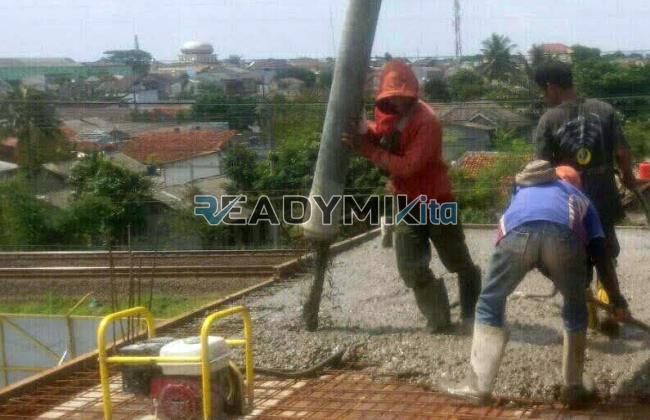

**Jasa Cor Readymix di Cibodas Tangerang Murah** - Hai Mitra Readymix Kita! Sedang merencanakan pembangunan di Cibodas Tangerang? Mencari cara untuk memastikan hasil pengecoran yang kuat, efisien, dan terpercaya? Nah, Anda sudah ada di tempat yang tepat! Kami dari Readymix Kita hadir sebagai solusi beton cor readymix berkualitas tinggi, siap mendukung proyek konstruksi Anda di Cibodas Tangerang dan sekitarnya.



## Mengapa Memilih Beton Cor Readymix untuk Proyek Anda?

Beton Cor Readymix adalah solusi konstruksi modern yang semakin populer di kalangan profesional. Apa yang membuat beton siap pakai ini begitu digemari? Sederhana saja: efisiensi dan kualitas. Beton ini diproduksi secara presisi di pabrik kami, menggunakan bahan-bahan terbaik, kemudian diangkut langsung ke lokasi proyek Anda menggunakan truk mixer khusus. Keunggulan utamanya? Mari kita lihat lebih dekat:

1. **Waktu dan Tenaga: Hemat Keduanya!**

   Tidak perlu lagi repot membuat campuran beton di lokasi proyek. Dengan beton readymix, proses pencampuran sudah dilakukan di pabrik, menghemat waktu dan tenaga kerja Anda secara signifikan.

2. **Kualitas Terjamin: Konsisten dan Terukur**

   Beton Cor Readymix diproduksi dengan takaran yang akurat dan melalui kontrol kualitas yang ketat. Ini berarti Anda mendapatkan kualitas yang konsisten setiap saat, mengurangi risiko kegagalan struktur akibat kesalahan pencampuran.

3. **Skala Proyek: Dari Kecil hingga Besar, Kami Siap!**

   Kapasitas produksi beton readymix kami sangat fleksibel. Kami dapat mengakomodasi kebutuhan proyek kecil seperti pembangunan rumah hingga proyek besar seperti gedung bertingkat.

4. **Peduli Lingkungan: Konstruksi yang Berkelanjutan**

   Proses produksi beton Cor Readymix yang lebih teratur membantu mengurangi limbah material di lokasi konstruksi, mendukung praktik bangunan yang lebih berkelanjutan.

## Mengapa ReadymixKita adalah Pilihan Tepat di Cibodas Tangerang?

Di antara banyaknya penyedia jasa pengecoran di Cibodas Tangerang Murah, ReadymixKita menawarkan lebih dari sekadar beton. Kami menawarkan kemitraan yang solid, didukung oleh pengalaman, kualitas, dan layanan yang tak tertandingi:

1. **Pengalaman Bertahun-tahun: Kepercayaan yang Teruji**

   Kami telah berkecimpung di industri konstruksi selama bertahun-tahun. Pengalaman ini memungkinkan kami memahami seluk-beluk proyek konstruksi, mulai dari perencanaan hingga eksekusi, dan memberikan solusi yang paling tepat.

2. **Pilihan Mutu Beton yang Lengkap: Sesuaikan dengan Kebutuhan Anda**

   Kami menyediakan berbagai kelas mutu beton, mulai dari K-225 untuk aplikasi standar hingga K-500 untuk konstruksi berat. Tim ahli kami siap membantu Anda memilih mutu beton yang paling sesuai dengan kebutuhan proyek Anda.

3. **Teknologi Modern: Pengecoran Cepat dan Presisi**

   Kami mengoperasikan peralatan pengecoran modern, termasuk pompa beton (concrete pump) yang memastikan pengecoran berlangsung cepat, merata, dan efisien.

4. **Tim Profesional: Siap Melayani dengan Prima**

   Tim kami terdiri dari para profesional yang berdedikasi. Kami siap memberikan dukungan penuh, mulai dari konsultasi perencanaan hingga pengawasan pelaksanaan di lokasi proyek Anda.

## Fokus Layanan Kami di Cibodas Tangerang: Memahami Kebutuhan Lokal

Sebagai penyedia jasa lokal, kami sangat memahami karakteristik dan tantangan konstruksi di Cibodas Tangerang. Baik itu kepadatan wilayah perkotaan atau kontur lahan yang bervariasi, kami selalu siap memberikan solusi terbaik:

1. **Pengiriman Tepat Waktu: Janji yang Kami Tepati**

   Kami menjamin pengiriman beton tepat waktu, berkat lokasi pabrik kami yang strategis di Cibodas Tangerang dan sistem logistik yang efisien.

2. **Konsultasi Gratis: Mitra yang Selalu Mendukung**

   Kami menawarkan layanan konsultasi gratis untuk membantu Anda menentukan jenis beton, metode pengecoran, dan solusi konstruksi yang paling optimal untuk proyek Anda.

3. **Penawaran Khusus: Nilai Lebih untuk Klien Lokal**

   Klien di Cibodas Tangerang berhak mendapatkan harga spesial dan penawaran menarik untuk proyek-proyek besar dan jangka panjang.

## Harga Terjangkau dan Penawaran Menggiurkan di Cibodas Tangerang

Kami memahami bahwa biaya adalah faktor penting dalam setiap proyek konstruksi. Oleh karena itu, ReadymixKita berkomitmen untuk memberikan:

1. **Harga yang Bersaing: Kualitas Terbaik dengan Investasi Optimal**

   Kami menawarkan harga yang kompetitif tanpa mengorbankan kualitas beton. Informasi harga yang transparan, termasuk biaya pengiriman dan penggunaan pompa beton, tersedia bagi Anda.

2. **Promo Menarik: Lebih Hemat dengan Penawaran Spesial**

   Nikmati diskon menarik untuk pemesanan dalam jumlah besar atau proyek yang berjalan dalam jangka waktu tertentu.

3. **Kepuasan Pelanggan: Prioritas Utama Kami**

   Kami memberikan garansi kepuasan penuh. Jika ada kendala selama proses pengecoran, tim kami akan segera memberikan solusi hingga proyek Anda selesai dengan sempurna.

## Tabel Harga Jasa Cor Readymix di Cibodas Tangerang



Jangan tunda lagi! Pastikan proyek Anda didukung oleh material berkualitas tinggi dan layanan profesional yang andal. Hubungi kami sekarang untuk mendapatkan solusi pengecoran terbaik di Cibodas Tangerang! [Hubungi Kami](URL) untuk penawaran khusus dan konsultasi gratis.

Kami juga menyediakan layanan survei lokasi untuk memastikan bahwa kami dapat memberikan solusi yang paling sesuai dengan kebutuhan spesifik proyek Anda. Segera pesan beton readymix dari ReadymixKita dan rasakan perbedaannya! Bersama ReadymixKita, bangunan impian Anda akan terwujud dengan kokoh dan tahan lama! [Pesan Sekarang](URL)