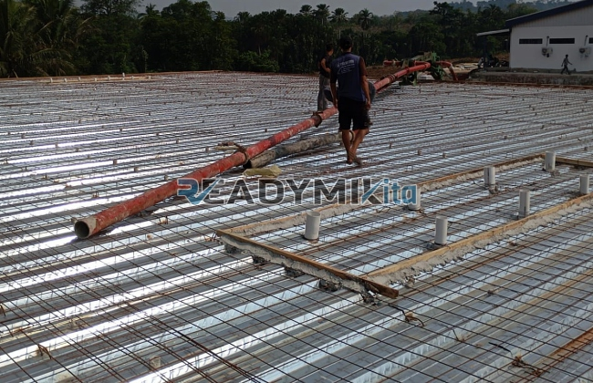

**Jasa Cor Readymix di Cicurug Sukabumi Murah** - Hai Mitra Readymix Kita! Membangun di Cicurug Sukabumi? Pasti ada tantangan yang unik, kan? Nah, kami dari Readymix Kita hadir sebagai solusi cerdas untuk kebutuhan beton cor readymix Anda. Kami menawarkan kemudahan, kualitas, dan efisiensi waktu yang tak tertandingi. Proyek lancar, konstruksi kuat – itu komitmen kami!



## Beton Readymix: Solusi Modern untuk Proyek Anda

Mungkin Anda bertanya-tanya, apa sebenarnya beton Cor Readymix itu? Sederhananya, beton readymix adalah campuran beton yang diproduksi secara presisi di pabrik modern, menggunakan bahan baku pilihan. Beton ini kemudian diangkut langsung ke lokasi proyek Anda menggunakan truk mixer khusus. Ada beberapa alasan kenapa memilih readymix itu langkah yang tepat:

1. **Hemat Waktu & Tenaga Kerja**

   Lupakan proses pencampuran manual yang memakan waktu dan tenaga! Dengan readymix, waktu pengerjaan proyek Anda bisa dipangkas drastis karena beton sudah siap pakai saat tiba di lokasi.

2. **Jaminan Kualitas Terus-Menerus**

   Proses produksi readymix yang terkontrol ketat menjamin konsistensi kualitas beton. Takaran yang akurat dan peralatan canggih meminimalkan risiko kesalahan, sehingga struktur bangunan Anda lebih kuat dan tahan lama.

3. **Skalabilitas untuk Semua Kebutuhan**

   Baik untuk proyek kecil-kecilan atau konstruksi berskala besar, readymix mampu memenuhi kebutuhan volume beton Anda dengan cepat dan efisien.

4. **Dukungan untuk Pembangunan Berkelanjutan**

   Proses produksi readymix yang lebih terkelola membantu mengurangi limbah material dan dampak negatif terhadap lingkungan.

## Mengapa ReadymixKita adalah Pilihan Terbaik di Cicurug Sukabumi?

Di tengah banyaknya pilihan penyedia beton readymix di Cicurug Sukabumi, kenapa harus ReadymixKita? Ini dia alasannya:

1. **Reputasi Teruji & Pengalaman Panjang**

   Pengalaman bertahun-tahun di industri konstruksi menjadikan kami paham betul kebutuhan proyek-proyek di Cicurug Sukabumi dan sekitarnya. Kami mengerti betul tantangan di lapangan.

2. **Pilihan Mutu Beton yang Lengkap**

   Kami menyediakan beragam kelas mutu beton, mulai dari K-225 untuk kebutuhan rumah tinggal, hingga K-500 untuk proyek infrastruktur berat. Pilihan beragam, sesuai kebutuhan Anda.

3. **Teknologi Pengecoran Terdepan**

   Kami menggunakan peralatan modern seperti concrete pump untuk memastikan pengecoran cepat, merata, dan tepat sasaran. Ini sangat penting, terutama untuk proyek dengan akses terbatas.

4. **Tim Ahli yang Siap Mendukung**

   Tim profesional kami siap memberikan panduan ahli, mulai dari perencanaan hingga pengawasan pelaksanaan di lokasi proyek Anda.

## Layanan Kami yang Disesuaikan untuk Kondisi Cicurug Sukabumi

Sebagai penyedia lokal, **ReadymixKita** memahami betul kondisi geografis dan tantangan konstruksi di Cicurug Sukabumi. 

1. **Pengiriman Tepat Waktu, Terpercaya**

   Kami menjamin pengiriman beton readymix yang tepat waktu, berkat lokasi pabrik yang strategis dan armada transportasi yang handal.

2. **Konsultasi Teknis Gratis**

   Bingung memilih jenis beton yang tepat? Jangan ragu untuk berkonsultasi dengan tim ahli kami. Kami akan memberikan rekomendasi terbaik sesuai kebutuhan proyek Anda.

3. **Penawaran Spesial untuk Proyek Lokal**

   Khusus untuk pelanggan di wilayah Cicurug Sukabumi, kami memberikan penawaran harga khusus dan diskon menarik untuk proyek-proyek tertentu.

## Harga Readymix yang Bersaing & Promo Menarik di Cicurug Sukabumi

Kami percaya bahwa kualitas terbaik tidak harus selalu mahal. **ReadymixKita** menawarkan:

1. **Harga yang Kompetitif**

   Kami menetapkan harga yang bersaing tanpa mengorbankan kualitas beton readymix yang kami sediakan. Informasi harga yang transparan tersedia.

2. **Promo dan Diskon Spesial**

   Dapatkan promo menarik untuk pemesanan volume besar atau proyek jangka panjang. Jangan lewatkan kesempatan ini!

3. **Jaminan Kepuasan Pelanggan**

   Kami berkomitmen untuk memberikan pelayanan terbaik dan memastikan kepuasan Anda sebagai pelanggan. Jika ada masalah, tim kami akan segera memberikan solusi.

## Informasi Harga Jasa Cor Readymix di Cicurug Sukabumi



Jangan tunda lagi! Pastikan proyek Anda berjalan lancar dengan beton readymix berkualitas dari **ReadymixKita**. Kami siap menjadi mitra terpercaya Anda dalam membangun masa depan.

Yuk, segera hubungi kami untuk mendapatkan penawaran harga terbaik dan layanan konsultasi gratis! Jangan ragu untuk bertanya – tim kami siap membantu mewujudkan proyek impian Anda di Cicurug Sukabumi. Kami berkomitmen untuk memberikan solusi pengecoran unggulan.