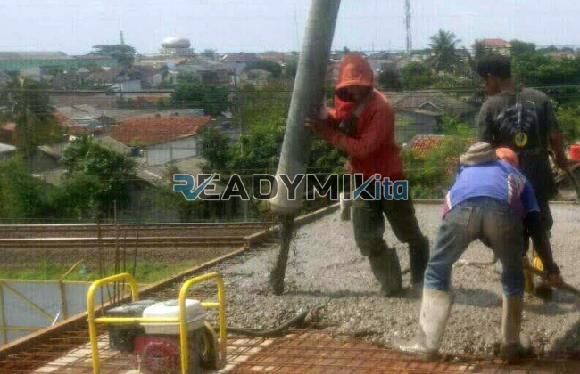

**Jasa Cor Readymix di Cidadap Sukabumi Murah** - Hai Mitra Readymix Kita! Apakah Anda sedang merencanakan proyek konstruksi di Cidadap Sukabumi? Mencari solusi beton yang cepat, praktis, dan berkualitas? Nah, Anda sudah berada di tempat yang tepat! Kami dari Readymix Kita hadir sebagai penyedia beton cor readymix terpercaya dan layanan sewa concrete pump untuk berbagai kebutuhan konstruksi di Cidadap Sukabumi Murah. Dengan komitmen pada kualitas dan efisiensi, kami siap mendukung kesuksesan proyek Anda.



## Mengapa Memilih Beton Readymix untuk Proyek Anda?

Beton readymix, atau beton cor siap pakai, adalah pilihan cerdas untuk proyek konstruksi modern. Dibuat secara presisi di pabrik dengan campuran material berkualitas tinggi, beton ini kemudian diangkut langsung ke lokasi proyek menggunakan truk mixer. Tapi, apa sih keunggulannya dibandingkan metode pengecoran tradisional? Berikut beberapa alasannya:

1. **Hemat Waktu dan Tenaga Kerja**

   Proses pencampuran di lokasi proyek seringkali memakan waktu dan membutuhkan tenaga kerja yang signifikan. Dengan beton readymix, proses ini sudah dilakukan sebelumnya, memungkinkan Anda menghemat waktu dan sumber daya.

2. **Kualitas yang Terjamin Konsisten**

   Kualitas beton readymix sangat terkontrol. Dengan takaran yang tepat dan teknologi modern, Anda mendapatkan beton dengan mutu yang seragam dan dapat diandalkan. Hal ini meminimalkan risiko kegagalan struktur akibat kesalahan pencampuran.

3. **Kapasitas Produksi Fleksibel**

   Kebutuhan beton bervariasi tergantung skala proyek. Beton readymix dapat dipesan sesuai kebutuhan, mulai dari volume kecil hingga besar, menjadikannya solusi yang fleksibel.

4. **Lebih Ramah Lingkungan**

   Penggunaan beton readymix cenderung menghasilkan lebih sedikit limbah material di lokasi konstruksi, karena proses pencampuran dilakukan di pabrik dengan kontrol yang lebih ketat.

## Keunggulan ReadymixKita di Cidadap Sukabumi Murah

Di antara sekian banyak penyedia jasa beton readymix di Cidadap Sukabumi Murah, mengapa harus memilih ReadymixKita? Ada beberapa alasan yang membuat kami unggul:

1. **Pengalaman dan Kepercayaan Pelanggan**

   Kami telah lama berkecimpung di industri konstruksi dan telah berhasil menyelesaikan berbagai proyek, mulai dari perumahan hingga infrastruktur berskala besar. Pengalaman ini membuat kami memahami betul kebutuhan Anda.

2. **Pilihan Mutu Beton yang Lengkap**

   Kami menawarkan beragam kelas mutu beton, termasuk K-225, K-300, K-350, hingga K-500. Pilih mutu yang paling sesuai dengan spesifikasi proyek Anda.

3. **Didukung Peralatan Modern**

   Kami dilengkapi dengan peralatan mutakhir, termasuk concrete pump yang akan mempercepat dan mempermudah proses pengecoran, bahkan di lokasi yang sulit dijangkau.

4. **Tim Profesional yang Berdedikasi**

   Tim kami terdiri dari tenaga ahli yang berpengalaman dan siap memberikan dukungan penuh, mulai dari perencanaan hingga eksekusi di lapangan. Kami juga siap menyesuaikan layanan dengan jadwal proyek Anda.

## Solusi Pengecoran Khusus untuk Kondisi Cidadap Sukabumi

Kami memahami betul karakteristik wilayah Cidadap Sukabumi yang bervariasi. Baik itu area perkotaan yang padat atau kawasan perbukitan, kami siap memberikan solusi pengecoran yang tepat:

1. **Pengiriman Tepat Waktu**

   Lokasi pabrik kami yang strategis memungkinkan kami untuk mengirimkan beton readymix ke lokasi proyek Anda di Cidadap Sukabumi Murah dengan cepat dan tepat waktu.

2. **Konsultasi Teknis Gratis**

   Bingung memilih jenis beton yang tepat? Jangan khawatir! Kami menyediakan layanan konsultasi gratis untuk membantu Anda menentukan solusi terbaik.

3. **Penawaran Spesial untuk Proyek Lokal**

   Sebagai bentuk dukungan kepada proyek-proyek konstruksi di Cidadap Sukabumi, kami menawarkan penawaran khusus dan diskon menarik.

## Harga Bersaing dan Promo Menarik di Cidadap Sukabumi

Kami percaya bahwa kualitas tidak harus mahal. ReadymixKita berkomitmen untuk memberikan harga yang kompetitif tanpa mengorbankan mutu.

1. **Harga Terjangkau dan Transparan**

   Kami menawarkan harga yang wajar dan transparan. Informasi harga, termasuk biaya pengiriman dan penggunaan concrete pump, akan kami sampaikan dengan jelas.

2. **Promo dan Diskon Spesial**

   Dapatkan diskon menarik untuk pemesanan dalam jumlah besar atau proyek jangka panjang.

3. **Kepuasan Pelanggan Terjamin**

   Kami berkomitmen untuk memberikan layanan terbaik dan memastikan Anda puas dengan hasil pengecoran kami.

## Informasi Harga Jasa Cor Readymix di Cidadap Sukabumi



Jangan biarkan kualitas material yang buruk menghambat kelancaran proyek Anda. Percayakan pengecoran Anda kepada ahlinya! Hubungi kami sekarang juga untuk mendapatkan penawaran terbaik dan solusi pengecoran yang paling sesuai dengan kebutuhan Anda di Cidadap Sukabumi.

Kami juga menawarkan layanan survei lokasi gratis untuk membantu Anda menentukan volume beton yang dibutuhkan. Pesan beton readymix sekarang dan dapatkan hasil konstruksi yang kuat, tahan lama, dan memuaskan. [Jasa Cor Readymix di Baktijaya Depok Murah](/readymix/jasa-cor-readymix-di-baktijaya-depok-murah/) bisa menjadi alternatif pilihan anda.

Di ReadymixKita, kami selalu berusaha memberikan yang terbaik bagi setiap klien. Dengan pengalaman, mutu, dan layanan yang ramah, kami yakin dapat menjadi mitra terpercaya Anda dalam mewujudkan proyek impian. Segera hubungi kami dan rasakan sendiri kualitas jasa pengecoran beton readymix di Cidadap Sukabumi dari ReadymixKita! Bersama kami, bangunlah masa depan yang kokoh dan berkelanjutan!