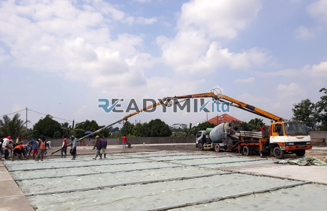

**Jasa Cor Readymix di Cidahu Sukabumi Murah** - Hai Mitra Readymix Kita! Lagi cari solusi beton cor yang praktis dan berkualitas di Cidahu Sukabumi? Nah, Anda sudah berada di tempat yang tepat! Kami dari Readymix Kita siap membantu kelancaran proyek konstruksi Anda dengan layanan readymix yang cepat, terpercaya, dan tentu saja, terjangkau. Pondasi yang kokoh adalah kunci bangunan yang tahan lama — dan kami memastikan Anda mendapatkan yang terbaik.



## Mengapa Memilih Cor Readymix untuk Proyek Anda?

Beton Cor Readymix, atau sering disebut beton instan, adalah campuran beton yang diproduksi di pabrik modern dengan kontrol kualitas yang ketat. Proses ini memastikan setiap batch memiliki komposisi yang tepat dan konsisten. Lalu, beton ini diantar langsung ke lokasi proyek menggunakan truk mixer khusus. Apa saja keunggulannya? Yuk, simak:

1. **Efisiensi Waktu dan Biaya**

   Pengerjaan cor langsung di lokasi proyek seringkali memakan waktu dan tenaga lebih. Dengan readymix, Anda menghemat keduanya! Pencampuran sudah dilakukan di pabrik, sehingga waktu pelaksanaan proyek Anda jadi lebih singkat.

2. **Kualitas Terjamin Konsisten**

   Salah satu tantangan terbesar dalam pencampuran manual adalah memastikan konsistensi kualitas. Readymix hadir sebagai solusinya. Dengan takaran presisi dan pengawasan mutu yang ketat, Anda mendapatkan beton dengan kualitas yang sama di setiap pengiriman.

3. **Kapasitas Produksi yang Fleksibel**

   Baik untuk proyek kecil maupun besar, readymix mampu memenuhi kebutuhan volume beton Anda. Kami siap melayani pesanan dengan fleksibilitas tinggi.

4. **Dukungan Ramah Lingkungan**

   Proses produksi readymix yang terkelola dengan baik meminimalkan limbah material konstruksi, berkontribusi pada praktik pembangunan yang lebih berkelanjutan.

## Apa yang Membuat ReadymixKita Unggul di Cidahu Sukabumi?

Di antara banyaknya penyedia readymix di Cidahu Sukabumi, **ReadymixKita** menawarkan nilai lebih. Kami tidak hanya sekadar menjual beton, tetapi juga memberikan solusi konstruksi komprehensif:

1. **Pengalaman Bertahun-tahun**

   Dengan pengalaman yang terakumulasi dari berbagai proyek konstruksi, kami memahami betul tantangan dan kebutuhan di lapangan. Kami siap memberikan solusi yang tepat untuk setiap detail proyek Anda.

2. **Pilihan Kelas Mutu yang Lengkap**

   Kami menyediakan beragam kelas mutu beton, mulai dari K-225 (untuk keperluan umum) hingga K-500 (untuk konstruksi bertingkat atau struktur yang membutuhkan kekuatan ekstra). Pilihan luas ini memastikan Anda mendapatkan material yang paling sesuai dengan rencana anggaran dan kebutuhan teknis.

3. **Didukung Peralatan Canggih**

   Kami menggunakan teknologi terkini, termasuk concrete pump, untuk memastikan proses pengecoran berjalan cepat, merata, dan efisien. Alat modern ini juga mempermudah pengecoran di area yang sulit dijangkau.

4. **Tim Ahli yang Siap Membantu**

   Tim kami terdiri dari ahli beton yang berpengalaman dan siap memberikan konsultasi, mulai dari pemilihan mutu beton hingga metode pengecoran yang optimal.

## Area Layanan dan Keunggulan di Cidahu Sukabumi

Sebagai penyedia lokal yang berbasis di Cidahu Sukabumi, kami mengerti betul kondisi geografis dan karakteristik proyek di wilayah ini. Baik itu proyek di pusat kota atau di area perbukitan, kami siap memberikan solusi terbaik. Berikut layanan khusus yang kami tawarkan:

1. **Pengiriman Tepat Waktu**

   Jaringan distribusi kami yang luas dan armada truk mixer yang handal menjamin pengiriman beton ke lokasi proyek tepat waktu, meminimalkan risiko keterlambatan.

2. **Layanan Konsultasi Gratis**

   Kami menawarkan konsultasi gratis untuk membantu Anda menentukan jenis beton yang paling ideal dan metode pengecoran yang paling efisien untuk proyek Anda.

3. **Penawaran Spesial untuk Proyek Lokal**

   Khusus untuk pelanggan di Cidahu Sukabumi dan sekitarnya, kami menawarkan harga istimewa dan diskon menarik untuk proyek-proyek berskala besar.

## Harga Readymix di Cidahu Sukabumi yang Kompetitif

Kami meyakini bahwa kualitas tidak harus mahal. **ReadymixKita** berkomitmen untuk menawarkan harga readymix yang kompetitif di Cidahu Sukabumi, tanpa mengorbankan mutu dan kualitas.

1. **Harga Transparan**

   Kami selalu terbuka dalam memberikan informasi harga, termasuk biaya pengiriman dan biaya tambahan lainnya. Anda tidak akan menemukan biaya tersembunyi!

2. **Promo dan Diskon Menarik**

   Pantau promo-promo spesial kami untuk mendapatkan penawaran terbaik, terutama untuk pemesanan dalam jumlah besar atau proyek jangka panjang.

3. **Garansi Kepuasan Pelanggan**

   Kami menjamin kepuasan Anda. Jika Anda menemukan masalah dengan produk atau layanan kami, tim kami akan segera menanganinya hingga tuntas.

## Informasi Harga Jasa Cor Readymix di Cidahu Sukabumi



Jangan tunda lagi! Dapatkan penawaran terbaik untuk kebutuhan readymix Anda di Cidahu Sukabumi. Hubungi kami sekarang dan biarkan tim ahli kami membantu mewujudkan proyek impian Anda!

Kami siap memberikan layanan survei lokasi dan konsultasi gratis untuk memastikan Anda mendapatkan solusi yang paling tepat. Pesan readymix dari **ReadymixKita** dan rasakan perbedaannya: kualitas terjamin, pengiriman cepat, dan harga yang bersahabat. Bangun struktur yang kuat dan tahan lama bersama kami! Gimana, sudah siap memulai proyek Anda?