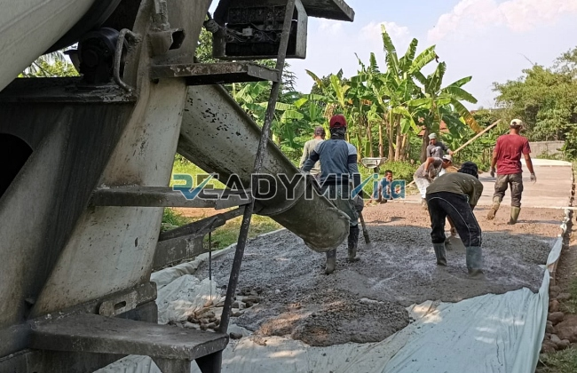

**Jasa Cor Readymix di Cideng Jakarta Murah** - Hai Mitra Readymix Kita! Sedang memikirkan proyek konstruksi di Cideng Jakarta? Mencari beton berkualitas dengan harga bersahabat? Tenang, Anda sudah berada di tempat yang tepat! ReadymixKita hadir sebagai solusi pengecoran readymix yang andal, efisien, dan terjangkau untuk semua kebutuhan konstruksi Anda di Cideng Jakarta Murah. Bukan sekadar pemasok, kami adalah mitra yang siap mendukung kesuksesan proyek Anda.



## Mengapa Memilih Beton Readymix untuk Proyek Anda?

Pernahkah Anda bertanya-tanya, apa sebenarnya beton Cor Readymix itu? Singkatnya, beton readymix adalah campuran beton yang sudah jadi, diproduksi di pabrik dengan formula yang presisi dan bahan-bahan berkualitas tinggi. Kemudian, beton ini diantarkan langsung ke lokasi proyek Anda menggunakan truk mixer. Nah, apa saja kelebihannya dibandingkan metode konvensional? Yuk, kita simak:

1. **Hemat Waktu dan Biaya Tenaga**

   Proses pencampuran beton di lokasi proyek itu memakan waktu dan tenaga, lho. Dengan beton readymix, Anda bisa menghemat keduanya, karena beton sudah siap pakai saat sampai di lokasi.

2. **Mutu Terjamin Konsisten**

   Di pabrik, takaran bahan baku beton readymix dikontrol secara ketat menggunakan teknologi modern. Hasilnya? Kualitas beton yang stabil dan meminimalkan risiko kesalahan yang bisa mempengaruhi kekuatan struktur.

3. **Skalabilitas Produksi**

   Butuh beton dalam jumlah besar untuk proyek berskala besar? Atau hanya sedikit untuk perbaikan kecil? Beton readymix bisa mengakomodasi semua kebutuhan volume dengan cepat dan efisien.

4. **Lebih Ramah Lingkungan**

   Proses produksi yang terkontrol juga mengurangi limbah material di lokasi proyek, yang tentunya lebih baik untuk lingkungan.

## Keunggulan ReadymixKita di Cideng Jakarta Murah

Di antara banyaknya penyedia jasa pengecoran di Jakarta, mengapa Anda harus memilih **ReadymixKita** khususnya di wilayah Cideng Jakarta Murah? Ini dia alasan utamanya:

1. **Reputasi Teruji dan Pengalaman Bertahun-Tahun**

   Kami bukan pemain baru di industri ini. Pengalaman bertahun-tahun menjadikan kami memahami seluk-beluk proyek konstruksi, mulai dari skala kecil rumah tinggal hingga proyek komersial dan infrastruktur besar.

2. **Pilihan Mutu Beton yang Variatif**

   Kami menyediakan beragam kelas mutu beton, mulai dari K-225 yang cocok untuk aplikasi standar, hingga K-500 untuk konstruksi yang membutuhkan kekuatan ekstra. Kami bantu Anda memilih mutu yang paling sesuai dengan kebutuhan proyek Anda.

3. **Didukung Peralatan Pengecoran Modern**

   Kami menggunakan pompa beton (concrete pump) dan peralatan canggih lainnya untuk memastikan proses pengecoran berlangsung cepat, merata, dan efisien, bahkan di area yang sulit dijangkau.

4. **Tim Ahli yang Siap Membantu**

   Tim profesional kami siap memberikan panduan dan dukungan teknis, mulai dari perencanaan hingga eksekusi di lapangan. Kami juga fleksibel dan bisa menyesuaikan jadwal pengiriman dengan kebutuhan proyek Anda.

## Memahami Kondisi Proyek di Cideng Jakarta

Sebagai penyedia jasa lokal, kami mengenal betul karakteristik konstruksi di Cideng Jakarta. Dari kepadatan penduduk dan keterbatasan lahan, hingga variasi kondisi tanah yang berbeda-beda, kami memahami tantangannya. **ReadymixKita** menawarkan solusi yang disesuaikan untuk mengatasi tantangan tersebut:

1. **Pengiriman Tepat Waktu dan Efisien**

   Kami menjamin pengiriman beton readymix tepat waktu ke lokasi proyek Anda di Cideng Jakarta Murah dan sekitarnya, mempertimbangkan kondisi lalu lintas yang padat.

2. **Konsultasi Teknis Gratis**

   Bingung jenis beton apa yang paling tepat untuk proyek Anda? Tim ahli kami siap memberikan konsultasi gratis untuk membantu Anda membuat keputusan terbaik.

3. **Penawaran Spesial untuk Pelanggan Lokal**

   Kami memberikan harga spesial dan diskon menarik untuk proyek-proyek konstruksi yang berlokasi di wilayah Cideng Jakarta.

## Investasi Cerdas dengan Harga Terjangkau di Cideng Jakarta



Kami berkomitmen untuk menyediakan layanan berkualitas dengan harga yang kompetitif. Kami percaya bahwa setiap proyek, tidak peduli skalanya, layak mendapatkan beton readymix berkualitas tanpa harus menguras anggaran.

1. **Harga Bersaing dan Transparan**

   Kami menawarkan harga yang wajar dan transparan, tanpa biaya tersembunyi. Anda akan mendapatkan informasi harga yang jelas, termasuk biaya pengiriman dan biaya tambahan jika menggunakan pompa beton.

2. **Promo dan Diskon Menarik**

   Nikmati diskon khusus untuk pemesanan dalam jumlah besar atau proyek jangka panjang. Kami selalu punya penawaran menarik untuk pelanggan setia kami.

3. **Kepuasan Pelanggan adalah Prioritas Kami**

   Kami menjamin kepuasan Anda. Jika ada kendala dalam proses pengecoran, tim kami siap memberikan solusi terbaik hingga proyek Anda selesai dengan sempurna.

Jangan tunda lagi! Hubungi kami sekarang juga untuk mendapatkan penawaran terbaik dan solusi pengecoran readymix yang tepat untuk proyek Anda di Cideng Jakarta Murah. Kami siap membantu mewujudkan proyek impian Anda dengan fondasi yang kuat dan tahan lama. Percayakan pengecoran Anda pada ahlinya – ReadymixKita!