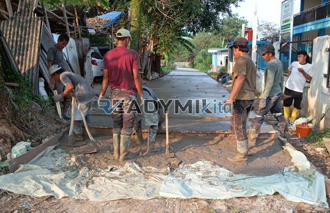

**Jasa Cor Readymix di Ciganjur Jakarta Murah** - Hai Mitra Readymix Kita! Mau mulai proyek konstruksi di Ciganjur Jakarta? Atau sedang mencari solusi pengecoran yang praktis dan berkualitas? Tenang, Anda sudah berada di tempat yang tepat! Kami dari Readymix Kita hadir sebagai supplier beton readymix terpercaya di Ciganjur Jakarta, siap membantu mewujudkan bangunan impian Anda dengan hasil cor yang kuat dan tahan lama. Pengecoran dengan Readymix dari kami bukan sekadar menuang beton—ini tentang membangun masa depan yang kokoh!



## Mengapa Memilih Beton Readymix? Keunggulan yang Perlu Anda Tahu

Beton readymix adalah solusi modern dalam dunia konstruksi. Bayangkan, beton berkualitas tinggi yang diproduksi secara presisi di pabrik dan langsung dikirim ke lokasi proyek Anda. Apa sih keuntungannya dibandingkan dengan metode tradisional? Yuk, kita bedah satu per satu:

1. **Hemat Waktu & Biaya Tenaga**

   Lupakan repotnya mencampur semen, pasir, dan kerikil di lokasi proyek. Dengan beton readymix, waktu pengerjaan proyek Anda jadi lebih singkat dan efisien—hemat biaya operasional juga, lho!

2. **Kualitas Terjamin Konsisten**

   Proses produksi yang terkontrol dan menggunakan material pilihan memastikan kualitas beton readymix selalu seragam. Risiko kegagalan akibat kesalahan takaran atau kualitas bahan baku yang buruk? Hampir nol!

3. **Kapasitas Fleksibel: Dari Skala Kecil Hingga Proyek Besar**

   Mau membangun rumah, renovasi, atau mengerjakan proyek infrastruktur skala besar? Kami siap menyediakan beton readymix sesuai kebutuhan Anda. Kapasitas produksi kami sangat fleksibel.

4. **Berkontribusi pada Lingkungan yang Lebih Baik**

   Dengan mengurangi limbah material di lokasi konstruksi, beton readymix membantu menjaga kelestarian lingkungan. Pilihan cerdas untuk konstruksi berkelanjutan!

## Readymix Kita: Partner Konstruksi Terbaik Anda di Ciganjur Jakarta

Di antara banyaknya penyedia jasa readymix di Ciganjur Jakarta, mengapa Anda harus memilih **ReadymixKita**? Ini dia jawabannya:

1. **Pengalaman Bertahun-tahun, Terbukti Andal**

   Kami telah lama berkecimpung di industri ini. Pengalaman kami memungkinkan kami memahami setiap tantangan konstruksi dan memberikan solusi yang tepat.

2. **Pilihan Mutu Beton Lengkap: K-225 Hingga K-500**

   Butuh beton untuk fondasi, kolom, atau lantai? Kami menyediakan berbagai kelas mutu beton, mulai dari K-225 (untuk struktur ringan) hingga K-500 (untuk beban berat).

3. **Peralatan Canggih: Concrete Pump untuk Pengecoran Lebih Cepat**

   Kami dilengkapi dengan pompa beton (concrete pump) modern untuk memastikan pengecoran berlangsung cepat, merata, dan efisien—terutama di area yang sulit dijangkau.

4. **Tim Ahli yang Siap Membantu Sepenuh Hati**

   Tim kami terdiri dari para profesional berpengalaman yang siap memberikan konsultasi dan dukungan teknis—mulai dari perencanaan hingga pelaksanaan di lapangan.

## Spesialisasi Layanan Kami di Ciganjur Jakarta

Kondisi geografis Ciganjur Jakarta yang bervariasi—mulai dari area padat penduduk hingga kawasan perbukitan—menuntut solusi konstruksi yang adaptif. **ReadymixKita** memahami hal ini dan menawarkan layanan khusus:

1. **Pengiriman Tepat Waktu, Menjangkau Seluruh Wilayah Ciganjur Jakarta**

   Kami menjamin pengiriman beton readymix tepat waktu, sehingga proyek Anda tidak mengalami penundaan. Jaringan distribusi kami yang luas menjangkau seluruh wilayah Ciganjur Jakarta dan sekitarnya.

2. **Konsultasi Gratis: Pilih Beton yang Tepat untuk Proyek Anda**

   Bingung memilih jenis beton yang sesuai dengan kebutuhan proyek Anda? Jangan khawatir! Kami menyediakan layanan konsultasi gratis untuk membantu Anda membuat keputusan yang tepat.

3. **Penawaran Istimewa untuk Pelanggan Lokal Ciganjur Jakarta**

   Sebagai bentuk apresiasi kepada pelanggan setia di Ciganjur Jakarta, kami menawarkan penawaran khusus dan potongan harga menarik untuk proyek-proyek tertentu.

## Harga Terjangkau dan Promo Menarik di Ciganjur Jakarta

Kami percaya bahwa kualitas tidak harus mahal. **ReadymixKita** berkomitmen untuk menawarkan harga yang kompetitif tanpa mengorbankan mutu produk dan layanan.

1. **Harga Transparan dan Bersaing**

   Kami akan memberikan rincian harga yang jelas dan transparan—tanpa biaya tersembunyi. Cek informasi lebih lanjut mengenai harga 
<table class="table">
  <caption>Daftar Harga Readymix (Per m³)</caption>
  <thead>
    <tr><th>Mutu Beton</th><th>Harga (Estimasi)</th></tr>
  </thead>
  <tbody>
    <tr><td>K-225</td><td>Rp X.XXX.XXX</td></tr>
    <tr><td>K-275</td><td>Rp Y.YYY.YYY</td></tr>
    <tr><td>K-300</td><td>Rp Z.ZZZ.ZZZ</td></tr>
  </tbody>
</table>
 (harga dapat berubah sesuai kondisi pasar, hubungi kami untuk penawaran terkini).

2. **Promo Eksklusif untuk Pemesanan dalam Jumlah Besar**

   Dapatkan diskon khusus untuk pemesanan beton readymix dalam jumlah besar atau untuk proyek-proyek jangka panjang.

3. **Kepuasan Pelanggan: Prioritas Utama Kami**

   Kami menjamin kepuasan Anda sebagai pelanggan. Jika ada masalah, tim kami akan segera merespons dan memberikan solusi terbaik.



Jangan tunda lagi! Segera hubungi kami untuk mendapatkan penawaran terbaik dan layanan pengecoran readymix berkualitas di Ciganjur Jakarta. Kami siap menjadi mitra terpercaya Anda dalam mewujudkan impian konstruksi. Kami juga menyediakan layanan survei lokasi gratis untuk membantu Anda menentukan kebutuhan beton yang tepat.

Yuk, wujudkan proyek Anda bersama ReadymixKita! Mitra Anda dalam konstruksi yang kuat dan tahan lama di Ciganjur Jakarta. Hubungi kami sekarang! [Jasa Cor Readymix di Abadijaya Depok Murah](/readymix/jasa-cor-readymix-di-abadijaya-depok-murah/) — informasi tambahan terkait layanan kami di Depok. [Jasa Cor Readymix di Balaraja Tangerang Murah](/readymix/jasa-cor-readymix-di-balaraja-tangerang-murah/) — solusi pengecoran handal di Tangerang.