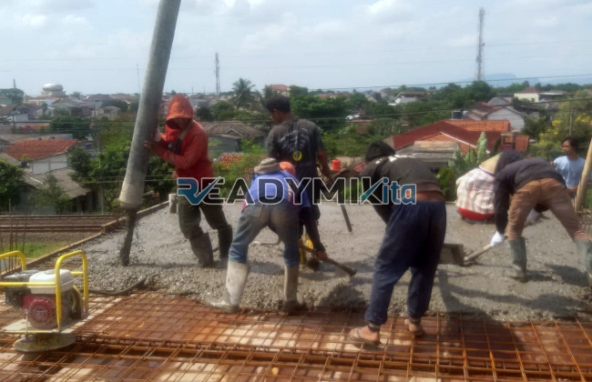

**Jasa Cor Readymix di Cijantung Jakarta Murah** - Hai Mitra Readymix Kita! Proyek konstruksi di Cijantung Jakarta sedang berjalan? Atau mungkin Anda baru merencanakan pembangunan? Tenang, kami punya solusinya! Readymix Kita hadir sebagai penyedia jasa cor readymix terpercaya, siap melayani kebutuhan pengecoran Anda dengan kualitas terbaik dan harga yang bersahabat. Yuk, simak bagaimana kami bisa membantu mewujudkan proyek impian Anda!



## Kenapa Memilih Pengecoran dengan Readymix?

Beton readymix: apa sih itu? Sederhananya, beton readymix adalah campuran beton siap pakai yang diproduksi secara akurat di pabrik modern menggunakan material pilihan. Lalu, campuran ini diangkut langsung ke lokasi proyek menggunakan truk mixer. Apa saja kelebihan menggunakan readymix dibandingkan metode tradisional? Ini dia:

1. **Hemat Waktu & Tenaga Kerja**

   Pengerjaan beton langsung di lokasi proyek seringkali memakan waktu dan membutuhkan banyak tenaga. Dengan readymix, waktu pengerjaan Anda dipangkas drastis karena proses pencampuran sudah dilakukan secara presisi di pabrik.

2. **Kualitas Terjaga Konsisten**

   Proses pencampuran beton readymix dilakukan dengan takaran yang tepat dan menggunakan teknologi modern, sehingga menghasilkan kualitas yang seragam dan terjamin. Ini meminimalkan risiko kesalahan pencampuran yang bisa mengancam kekuatan struktur.

3. **Skala Produksi Fleksibel**

   Kebutuhan beton untuk proyek besar atau kecil? Readymix Kita siap memenuhi! Kami mampu menyediakan beton dalam volume besar dengan cepat, jadi Anda tidak perlu khawatir kekurangan suplai.

4. **Lebih Ramah Lingkungan**

   Dengan kontrol kualitas yang lebih baik, pembuatan readymix menghasilkan lebih sedikit limbah material di lokasi proyek, sehingga lebih mendukung praktik konstruksi berkelanjutan.

## Mengapa ReadymixKita adalah Pilihan Terbaik di Cijantung Jakarta?

Di antara banyaknya penyedia jasa pengecoran, kenapa harus memilih **ReadymixKita** di Cijantung Jakarta? Ada beberapa alasan yang akan meyakinkan Anda:

1. **Pengalaman & Reputasi Terpercaya**

   Kami telah berpengalaman bertahun-tahun di industri konstruksi, sehingga memahami seluk-beluk kebutuhan berbagai jenis proyek, mulai dari hunian pribadi hingga bangunan komersial dan infrastruktur.

2. **Pilihan Mutu Beton yang Lengkap**

   Kami menyediakan beragam kelas mutu beton, mulai dari K-225 yang ideal untuk pekerjaan standar, hingga K-500 untuk konstruksi yang memerlukan kekuatan ekstra. Pilih sesuai kebutuhan proyek Anda! Kami siap membantu menentukan kelas mutu yang paling tepat.

3. **Didukung Peralatan Canggih**

   Untuk memastikan pengecoran yang cepat, efisien, dan merata, kami menggunakan peralatan modern seperti pompa beton (concrete pump) yang handal.

4. **Tim Ahli yang Siap Membantu**

   Tim profesional kami siap memberikan dukungan, mulai dari konsultasi awal, pemilihan material, hingga pengawasan pelaksanaan pengecoran di lapangan. Kami juga fleksibel dalam menyesuaikan jadwal dengan kebutuhan proyek Anda.

## Layanan Khusus untuk Kondisi Medan di Cijantung Jakarta

Sebagai penyedia jasa lokal di Cijantung Jakarta, kami paham betul karakteristik daerah ini. Kondisi medan yang bervariasi – mulai dari area padat penduduk hingga kontur berbukit – membutuhkan solusi pengecoran yang tepat. **ReadymixKita** menawarkan:

1. **Pengiriman Tepat Waktu**

   Kami menjamin pengiriman beton readymix tepat waktu, dengan mempertimbangkan jarak strategis antara pabrik kami dan berbagai lokasi proyek di Cijantung Jakarta dan sekitarnya.

2. **Konsultasi Gratis untuk Proyek Anda**

   Kami menyediakan layanan konsultasi tanpa biaya untuk membantu Anda memilih jenis beton yang paling sesuai dengan kebutuhan proyek.

3. **Penawaran Spesial untuk Pelanggan Lokal**

   Bagi pelanggan di Cijantung Jakarta, kami seringkali menyediakan penawaran harga khusus dan diskon menarik, terutama untuk proyek-proyek berskala besar.

## Harga Bersaing dan Promo Menarik di Cijantung Jakarta

Kami memahami bahwa anggaran adalah hal penting dalam setiap proyek konstruksi. Itulah mengapa **ReadymixKita** menawarkan:

1. **Harga yang Kompetitif**

   Kami berkomitmen untuk memberikan harga yang terjangkau tanpa mengorbankan kualitas beton readymix yang kami sediakan. Detail harga, termasuk biaya pengiriman dan penggunaan pompa beton, tersedia secara transparan.

2. **Promo & Diskon Spesial**

   Dapatkan keuntungan lebih dengan memanfaatkan promo menarik untuk pemesanan volume besar atau proyek yang berjalan dalam jangka waktu lama.

3. **Kepuasan Anda adalah Prioritas Kami**

   Kami memberikan garansi kepuasan pelanggan. Apabila ada kendala dalam proses pengecoran, tim kami siap memberikan solusi terbaik hingga proyek Anda selesai dengan sempurna.

## Informasi Harga Jasa Cor Readymix di Cijantung Jakarta



Jangan biarkan kualitas beton menjadi hambatan dalam kesuksesan proyek Anda. Segera hubungi kami untuk mendapatkan solusi pengecoran terbaik di Cijantung Jakarta!

Kami melayani survei lokasi dan konsultasi gratis untuk memastikan semua kebutuhan Anda terpenuhi. Pesan sekarang juga dan nikmati kualitas konstruksi yang kokoh, tahan lama, dan memuaskan.

ReadymixKita selalu berupaya memberikan pelayanan prima kepada seluruh pelanggan. Dengan pengalaman, komitmen terhadap kualitas, dan pelayanan yang ramah, kami yakin bisa menjadi mitra yang ideal untuk mewujudkan proyek impian Anda. Hubungi kami sekarang dan rasakan sendiri keunggulan jasa Pengecoran dengan Cor Readymix di Cijantung Jakarta dari ReadymixKita. Bersama, kita bangun masa depan yang lebih kuat! [Jasa Cor Readymix di Bali Mester Jakarta Murah](/readymix/jasa-cor-readymix-di-bali-mester-jakarta-murah/) — untuk Anda yang mencari mitra konstruksi terpercaya di area Jakarta.