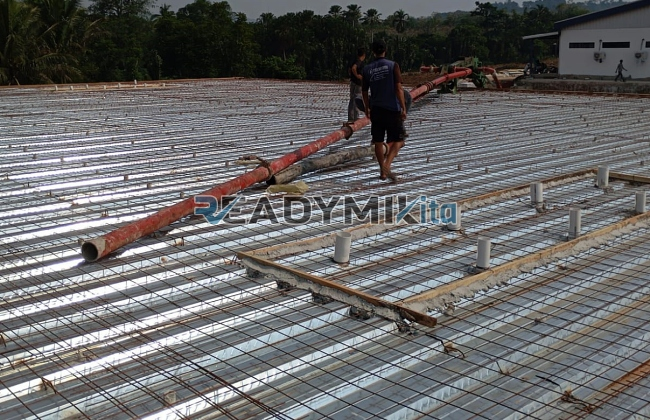

**Jasa Cor Readymix di Cikaret Bogor Murah** - Hai Mitra Readymix Kita! Bagaimana kabar Anda? Jika Anda tengah merencanakan pembangunan di Cikaret Bogor, kami dari Readymix Kita siap menjadi mitra terpercaya Anda. Kami adalah penyedia beton cor *readymix* berkualitas tinggi, siap mendukung proyek konstruksi Anda dengan solusi yang efisien dan terjangkau. Yuk, simak lebih lanjut apa yang bisa kami tawarkan!



## Mengapa Beton Readymix adalah Pilihan Tepat untuk Proyek Anda?

Beton *readymix* adalah solusi modern untuk pengecoran yang semakin populer di Cikaret Bogor. Tapi, apa sebenarnya beton *readymix* itu? Sederhananya, beton ini merupakan campuran beton siap pakai yang diproduksi secara presisi di pabrik kami menggunakan bahan baku terbaik. Kemudian, beton ini diantarkan langsung ke lokasi proyek Anda menggunakan truk *mixer*. Nah, lho! Apa saja keunggulan menggunakan beton *readymix* daripada metode tradisional? Berikut adalah beberapa alasannya:

1. **Hemat Waktu dan Tenaga:** Pengecoran manual memerlukan waktu dan tenaga yang tidak sedikit. Dengan *readymix*, waktu pengerjaan proyek Anda dipangkas secara signifikan karena pencampuran sudah dilakukan di pabrik.
2. **Kualitas Terjamin:** Formulasi akurat dan kontrol kualitas yang ketat memastikan setiap batch beton memiliki mutu yang konsisten, meminimalkan risiko kegagalan struktur.
3. **Skala Proyek Fleksibel:** Dari proyek kecil seperti renovasi rumah hingga proyek besar seperti pembangunan gedung bertingkat, *readymix* dapat memenuhi kebutuhan volume beton Anda.
4. **Dukungan Ramah Lingkungan:** Proses produksi *readymix* yang terkendali membantu mengurangi limbah material konstruksi, berkontribusi pada praktik pembangunan yang lebih berkelanjutan.

## Kenapa Harus Memilih Readymix Kita di Cikaret Bogor?

Di antara banyaknya penyedia jasa beton, **ReadymixKita** menawarkan keunggulan yang tak tertandingi, khususnya di wilayah Cikaret Bogor. Ini beberapa alasan kenapa Anda harus memilih kami:

1. **Pengalaman dan Keandalan:** Berbekal pengalaman bertahun-tahun di industri konstruksi, kami memahami betul seluk-beluk proyek, mulai dari perumahan hingga infrastruktur besar.
2. **Pilihan Mutu Beton Lengkap:** Kami menyediakan berbagai kelas mutu beton, mulai dari K-225 untuk kebutuhan dasar hingga K-500 untuk proyek konstruksi berat. Semua disesuaikan dengan spesifikasi proyek Anda!
3. **Teknologi Pengecoran Modern:** Kami didukung oleh peralatan modern seperti pompa beton (concrete pump) untuk memastikan pengecoran berjalan cepat, merata, dan presisi.
4. **Tim Profesional yang Siap Membantu:** Tim kami siap memberikan layanan konsultasi dan dukungan penuh, mulai dari perencanaan hingga penyelesaian proyek di lokasi Anda.

## Layanan Kami yang Dirancang untuk Kondisi Cikaret Bogor

Sebagai penyedia jasa lokal, **ReadymixKita** sangat memahami karakteristik wilayah Cikaret Bogor. Kondisi medan yang bervariasi, mulai dari dataran hingga perbukitan, memerlukan solusi pengecoran yang tepat. Berikut layanan khusus yang kami tawarkan:

1. **Pengiriman Tepat Waktu:** Kami menjamin pengiriman beton *readymix* tepat waktu ke lokasi proyek Anda di Cikaret Bogor dan sekitarnya, memanfaatkan jarak yang efisien dari pabrik kami.
2. **Konsultasi Teknis Gratis:** Kami menyediakan layanan konsultasi gratis untuk membantu Anda memilih jenis beton dan metode pengecoran yang optimal untuk kebutuhan proyek Anda.
3. **Penawaran Spesial untuk Proyek Lokal:** Dapatkan penawaran menarik dan diskon khusus untuk proyek konstruksi yang berlokasi di wilayah Cikaret Bogor.

## Harga Bersaing dan Promo Menarik di Cikaret Bogor

Kami percaya bahwa kualitas tidak harus mahal. **ReadymixKita** hadir dengan:

1. **Harga Kompetitif:** Kami menawarkan harga yang terjangkau tanpa mengorbankan mutu beton dan layanan kami. Kami memberikan transparansi harga, termasuk biaya pengiriman dan penggunaan pompa beton.
2. **Promo dan Diskon:** Manfaatkan promo menarik untuk pemesanan volume besar atau proyek jangka panjang.
3. **Kepuasan Pelanggan Terjamin:** Kami berkomitmen untuk memberikan layanan terbaik dan solusi jika ada kendala selama proses pengecoran. Proyek Anda selesai tepat waktu dan berkualitas? Itu prioritas kami!

## Daftar Harga Jasa Cor Readymix di Cikaret Bogor



Jangan biarkan kualitas beton menjadi penghambat kelancaran proyek Anda. Segera hubungi ReadymixKita untuk mendapatkan solusi pengecoran terbaik dan harga terjangkau di Cikaret Bogor!

Kami siap membantu Anda dalam survei lokasi dan memberikan konsultasi gratis untuk memastikan kebutuhan Anda terpenuhi dengan sempurna. Pesan sekarang dan rasakan manfaat beton *readymix* berkualitas untuk konstruksi yang kokoh dan tahan lama. Dapatkan hasil yang Anda impikan untuk proyek Anda!

<table class="table">
  <caption>Spesifikasi Mutu Beton Readymix</caption>
  <thead>
    <tr><th>Mutu Beton</th><th>Kekuatan Tekan (MPa)</th><th>Aplikasi</th></tr>
  </thead>
  <tbody>
    <tr><td>K-225</td><td>22.5</td><td>Pekerjaan non-struktural, lantai dasar</td></tr>
    <tr><td>K-300</td><td>30.0</td><td>Kolom, balok, lantai</td></tr>
    <tr><td>K-350</td><td>35.0</td><td>Struktur bangunan bertingkat</td></tr>
    <tr><td>K-400</td><td>40.0</td><td>Pondasi, struktur tahan gempa</td></tr>
    <tr><td>K-500</td><td>50.0</td><td>Proyek infrastruktur berat</td></tr>
  </tbody>
</table>
