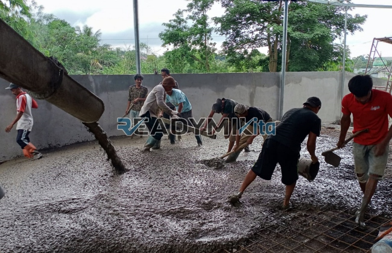

**Jasa Cor Readymix di Cikoko Jakarta Murah** - Hai Mitra Readymix Kita! Proyek konstruksi sedang berjalan di Cikoko Jakarta? Mencari material yang andal, cepat, dan berkualitas tinggi? Nah, Anda sudah berada di tempat yang tepat! Kami dari Readymix Kita hadir sebagai solusi pengecoran readymix terpercaya, siap mendukung kesuksesan proyek Anda. Kenapa pilih readymix? Karena efisiensi dan kualitasnya tak terbantahkan. Yuk, simak selengkapnya!



## Keunggulan Memilih Pengecoran dengan Readymix

Beton readymix, atau beton Cor Readymix, adalah campuran beton siap pakai yang dibuat dengan presisi tinggi di pabrik menggunakan bahan-bahan unggulan. Material ini kemudian diangkut menggunakan truk mixer langsung ke lokasi proyek Anda. Apa keuntungan memilih metode ini dibandingkan cara tradisional? Simak ulasannya:

1. **Efisiensi Waktu dan Tenaga**

   Proses pencampuran beton di lokasi proyek sering kali memakan waktu dan membutuhkan tenaga yang besar. Dengan readymix, waktu pengerjaan bisa dipangkas secara signifikan karena pencampuran sudah dilakukan di pabrik.

2. **Konsistensi Mutu Terjamin**

   Beton Cor Readymix dirancang dengan takaran yang akurat dan menggunakan peralatan modern. Ini menghasilkan kualitas beton yang stabil dan seragam, meminimalkan risiko masalah struktural akibat kesalahan pengukuran.

3. **Skala Produksi Fleksibel**

   Beton Cor Readymix mampu memenuhi kebutuhan volume besar dalam waktu singkat, ideal untuk proyek konstruksi skala kecil maupun besar.

4. **Dukungan untuk Pembangunan Berkelanjutan**

   Proses produksi beton Cor Readymix yang terkontrol lebih efektif dalam mengurangi pemborosan material selama proses pembangunan.

## Mengapa Memilih ReadymixKita di Cikoko Jakarta?

Di antara banyaknya penyedia jasa pengecoran di Cikoko Jakarta, **ReadymixKita** menawarkan keunggulan yang membedakan kami:

1. **Pengalaman dan Kepercayaan Pelanggan**

   Kami telah bertahun-tahun berkecimpung di dunia konstruksi dan memahami betul kebutuhan beragam proyek, mulai dari rumah tinggal hingga gedung komersial dan infrastruktur publik.

2. **Pilihan Mutu Beton yang Lengkap**

   Kami menyediakan berbagai kelas mutu beton, dari K-225 untuk aplikasi standar hingga K-500 untuk konstruksi yang lebih berat. Kebutuhan proyek Anda, kami penuhi!

3. **Peralatan Modern dan Terawat**

   Kami berinvestasi dalam peralatan canggih, termasuk pompa beton (concrete pump), untuk memastikan proses pengecoran berjalan lancar, cepat, dan merata.

4. **Tim Ahli yang Siap Membantu**

   Tim profesional kami siap memberikan panduan komprehensif, mulai dari perencanaan awal hingga implementasi di lapangan. Kami menyesuaikan layanan dengan jadwal dan kebutuhan spesifik proyek Anda.

## Layanan Kami yang Dirancang untuk Kondisi Cikoko Jakarta

Sebagai penyedia jasa lokal, kami sangat memahami seluk-beluk konstruksi di Cikoko Jakarta. Kondisi medan yang bervariasi, dari area perkotaan padat hingga daerah berbukit, membutuhkan solusi khusus. **ReadymixKita** siap menghadapinya:

1. **Pengiriman Tepat Waktu**

   Kami menjamin pengiriman beton tepat waktu karena lokasi pabrik kami yang strategis di Cikoko Jakarta dan sekitarnya, meminimalkan waktu tempuh.

2. **Konsultasi Ahli untuk Proyek Anda**

   Kami menawarkan layanan konsultasi gratis untuk membantu Anda memilih jenis beton yang paling sesuai dengan kebutuhan proyek dan metode pengecoran yang optimal.

3. **Penawaran Istimewa untuk Proyek Lokal**

   Pelanggan di Cikoko Jakarta berhak mendapatkan penawaran khusus dan diskon menarik, terutama untuk proyek-proyek berskala besar.

## Harga Kompetitif dan Promo Menarik di Cikoko Jakarta

Kami memahami bahwa anggaran adalah pertimbangan penting dalam setiap proyek. Karena itu, **ReadymixKita** selalu berusaha memberikan:

1. **Harga yang Bersaing**

   Kami menawarkan harga yang terjangkau tanpa mengorbankan kualitas. Kami memberikan informasi harga yang transparan, termasuk biaya pengiriman dan penggunaan peralatan tambahan seperti pompa beton.

2. **Promo dan Diskon Spesial**

   Nikmati berbagai promo menarik untuk pemesanan dalam jumlah besar atau proyek yang berjalan dalam jangka waktu tertentu.

3. **Jaminan Kepuasan Pelanggan**

   Kami menjamin kualitas layanan kami. Jika terjadi kendala selama proses pengecoran, tim kami akan segera turun tangan untuk mencari solusi hingga proyek Anda selesai dengan memuaskan.

## Informasi Harga Jasa Cor Readymix di Cikoko Jakarta



Jangan tunda lagi! Pastikan proyek Anda dibangun dengan material yang berkualitas dan proses yang efisien. Hubungi kami sekarang juga untuk mendapatkan penawaran terbaik untuk jasa pengecoran di Cikoko Jakarta!

Kami juga menyediakan layanan survei lokasi gratis dan konsultasi mendalam untuk memastikan kebutuhan Anda terpenuhi dengan sempurna. Pesan sekarang dan rasakan sendiri hasil konstruksi yang kuat, tahan lama, dan sesuai dengan harapan Anda.

Di ReadymixKita, kepuasan pelanggan adalah prioritas utama kami. Dengan pengalaman, kualitas produk, dan layanan yang profesional, kami siap menjadi mitra terpercaya Anda dalam mewujudkan proyek impian. Segera hubungi kami dan rasakan keunggulan jasa Pengecoran dg Cor Readymix di Cikoko Jakarta dari ReadymixKita. Yuk, bangun masa depan yang kokoh bersama kami! [Jasa Cor Readymix di Babakan Bogor Murah](/readymix/jasa-cor-readymix-di-babakan-bogor-murah/) — Temukan solusi beton readymix berkualitas untuk proyek Anda di Babakan Bogor!