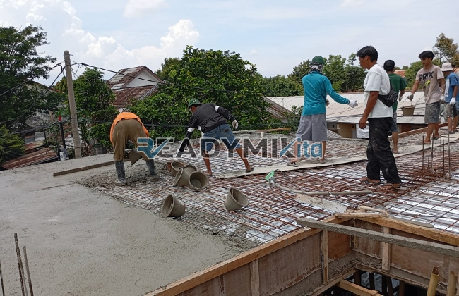

**Jasa Cor Readymix di Cilangkap Depok Murah** - Hai Mitra Readymix Kita! Butuh solusi pengecoran cepat dan andal di Cilangkap Depok? Kami hadir untuk menjawab kebutuhan konstruksi Anda. ReadymixKita adalah penyedia jasa cor readymix yang berkomitmen memberikan kualitas terbaik, efisiensi waktu, dan harga yang bersaing. Yuk, simak bagaimana kami bisa menjadi bagian dari kesuksesan proyek Anda!



## Mengapa Memilih Beton Readymix untuk Proyek Anda?

Beton readymix, atau beton siap pakai, adalah solusi modern dalam konstruksi yang menawarkan sejumlah keuntungan signifikan dibandingkan metode tradisional. Material ini diproduksi di pabrik dengan kontrol kualitas ketat, lalu diantarkan langsung ke lokasi proyek Anda. Ini yang membuat pengecoran menjadi lebih efisien dan efektif. Apa saja keunggulannya?

1. **Hemat Waktu dan Biaya Tenaga**

   Proses pencampuran beton di lokasi konstruksi memerlukan waktu dan tenaga kerja yang cukup besar. Dengan readymix, Anda bisa langsung fokus pada tahap pengecoran, memangkas waktu pengerjaan dan biaya operasional.

2. **Kualitas Terjamin & Konsisten**

   ReadymixKita menggunakan bahan baku berkualitas tinggi dan teknologi modern dalam setiap batching. Ini menjamin konsistensi kualitas beton, meminimalkan risiko kegagalan struktural akibat kesalahan pencampuran.

3. **Kapasitas Produksi Fleksibel**

   Kami mampu memenuhi kebutuhan beton dalam skala kecil maupun besar. Proyek perumahan, gedung bertingkat, atau infrastruktur publik – Kami siap melayani dengan kapasitas yang sesuai.

4. **Dukungan Ramah Lingkungan**

   Proses produksi readymix kami dirancang untuk mengurangi limbah material di lokasi konstruksi, berkontribusi pada praktik pembangunan yang lebih berkelanjutan.

## Apa yang Membuat ReadymixKita Unggul di Cilangkap Depok?

Di antara banyaknya pilihan penyedia jasa, ReadymixKita berdiri teguh sebagai mitra terpercaya di Cilangkap Depok. Kami tidak hanya menawarkan beton, tetapi juga solusi konstruksi yang komprehensif dan disesuaikan dengan kebutuhan Anda.

1. **Pengalaman & Keahlian Teruji**

   Dengan pengalaman bertahun-tahun di industri ini, kami memahami seluk-beluk konstruksi dan mampu memberikan solusi terbaik untuk setiap tantangan proyek.

2. **Pilihan Mutu Beton Lengkap**

   Kami menyediakan berbagai tingkatan mutu beton, mulai dari K-225 untuk aplikasi umum hingga K-500 untuk konstruksi yang membutuhkan kekuatan ekstra. Konsultasikan dengan tim kami untuk memilih mutu yang tepat.

3. **Didukung Peralatan Mutakhir**

   Kami berinvestasi pada peralatan modern, termasuk concrete pump untuk pengecoran yang cepat dan merata, bahkan di area yang sulit dijangkau.

4. **Layanan Profesional & Responsif**

   Tim kami yang berdedikasi siap memberikan layanan konsultasi, perencanaan, dan dukungan teknis di lapangan. Kami berkomitmen untuk menyesuaikan jadwal pengiriman dengan kebutuhan Anda.

## Cakupan Layanan Kami di Cilangkap Depok dan Sekitarnya

Memahami kondisi lokal adalah kunci keberhasilan proyek. ReadymixKita memahami karakteristik wilayah Cilangkap Depok dan sekitarnya, termasuk tantangan topografi dan aksesibilitas. Layanan kami dirancang untuk mengatasi hal tersebut:

1. **Pengiriman Tepat Waktu**

   Lokasi pabrik kami yang strategis memungkinkan kami menjamin pengiriman beton tepat waktu, meminimalkan keterlambatan proyek.

2. **Konsultasi Ahli**

   Kami menawarkan layanan konsultasi gratis untuk membantu Anda menentukan jenis beton dan metode pengecoran yang paling sesuai dengan kebutuhan proyek Anda.

3. **Penawaran Spesial untuk Proyek Lokal**

   Nikmati harga khusus dan diskon menarik untuk proyek yang berlokasi di Cilangkap Depok dan sekitarnya.

## Harga Terjangkau & Penawaran Menarik di Cilangkap Depok

Kami percaya bahwa kualitas tidak harus mahal. ReadymixKita menawarkan:

1. **Harga Bersaing**

   Kami berkomitmen untuk memberikan harga yang kompetitif tanpa mengorbankan kualitas beton readymix yang kami sediakan. Kami menyediakan informasi harga yang transparan, termasuk biaya pengiriman.

2. **Promo Eksklusif**

   Dapatkan diskon menarik untuk pemesanan dalam volume besar atau proyek berjangka panjang.

3. **Jaminan Kepuasan Pelanggan**

   Kepuasan Anda adalah prioritas utama kami. Jika Anda mengalami kendala selama proses pengecoran, tim kami akan segera memberikan solusi.

## Informasi Harga Jasa Cor Readymix di Cilangkap Depok



Jangan biarkan kualitas material yang buruk menghambat kemajuan proyek Anda. Percayakan pengecoran Anda kepada ahlinya! Hubungi kami sekarang untuk mendapatkan penawaran terbaik dan solusi pengecoran yang disesuaikan dengan kebutuhan Anda di Cilangkap Depok.

Kami siap membantu Anda merencanakan proyek impian Anda. Segera hubungi kami untuk konsultasi gratis dan nikmati kualitas terbaik dari jasa Pengecoran dengan Cor Readymix di Cilangkap Depok dari ReadymixKita. Bersama, kita wujudkan bangunan yang kuat dan tahan lama! [Jasa Cor Readymix di Abadijaya Depok Murah](/readymix/jasa-cor-readymix-di-abadijaya-depok-murah/)