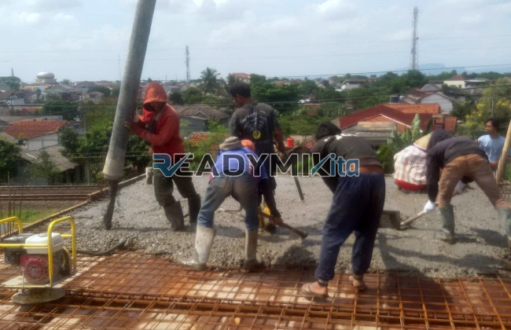

**Jasa Cor Readymix di Cilangkap Jakarta Murah** - Hai Mitra Readymix Kita! Ada rencana membangun di Cilangkap Jakarta? Cari solusi pengecoran yang praktis, cepat, dan berkualitas? Nah, Anda sudah berada di tempat yang tepat! Kami dari ReadymixKita hadir sebagai penyedia beton cor readymix terpercaya, siap mendukung kesuksesan proyek konstruksi Anda di Cilangkap Jakarta dan sekitarnya. Dengan layanan yang terjangkau dan mutu yang terjamin, kami siap menjadi mitra ideal Anda.



## Beton Readymix: Solusi Cerdas untuk Konstruksi Modern

Apa itu beton readymix dan kenapa begitu populer di kalangan kontraktor dan pemilik proyek? Sederhananya, beton readymix adalah campuran beton yang diproduksi di pabrik dengan formula yang telah teruji, kemudian diantar langsung ke lokasi proyek Anda. Proses ini memastikan konsistensi mutu dan efisiensi waktu yang signifikan dibandingkan dengan metode tradisional. Berikut beberapa kelebihan utama beton readymix:

1. **Hemat Waktu dan Biaya Tenaga**

   Lupakan repotnya mencampur beton manual di lokasi! Beton readymix siap pakai, mempercepat proses pengecoran dan memangkas biaya tenaga kerja.

2. **Mutu Terjamin dan Konsisten**

   Dengan takaran material yang presisi di pabrik, beton readymix menjamin mutu yang stabil dan konsisten di setiap pengiriman. Ini meminimalkan risiko kegagalan konstruksi.

3. **Kapasitas Produksi Fleksibel**

   Kebutuhan beton bervariasi tergantung skala proyek. Readymix mampu memenuhi permintaan mulai dari proyek kecil hingga konstruksi skala besar.

4. **Berkontribusi pada Lingkungan yang Lebih Baik**

   Proses produksi yang terkontrol mengurangi limbah material di lokasi proyek, menjadikannya pilihan yang lebih ramah lingkungan.

## Kenapa Memilih ReadymixKita di Cilangkap Jakarta?

Di antara begitu banyak penyedia jasa pengecoran di Cilangkap Jakarta, **ReadymixKita** menawarkan lebih dari sekadar beton cor. Kami berkomitmen untuk memberikan solusi komprehensif yang disesuaikan dengan kebutuhan unik proyek Anda. Yuk, simak apa saja keunggulan kami:

1. **Pengalaman dan Reputasi Terpercaya**

   Berpengalaman bertahun-tahun di industri ini, kami telah menyelesaikan berbagai proyek konstruksi dengan sukses, mulai dari bangunan residensial hingga infrastruktur publik.

2. **Pilihan Mutu Beton yang Lengkap**

   Kami menyediakan berbagai kelas mutu beton, termasuk K-225, K-300, K-350, dan K-500. Konsultasikan proyek Anda dengan kami, dan kami akan merekomendasikan mutu yang paling sesuai.

3. **Didukung Peralatan Modern**

   Kami menggunakan teknologi terkini, termasuk pompa beton (concrete pump) yang handal, untuk memastikan proses pengecoran berjalan lancar dan efisien.

4. **Tim Ahli yang Berdedikasi**

   Tim kami terdiri dari para profesional berpengalaman yang siap memberikan dukungan teknis dan solusi terbaik untuk proyek Anda.

## Layanan Kami yang Disesuaikan untuk Kondisi Cilangkap Jakarta

Cilangkap Jakarta memiliki karakteristik geografis dan kondisi lalu lintas yang unik. **ReadymixKita** memahami tantangan ini dan menawarkan layanan yang dirancang khusus untuk menjawab kebutuhan Anda:

1. **Pengiriman Tepat Waktu dan Andal**

   Kami menjamin pengiriman beton readymix tepat waktu, karena didukung oleh armada truk mixer yang terawat dan perencanaan rute yang optimal.

2. **Konsultasi Teknis Gratis**

   Bingung memilih jenis beton yang tepat? Tim ahli kami siap memberikan konsultasi gratis untuk membantu Anda dalam pengambilan keputusan.

3. **Penawaran Spesial untuk Proyek Lokal Cilangkap Jakarta**

   Kami memberikan harga khusus dan diskon menarik bagi pelanggan yang berlokasi di wilayah Cilangkap Jakarta.

## Harga Beton Readymix di Cilangkap Jakarta yang Bersaing

Kami percaya bahwa kualitas tidak harus mahal. **ReadymixKita** menawarkan harga yang kompetitif tanpa mengorbankan mutu.

1. **Transparansi Harga**

   Kami memberikan informasi harga yang jelas dan rinci, termasuk biaya pengiriman dan biaya tambahan lainnya.

2. **Promo Menarik**

   Dapatkan diskon khusus untuk pemesanan dalam jumlah besar atau proyek jangka panjang.

3. **Jaminan Kepuasan Pelanggan**

   Kami berkomitmen untuk memberikan layanan terbaik agar Anda merasa puas dengan hasil pengecoran kami.

## Informasi Harga Jasa Cor Readymix Terbaru di Cilangkap Jakarta



Jangan tunda lagi! Segera konsultasikan proyek Anda dengan kami dan dapatkan penawaran terbaik untuk jasa pengecoran readymix di Cilangkap Jakarta. Kami siap membantu Anda mewujudkan bangunan impian yang kuat dan tahan lama. Hubungi kami sekarang juga untuk mendapatkan layanan yang responsif dan berkualitas! [Hubungi Kami](URL_CONTACT)

Ingin tahu lebih banyak tentang jenis-jenis beton readymix yang kami sediakan? Baca artikel kami tentang [Jasa Cor Readymix di Abadijaya Depok Murah](/readymix/jasa-cor-readymix-di-abadijaya-depok-murah/) untuk mendapatkan informasi lebih lanjut. Dengan solusi pengecoran yang tepat, proyek Anda akan berjalan lancar dan efisien! Kami tunggu kabar baiknya dan siap menjadi bagian dari kesuksesan proyek Anda di Cilangkap Jakarta!