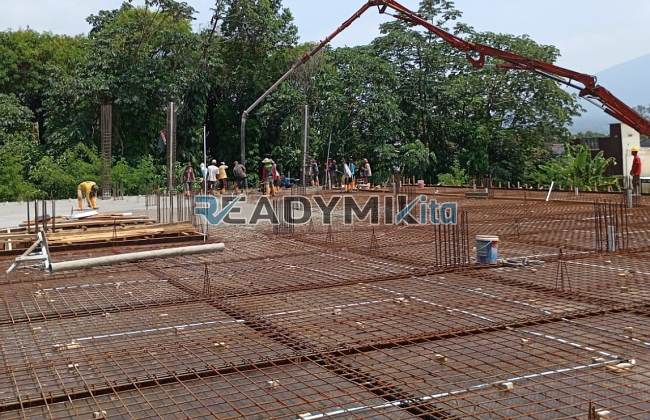

**Jasa Cor Readymix di Ciledug Tangerang Murah** - Hai Mitra Readymix Kita! Apakah Anda sedang merencanakan proyek konstruksi di Ciledug Tangerang? Mencari solusi beton yang cepat, praktis, dan berkualitas? Nah, Anda sudah berada di tempat yang tepat! Kami hadir sebagai penyedia jasa pengecoran readymix terpercaya, siap mendukung kesuksesan proyek Anda dengan beton terbaik. Yuk, simak bagaimana readymix bisa menjadi solusi ideal untuk kebutuhan konstruksi Anda di Ciledug Tangerang Murah!



## Mengapa Memilih Pengecoran dengan Readymix?

Beton readymix, atau beton cor siap pakai, adalah solusi modern yang semakin populer di dunia konstruksi. Dibuat dengan presisi tinggi di pabrik khusus, campuran beton ini kemudian diangkut langsung ke lokasi proyek menggunakan truk mixer. Tapi apa saja sih keunggulannya dibandingkan cara tradisional? Berikut ini beberapa alasan kenapa readymix menjadi pilihan cerdas:

1. **Hemat Waktu dan Tenaga Kerja**

   Proses pencampuran beton di lokasi konstruksi seringkali memakan waktu dan sumber daya manusia yang signifikan. Dengan readymix, Anda bisa menghemat keduanya! Beton sudah siap cor saat tiba di lokasi, mempercepat progres proyek Anda.

2. **Kualitas Terjamin dan Konsisten**

   Di pabrik kami, setiap batch beton diformulasikan dengan takaran yang tepat menggunakan peralatan modern. Ini memastikan kualitas beton yang konsisten dan terhindar dari kesalahan pencampuran yang bisa membahayakan kekuatan struktur.

3. **Fleksibilitas dan Kapasitas Besar**

   Butuh beton dalam jumlah besar untuk proyek skala besar? Atau hanya sedikit untuk perbaikan kecil? Readymix bisa mengakomodasi kebutuhan apa pun, dari proyek kecil hingga proyek infrastruktur raksasa.

4. **Berkontribusi pada Lingkungan yang Lebih Baik**

   Proses produksi readymix yang terkelola dengan baik meminimalkan limbah material di lokasi konstruksi, menjadikannya pilihan yang lebih ramah lingkungan.

## Apa yang Membuat Kami Unggul di Ciledug Tangerang?

Di antara banyaknya penyedia jasa pengecoran di Ciledug Tangerang Murah, **ReadymixKita** menawarkan keunggulan yang membedakan kami dari yang lain:

1. **Pengalaman dan Kepercayaan Pelanggan**

   Berbekal pengalaman bertahun-tahun di industri konstruksi, kami memahami seluk-beluk proyek konstruksi. Kami telah membantu banyak klien mulai dari pembangunan rumah tinggal, gedung komersial, hingga proyek infrastruktur.

2. **Pilihan Mutu Beton yang Lengkap**

   Kami menyediakan berbagai pilihan mutu beton, mulai dari K-225 yang umum digunakan hingga K-500 untuk konstruksi yang membutuhkan kekuatan ekstra. Kami akan membantu Anda memilih mutu beton yang paling tepat untuk kebutuhan proyek Anda.

3. **Teknologi Modern dan Peralatan Canggih**

   Kami berinvestasi dalam peralatan modern, termasuk *concrete pump*, untuk memastikan pengecoran berlangsung cepat, efisien, dan menghasilkan permukaan beton yang rata dan sempurna.

4. **Tim Profesional dan Pelayanan Prima**

   Tim ahli kami siap memberikan konsultasi dan dukungan teknis mulai dari tahap perencanaan hingga penyelesaian proyek. Kami juga fleksibel dan siap menyesuaikan dengan jadwal proyek Anda.

## Layanan Kami yang Dirancang Khusus untuk Ciledug Tangerang

Sebagai penyedia jasa lokal, kami memahami tantangan konstruksi di Ciledug Tangerang. Mulai dari kepadatan lalu lintas hingga kondisi tanah yang beragam, kami telah menyiapkan solusi yang tepat:

1. **Pengiriman Tepat Waktu**

   Lokasi pabrik kami yang strategis di sekitar Ciledug Tangerang memungkinkan kami menjamin pengiriman beton tepat waktu, bahkan di tengah kemacetan.

2. **Konsultasi Gratis dan Solusi Tepat**

   Kami menawarkan layanan konsultasi gratis untuk membantu Anda menentukan jenis beton yang paling sesuai dengan kebutuhan proyek Anda.

3. **Penawaran Istimewa untuk Pelanggan Lokal**

   Khusus untuk pelanggan di wilayah Ciledug Tangerang Murah, kami menawarkan harga khusus dan diskon menarik untuk proyek-proyek besar.

## Harga Terjangkau dan Promo Menarik di Ciledug Tangerang

Kami percaya bahwa kualitas beton yang baik tidak harus mahal. **ReadymixKita** berkomitmen untuk memberikan:

1. **Harga yang Kompetitif**

   Kami menawarkan harga yang kompetitif tanpa mengorbankan kualitas beton. Kami akan memberikan rincian harga yang jelas, termasuk biaya pengiriman dan penggunaan pompa beton.

2. **Promo dan Diskon Spesial**

   Manfaatkan promo menarik untuk pemesanan dalam jumlah besar atau proyek dengan jangka waktu tertentu.

3. **Kepuasan Pelanggan adalah Prioritas Kami**

   Kami menjamin kualitas layanan kami dan siap membantu menyelesaikan setiap kendala yang mungkin timbul selama proses pengecoran.

## Informasi Harga Jasa Cor Readymix di Ciledug Tangerang



Jangan biarkan kualitas material menjadi penghalang kesuksesan proyek Anda. Percayakan pengecoran beton Anda kepada ahlinya! Hubungi kami sekarang juga untuk mendapatkan penawaran terbaik dan solusi pengecoran yang optimal di Ciledug Tangerang Murah.

Kami juga menyediakan layanan survei lokasi gratis untuk membantu Anda menentukan kebutuhan beton yang tepat. Pesan sekarang dan rasakan perbedaan kualitas konstruksi yang tahan lama dan memuaskan. [Jasa Cor Readymix di Babakan Bogor Murah](/readymix/jasa-cor-readymix-di-babakan-bogor-murah/) — untuk kebutuhan beton di wilayah tetangga, kami juga siap melayani. Di ReadymixKita, kami adalah mitra terpercaya Anda dalam membangun masa depan yang kokoh! Segera hubungi kami dan wujudkan proyek impian Anda.