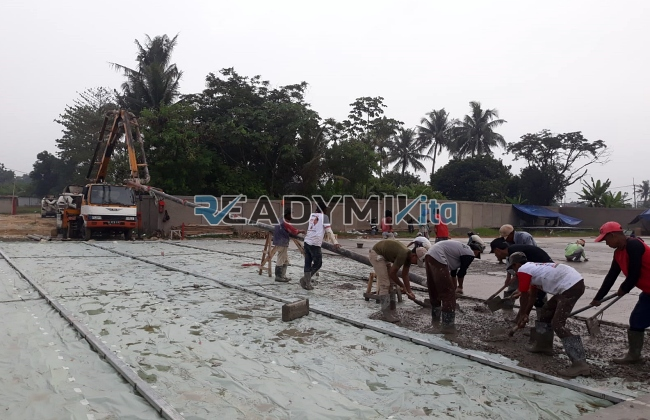

**Jasa Cor Readymix di Cilendek Bogor Murah** - Hai Mitra Readymix Kita! Lagi cari solusi pengecoran yang handal untuk proyek di Cilendek Bogor? Nah, Anda sudah berada di tempat yang tepat! Kami dari Readymix Kita hadir untuk menyediakan beton cor readymix berkualitas tinggi yang akan memastikan konstruksi Anda kokoh dan tahan lama. Apa yang membedakan kami? Yuk, kita simak lebih lanjut!



## Mengapa Beton Readymix Pilihan Tepat?

Beton cor readymix adalah solusi modern untuk kebutuhan konstruksi Anda. Lantas, apa sih yang membuat beton readymix semakin populer? Sederhananya, beton ini diproduksi secara presisi di pabrik, menggunakan bahan baku terbaik dan teknologi terkini. Lalu, langsung dikirim ke lokasi proyek Anda menggunakan truk mixer khusus. Berikut beberapa keunggulan yang bisa Anda rasakan:

1. **Hemat Waktu dan Tenaga Kerja**

   Proses pembuatan beton di lokasi proyek seringkali lama dan membutuhkan banyak tenaga. Dengan readymix, waktu pengerjaan bisa dipangkas drastis karena beton sudah siap pakai saat tiba di lokasi.

2. **Jaminan Kualitas Konsisten**

   Dengan takaran yang akurat dan kontrol kualitas yang ketat, beton readymix menjamin kualitas yang konsisten. Ini meminimalisir risiko kegagalan struktur akibat kesalahan pencampuran.

3. **Kemampuan Produksi Skala Besar**

   Kapasitas produksi readymix sangat besar, menjadikannya ideal untuk proyek kecil maupun skala besar. Kebutuhan beton Anda akan terpenuhi dengan cepat dan efisien.

4. **Dukungan Ramah Lingkungan**

   Proses produksi readymix yang terkontrol menghasilkan lebih sedikit limbah dibandingkan metode konvensional, sehingga lebih ramah lingkungan.

## Keunggulan Memilih ReadymixKita di Cilendek Bogor

Di antara banyaknya penyedia jasa di Cilendek Bogor, mengapa harus memilih **ReadymixKita**? Jawabannya terletak pada komitmen kami untuk memberikan yang terbaik bagi Mitra. Berikut beberapa keunggulan yang kami tawarkan:

1. **Pengalaman dan Kepercayaan**

   Dengan pengalaman bertahun-tahun di industri konstruksi, kami memahami betul kebutuhan proyek Anda. Baik itu perumahan, gedung komersial, ataupun proyek infrastruktur.

2. **Pilihan Mutu Beton yang Lengkap**

   Kami menyediakan berbagai kelas mutu beton, mulai dari K-225 untuk kebutuhan umum hingga K-500 untuk konstruksi yang membutuhkan kekuatan ekstra. Pilihan ini disesuaikan dengan kebutuhan spesifik proyek Anda.

3. **Didukung Peralatan Canggih**

   Kami menggunakan peralatan modern, termasuk pompa beton (concrete pump) yang dapat mempercepat dan meratakan proses pengecoran.

4. **Tim Profesional yang Siap Membantu**

   Tim kami yang berpengalaman siap memberikan panduan dan dukungan, mulai dari perencanaan hingga eksekusi di lapangan. Kami juga fleksibel menyesuaikan jadwal pengerjaan dengan kebutuhan Anda.

## Layanan Kami yang Terfokus di Cilendek Bogor

Kami mengenal betul karakteristik konstruksi di Cilendek Bogor. Dari area perkotaan yang padat hingga kondisi tanah yang beragam, **ReadymixKita** siap memberikan solusi yang tepat:

1. **Pengiriman yang Tepat Waktu**

   Kami mengutamakan ketepatan waktu pengiriman beton ke lokasi proyek Anda di Cilendek Bogor, memastikan kelancaran proses konstruksi.

2. **Konsultasi Bebas Biaya**

   Dapatkan konsultasi gratis dari tim ahli kami untuk memilih jenis beton dan metode pengecoran yang paling sesuai dengan kebutuhan proyek Anda.

3. **Penawaran Spesial untuk Proyek Lokal**

   Khusus untuk pelanggan di wilayah Cilendek Bogor, kami menawarkan tarif khusus dan diskon menarik untuk proyek-proyek besar.

## Harga Bersaing dan Promo Menarik di Cilendek Bogor

Kami memahami pentingnya anggaran dalam setiap proyek konstruksi. **ReadymixKita** berkomitmen untuk memberikan harga yang terjangkau tanpa mengorbankan kualitas:

1. **Harga yang Kompetitif**

   Kami menawarkan harga yang bersaing di pasar, lengkap dengan informasi biaya pengiriman dan penggunaan alat bantu seperti pompa beton.

2. **Promo dan Diskon Spesial**

   Manfaatkan diskon menarik untuk pemesanan dalam jumlah besar atau proyek yang berlangsung dalam jangka waktu tertentu.

3. **Kepuasan Pelanggan Terjamin**

   Kami memberikan garansi kepuasan untuk setiap layanan yang kami berikan. Jika ada kendala, tim kami akan segera membantu hingga proyek Anda selesai sempurna.

## Informasi Harga Jasa Cor Readymix di Cilendek Bogor



Jangan tunda lagi! Dapatkan solusi pengecoran terbaik di Cilendek Bogor dengan **ReadymixKita**. Kami juga menyediakan layanan survei lokasi dan konsultasi gratis untuk memastikan kebutuhan Anda terpenuhi dengan tepat. Segera pesan dan rasakan kualitas konstruksi yang tahan lama dan memuaskan. [Jasa Cor Readymix di Babakan Bogor Murah](/readymix/jasa-cor-readymix-di-babakan-bogor-murah/) bisa menjadi referensi tambahan untuk kebutuhan serupa di daerah sekitar.

Hubungi kami sekarang juga untuk mendapatkan penawaran terbaik dan wujudkan proyek konstruksi impian Anda! Dengan ReadymixKita, kekuatan dan ketahanan bangunan Anda adalah prioritas kami.