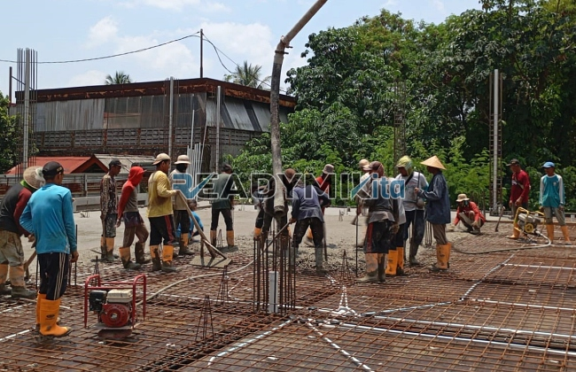

**Jasa Cor Readymix di Cililitan Jakarta Murah** - Hai Mitra Readymix Kita! Proyek konstruksi di Cililitan Jakarta sedang berjalan? Atau mungkin baru sebatas rencana? Kami punya solusi tepat untuk fondasi yang kokoh dan tahan lama. Mengapa memilih beton readymix? Karena kualitasnya terjamin, pengerjaannya efisien, dan investasinya cerdas. Yuk, simak bagaimana Readymix Kita bisa membantu mewujudkan bangunan impian Anda!



## Mengapa Readymix: Keunggulan Pengecoran Modern

Apa itu beton readymix? Sederhananya, beton readymix adalah campuran beton siap pakai yang diproduksi dengan presisi di pabrik menggunakan bahan baku berkualitas tinggi. Prosesnya praktis: beton diproduksi, lalu diangkut dengan truk mixer langsung ke lokasi proyek Anda. Keunggulan menggunakan beton readymix dibanding metode tradisional? Cukup banyak, lho!

1. **Hemat Waktu & Tenaga**

   Pengecoran manual seringkali memakan waktu dan tenaga tak sedikit. Nah, dengan readymix, prosesnya jauh lebih cepat karena pencampuran sudah dilakukan sebelumnya di pabrik. Anda bisa fokus pada tahapan lain pembangunan.

2. **Kualitas Terjamin Konsisten**

   Campuran beton readymix dibuat dengan takaran akurat dan peralatan canggih. Hasilnya? Kualitas yang konsisten, meminimalkan risiko kegagalan struktur akibat kesalahan pencampuran.

3. **Skala Produksi Fleksibel**

   Baik proyek skala kecil maupun besar, readymix mampu memenuhi kebutuhan Anda dengan cepat dan efisien. Kapasitas produksinya sangat mumpuni.

4. **Berkontribusi Pada Lingkungan**

   Proses produksi readymix yang lebih terkelola membantu mengurangi limbah material selama konstruksi. Pilihan yang lebih ramah lingkungan, kan?

## Mengapa Memilih ReadymixKita di Cililitan Jakarta?

Di antara banyaknya penyedia jasa pengecoran di Cililitan Jakarta, **ReadymixKita** menawarkan beberapa keunggulan yang menjadikannya mitra terbaik untuk proyek Anda:

1. **Pengalaman & Kepercayaan Pelanggan**

   Kami memiliki pengalaman yang solid di industri konstruksi. Kami mengerti betul kebutuhan setiap proyek, mulai dari pembangunan rumah, gedung komersial, hingga infrastruktur berskala besar.

2. **Pilihan Mutu Beton yang Lengkap**

   Kami menyediakan berbagai mutu beton, mulai dari K-225 yang umum digunakan hingga K-500 untuk konstruksi yang membutuhkan kekuatan ekstra. Semua disesuaikan dengan kebutuhan spesifik proyek Anda.

3. **Didukung Peralatan Modern**

   Pengecoran dilakukan dengan alat-alat canggih, termasuk *concrete pump*, yang memastikan proses pengecoran cepat, merata, dan efisien.

4. **Tim Ahli yang Siap Membantu**

   Tim profesional kami siap memberikan panduan dan dukungan dari tahap perencanaan hingga eksekusi di lokasi proyek. Kami juga fleksibel menyesuaikan jadwal dengan kebutuhan proyek Anda.

## Layanan Kami di Cililitan Jakarta: Menyesuaikan dengan Kebutuhan Lokal

Sebagai penyedia jasa lokal di Cililitan Jakarta, kami memahami betul tantangan konstruksi di wilayah ini. Kondisi medan yang beragam, mulai dari area perkotaan padat hingga kawasan perbukitan, membutuhkan solusi yang tepat. **ReadymixKita** hadir dengan layanan khusus:

1. **Pengiriman Tepat Waktu**

   Lokasi pabrik kami yang strategis di Cililitan Jakarta dan sekitarnya memungkinkan kami memastikan pengiriman beton tepat waktu, sesuai jadwal proyek Anda.

2. **Konsultasi Gratis**

   Kami menyediakan layanan konsultasi gratis untuk membantu Anda memilih jenis beton yang paling sesuai dengan kebutuhan proyek dan metode pengecoran yang optimal.

3. **Penawaran Spesial untuk Proyek Lokal**

   Klien di wilayah Cililitan Jakarta berhak mendapatkan tarif spesial dan diskon menarik untuk proyek-proyek besar.

## Harga Terjangkau di Cililitan Jakarta dan Promo Menarik

Anggaran proyek tentu menjadi perhatian utama. **ReadymixKita** hadir dengan komitmen memberikan harga yang kompetitif tanpa mengorbankan kualitas. Kami menjamin transparansi harga dan menawarkan:

1. **Harga Bersaing**

   Kami menawarkan harga yang kompetitif untuk readymix, termasuk biaya pengiriman dan penggunaan alat seperti concrete pump.

2. **Promo Spesial**

   Nikmati diskon menarik untuk pemesanan dalam volume besar atau proyek yang berjalan dalam jangka waktu panjang.

3. **Jaminan Kepuasan Pelanggan**

   Kami berkomitmen untuk memberikan solusi terbaik. Jika ada kendala dalam proses pengecoran, tim kami siap membantu hingga proyek Anda selesai dengan memuaskan.

## Informasi Harga Jasa Cor Readymix di Cililitan Jakarta



Jangan biarkan kualitas yang buruk menghambat kelancaran proyek Anda. Segera hubungi kami untuk mendapatkan solusi pengecoran terbaik di Cililitan Jakarta!

Kami juga menyediakan layanan survei lokasi dan konsultasi gratis untuk memastikan semua kebutuhan Anda terpenuhi. Pesan sekarang dan rasakan manfaatnya: konstruksi yang kokoh, awet, dan memuaskan. [Jasa Cor Readymix di Bale Kambang Jakarta Murah](/readymix/jasa-cor-readymix-di-bale-kambang-jakarta-murah/) menawarkan solusi serupa untuk area sekitar.

ReadymixKita selalu berkomitmen memberikan layanan terbaik bagi Anda. Dengan pengalaman, kualitas, dan pelayanan yang ramah, kami siap menjadi mitra terpercaya Anda. Hubungi kami sekarang dan rasakan sendiri keunggulan layanan pengecoran readymix dari ReadymixKita di Cililitan Jakarta! Bangun masa depan yang kuat bersama kami!