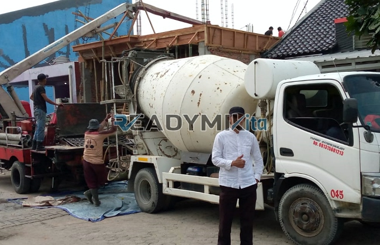

**Jasa Cor Readymix di Cilodong Depok Murah** - Hai Mitra Readymix Kita! Gimana kabarnya? Mencari solusi pengecoran beton yang andal dan efisien di Cilodong Depok? Nah, Anda sudah berada di tempat yang tepat! Kami dari Readymix Kita, spesialis dalam penyediaan beton cor readymix dan layanan concrete pump, siap mendukung kesuksesan proyek konstruksi Anda. Dengan layanan cepat dan harga terjangkau di Cilodong Depok Murah, kami hadir untuk memberikan yang terbaik.



## Mengapa Beton Readymix adalah Pilihan Tepat?

Beton cor readymix adalah campuran beton yang diproduksi secara presisi di pabrik kami, menggunakan bahan baku berkualitas tinggi. Beton ini kemudian diangkut menggunakan truk mixer khusus langsung ke lokasi proyek Anda. Jadi, apa saja keunggulannya dibanding cara konvensional? Simak poin-poin penting berikut:

1. **Hemat Waktu dan Biaya Tenaga**

   Lupakan proses mencampur beton manual yang memakan waktu dan tenaga. Dengan readymix, waktu pengerjaan proyek Anda jadi lebih singkat, otomatis menghemat biaya operasional.

2. **Kualitas Terjamin dan Konsisten**

   Kami menjamin konsistensi kualitas beton setiap batch. Proses produksi yang terkontrol dan penggunaan teknologi modern memastikan mutu beton sesuai standar yang Anda butuhkan. Ini mengurangi risiko kegagalan konstruksi.

3. **Fleksibilitas Kapasitas Produksi**

   Baik untuk proyek skala kecil maupun besar, kami mampu menyediakan beton readymix dalam volume yang Anda tentukan. Kami siap melayani kebutuhan proyek Anda, apapun ukurannya.

4. **Kontribusi untuk Lingkungan yang Lebih Baik**

   Proses produksi readymix yang efisien membantu meminimalkan limbah material konstruksi, mendukung praktik pembangunan yang lebih berkelanjutan.

## Mengapa Memilih ReadymixKita di Cilodong Depok?

Di Cilodong Depok, banyak sekali penyedia jasa beton. Tapi, apa yang membedakan ReadymixKita? Berikut beberapa alasan yang menjadikan kami pilihan utama:

1. **Pengalaman dan Reputasi Terpercaya**

   Berpengalaman bertahun-tahun melayani berbagai proyek konstruksi – mulai dari perumahan hingga infrastruktur – kami memahami seluk-beluk kebutuhan Anda.

2. **Pilihan Mutu Beton yang Lengkap**

   Kami menyediakan beragam grade beton, mulai dari K-225 hingga K-500, sesuai dengan spesifikasi proyek Anda. Kami bantu Anda memilih mutu yang paling tepat.

3. **Peralatan Pengecoran Modern**

   Kami dilengkapi dengan concrete pump modern yang memungkinkan pengecoran cepat dan merata, bahkan di area yang sulit dijangkau.

4. **Tim Ahli yang Siap Membantu**

   Tim profesional kami siap memberikan dukungan dari perencanaan hingga eksekusi. Kami juga fleksibel menyesuaikan jadwal dengan kebutuhan Anda.

## Layanan Kami di Cilodong Depok dan Sekitarnya

Sebagai penyedia lokal, kami sangat memahami karakteristik konstruksi di Cilodong Depok dan area sekitarnya. Kami hadir untuk memberikan solusi yang tepat untuk tantangan unik di wilayah ini:

1. **Pengiriman Tepat Waktu**

   Kami menjamin pengiriman beton readymix sesuai jadwal yang disepakati, memanfaatkan lokasi pabrik strategis kami di Cilodong Depok.

2. **Konsultasi Gratis dan Terpercaya**

   Butuh saran ahli? Tim kami siap memberikan konsultasi gratis untuk membantu Anda memilih jenis beton yang paling sesuai dengan proyek Anda.

3. **Penawaran Khusus untuk Pelanggan Cilodong Depok**

   Khusus untuk pelanggan di Cilodong Depok, kami menawarkan harga spesial dan diskon menarik untuk proyek-proyek besar.

## Harga Beton Readymix Cilodong Depok yang Bersaing

Kami mengerti bahwa biaya adalah faktor penting. Oleh karena itu, ReadymixKita berkomitmen untuk:

1. **Harga Kompetitif dan Transparan**

   Kami menawarkan harga yang kompetitif tanpa mengorbankan kualitas. Informasi harga yang lengkap, termasuk biaya pengiriman dan penggunaan pompa beton, akan kami berikan.

2. **Promo dan Diskon Menarik**

   Nikmati penawaran khusus untuk pemesanan volume besar atau proyek jangka panjang.

3. **Kepuasan Pelanggan sebagai Prioritas Utama**

   Kami memberikan garansi kepuasan. Jika ada kendala, tim kami siap membantu sampai proyek Anda selesai dengan sempurna.

## Informasi Harga Jasa Cor Readymix di Cilodong Depok



Jangan biarkan kualitas material menjadi penghalang kesuksesan proyek Anda. Percayakan pengecoran Anda pada ahlinya! Hubungi kami sekarang untuk mendapatkan solusi pengecoran beton readymix yang terbaik di Cilodong Depok.

Kami juga menyediakan layanan survei lokasi gratis untuk kesesuaian proyek Anda. Pesan sekarang dan rasakan manfaat kualitas beton yang terjamin dan layanan profesional dari ReadymixKita. Bangunan kokoh, tahan lama, dan sesuai harapan? Mudah saja bersama kami! Kualitas terbaik dan layanan yang ramah tersedia di Cilodong Depok Murah. Segera hubungi tim kami untuk konsultasi dan penawaran terbaik.