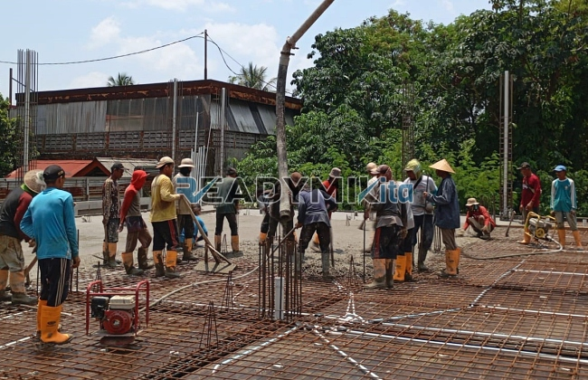

**Jasa Cor Readymix di Ciluar Bogor Murah** - Halo Mitra Readymix Kita! Pembangunan di Ciluar Bogor semakin pesat, kan? Nah, untuk memastikan setiap proyek Anda berdiri kokoh dan tahan lama, kami dari Readymix Kita hadir sebagai solusi pengecoran terbaik. Kami adalah supplier beton cor readymix terpercaya di Ciluar Bogor dan sekitarnya.



## Mengapa Memilih Beton Readymix untuk Proyek Anda?

Beton Cor Readymix: Solusi Modern untuk Konstruksi Cepat dan Kuat. Apa sih yang bikin beton readymix ini spesial? Singkatnya, beton ini diproduksi di pabrik dengan standar kualitas ketat, lalu dikirim langsung ke lokasi proyek Anda menggunakan truk mixer. Dibanding cara konvensional, beton readymix menawarkan segudang keunggulan:

1. **Hemat Waktu dan Biaya Tenaga Kerja**

   Proses pencampuran beton langsung di lokasi proyek itu butuh waktu dan banyak tenaga. Dengan readymix, Anda bisa mempersingkat jadwal pengerjaan proyek secara signifikan!

2. **Kualitas Terjamin Konsisten**

   Pencampuran yang presisi dengan teknologi modern memastikan kualitas beton yang seragam di setiap pengiriman. Risiko kesalahan takaran yang bisa melemahkan struktur bangunan? Lupakan!

3. **Skala Produksi Fleksibel**

   Mau proyek kecil atau skala besar, beton readymix siap memenuhi kebutuhan Anda. Kami bisa menyesuaikan volume pengiriman sesuai pesanan.

4. **Dukungan Ramah Lingkungan**

   Efisiensi produksi di pabrik meminimalkan limbah material di lokasi proyek, membantu terciptanya lingkungan konstruksi yang lebih bersih dan hijau.

## Apa yang Membuat ReadymixKita Unggul di Ciluar Bogor?

Di tengah banyak pilihan penyedia jasa pengecoran, kenapa harus memilih ReadymixKita di Ciluar Bogor? Ini dia alasannya:

1. **Pengalaman dan Reputasi Terpercaya**

   Selama bertahun-tahun, kami telah menjadi bagian dari kesuksesan berbagai proyek konstruksi, mulai dari rumah tinggal, bangunan komersial, hingga infrastruktur penting.

2. **Pilihan Mutu Beton yang Lengkap**

   Kami menyediakan berbagai grade beton, mulai dari K-225 untuk aplikasi standar hingga K-500 untuk struktur yang membutuhkan kekuatan ekstra. Pilihan mutu ini disesuaikan dengan kebutuhan spesifik proyek Anda.

3. **Didukung Peralatan Pengecoran Modern**

   Kami menggunakan peralatan canggih seperti concrete pump untuk memastikan pengecoran berlangsung cepat, efisien, dan merata di seluruh area proyek.

4. **Tim Profesional yang Siap Membantu**

   Tim ahli kami siap memberikan konsultasi dan panduan dari tahap perencanaan hingga penyelesaian proyek. Kami juga fleksibel menyesuaikan jadwal pengiriman dengan kebutuhan Anda.

## Jangkauan Layanan Kami di Wilayah Ciluar Bogor

Sebagai penyedia jasa lokal, kami sangat memahami karakteristik konstruksi di Ciluar Bogor. Baik proyek di area perkotaan padat penduduk maupun di area perbukitan, kami siap menghadapinya:

1. **Pengiriman Tepat Waktu**

   Lokasi pabrik kami yang strategis di Ciluar Bogor memungkinkan kami memberikan layanan pengiriman yang cepat dan tepat waktu.

2. **Konsultasi Gratis untuk Kebutuhan Proyek Anda**

   Bingung memilih jenis beton yang tepat? Kami menawarkan konsultasi gratis untuk membantu Anda menentukan solusi pengecoran yang paling sesuai dengan anggaran dan kebutuhan proyek.

3. **Penawaran Spesial untuk Proyek Lokal Ciluar Bogor**

   Klien di wilayah Ciluar Bogor berkesempatan mendapatkan tarif khusus dan diskon menarik untuk proyek-proyek besar.

## Investasi Cerdas: Harga Terjangkau dan Promo Menarik di Ciluar Bogor

Kami percaya bahwa kualitas tidak harus mahal. Di ReadymixKita, Anda mendapatkan produk beton terbaik dengan harga yang kompetitif:

1. **Harga yang Bersaing**

   Kami menawarkan harga yang transparan dan terjangkau, termasuk biaya pengiriman dan penggunaan peralatan tambahan seperti concrete pump.

2. **Promo dan Diskon Menguntungkan**

   Nikmati diskon menarik untuk pemesanan dalam jumlah besar atau proyek konstruksi yang berlangsung lama.

3. **Jaminan Kepuasan Pelanggan**

   Kami berkomitmen untuk memberikan pelayanan terbaik. Jika ada kendala selama proses pengecoran, tim kami siap memberikan solusi hingga proyek Anda selesai dengan sempurna.

## Informasi Harga Jasa Cor Readymix di Ciluar Bogor



Jangan tunda lagi! Dapatkan penawaran terbaik untuk proyek Anda di Ciluar Bogor. Hubungi kami sekarang juga untuk konsultasi gratis dan penawaran harga spesial.

Kami siap membantu mewujudkan bangunan impian Anda. Pesan beton readymix dari ReadymixKita dan rasakan kualitasnya langsung! Baca artikel kami tentang perbedaan beton K225 dan K300 untuk informasi lebih lanjut. Bersama ReadymixKita, konstruksi Anda lebih efisien, kokoh, dan terpercaya! Segera hubungi kami untuk informasi lebih lanjut.