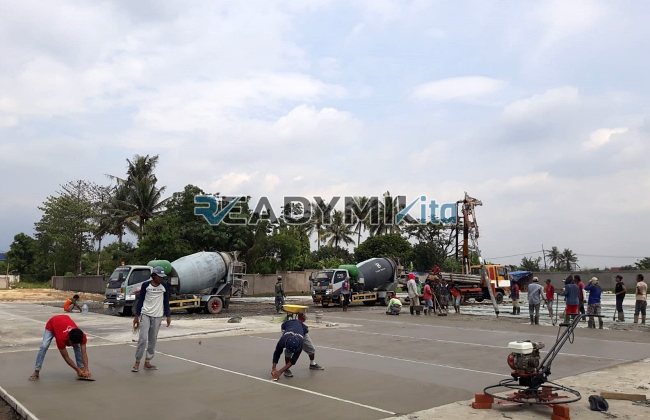

**Jasa Cor Readymix di Cimanggu Sukabumi Murah** - Hai Mitra Readymix Kita! Punya rencana membangun di Cimanggu Sukabumi? Kami hadir sebagai solusi pengecoran praktis dan berkualitas. Proyek konstruksi Anda membutuhkan fondasi kokoh?  Nah, Anda sudah berada di tempat yang tepat! Kami dari Readymix Kita memberikan solusi pengecoran readymix yang andal, efisien, dan tentunya, terjangkau di Cimanggu Sukabumi Murah.



## Mengapa Memilih Pengecoran dengan Readymix?

Beton Cor Readymix adalah solusi pengecoran modern yang semakin digemari di kalangan profesional konstruksi. Proses pencampuran dilakukan presisi di pabrik, menggunakan bahan baku berkualitas tinggi. Selanjutnya, beton siap pakai ini diangkut langsung ke lokasi proyek menggunakan truk mixer khusus. Apa saja kelebihannya dibandingkan metode konvensional?

1. **Hemat Waktu dan Biaya Tenaga**

   Pengecoran manual di lokasi seringkali memakan waktu dan memerlukan banyak tenaga kerja.  Dengan Readymix, waktu pengerjaan proyek Anda jadi lebih singkat, sekaligus mengurangi biaya operasional.

2. **Kualitas Terjamin dan Konsisten**

   Proses produksi yang terkontrol memastikan setiap batch beton memiliki kualitas yang sama. Hal ini penting untuk kekuatan dan ketahanan bangunan Anda.

3. **Fleksibilitas Volume**

   Baik untuk proyek kecil maupun besar, Readymix mampu menyediakan beton sesuai kebutuhan Anda, tanpa sisa atau kekurangan.

4. **Dukungan Ramah Lingkungan**

   Produksi terkontrol di pabrik meminimalkan limbah material di lokasi proyek, mendukung praktik konstruksi berkelanjutan.

## Keunggulan Jasa ReadymixKita di Cimanggu Sukabumi

Di antara pilihan penyedia jasa di Cimanggu Sukabumi, **ReadymixKita** menawarkan keunggulan yang membedakan kami:

1. **Pengalaman dan Keandalan**

   Bertahun-tahun melayani berbagai proyek konstruksi – mulai dari rumah tinggal, bangunan komersial, hingga proyek infrastruktur – membuat kami memahami betul tantangan dan kebutuhan Anda.

2. **Pilihan Mutu Beton Lengkap**

   Kami menyediakan berbagai kelas mutu beton, mulai dari K-225 untuk aplikasi standar hingga K-500 untuk konstruksi yang membutuhkan kekuatan ekstra. Pilihan ini memungkinkan Anda menyesuaikan dengan kebutuhan proyek spesifik Anda.

3. **Didukung Peralatan Modern**

   Kami berinvestasi pada peralatan pengecoran modern, termasuk *concrete pump* atau pompa beton, untuk mempercepat proses pengecoran dan menghasilkan hasil yang lebih rapi dan rata.

4. **Tim Profesional yang Berdedikasi**

   Tim kami terdiri dari tenaga ahli yang siap membantu Anda mulai dari perencanaan hingga pelaksanaan di lapangan. Kami juga fleksibel dalam menyesuaikan jadwal dengan kebutuhan proyek Anda.

## Layanan Kami di Wilayah Cimanggu Sukabumi dan Sekitarnya

Karena berlokasi dekat, kami memahami betul karakteristik konstruksi di Cimanggu Sukabumi.  Area ini memiliki variasi kondisi tanah dan medan, mulai dari dataran hingga perbukitan. **ReadymixKita** hadir dengan solusi yang disesuaikan:

1. **Pengiriman Tepat Waktu**

   Jarak pabrik kami dengan lokasi proyek di Cimanggu Sukabumi relatif dekat, sehingga kami menjamin pengiriman beton tepat waktu untuk kelancaran pekerjaan Anda.

2. **Konsultasi Teknis Gratis**

   Butuh saran tentang jenis beton yang paling sesuai untuk proyek Anda? Tim kami siap memberikan konsultasi gratis untuk membantu Anda membuat keputusan terbaik.

3. **Penawaran Khusus untuk Proyek Lokal**

   Kami memberikan tarif spesial dan diskon menarik untuk proyek-proyek konstruksi di Cimanggu Sukabumi dan sekitarnya, sebagai bentuk dukungan kami untuk pembangunan daerah.

## Harga Terjangkau dan Promo Menarik di Cimanggu Sukabumi

Kami mengerti bahwa anggaran adalah faktor penting dalam setiap proyek.  **ReadymixKita** berkomitmen untuk menawarkan:

1. **Harga yang Bersaing**

   Kami menawarkan harga yang kompetitif tanpa mengorbankan kualitas beton. Informasi harga, termasuk biaya pengiriman dan penggunaan peralatan tambahan, disampaikan secara transparan.

2. **Promo dan Diskon Spesial**

   Nikmati diskon menarik untuk pemesanan dalam jumlah besar atau proyek yang berlangsung dalam jangka waktu tertentu.

3. **Jaminan Kepuasan Pelanggan**

   Kami berkomitmen untuk memastikan Anda puas dengan layanan kami. Jika ada masalah selama proses pengecoran, tim kami akan segera menyelesaikan hingga proyek Anda selesai dengan sempurna.

## Daftar Harga Jasa Cor Readymix di Cimanggu Sukabumi



Jangan biarkan proyek Anda terhambat oleh material berkualitas rendah!  Hubungi kami sekarang untuk mendapatkan solusi pengecoran terbaik di Cimanggu Sukabumi. [Jasa Cor Readymix di Babakan Bogor Murah](/readymix/jasa-cor-readymix-di-babakan-bogor-murah/) adalah contoh lain dari komitmen kami terhadap layanan berkualitas di daerah terdekat.

Kami menyediakan layanan survei lokasi dan konsultasi gratis untuk memastikan kebutuhan Anda terpenuhi dengan tepat.  Pesan sekarang dan rasakan ketenangan pikiran dengan hasil konstruksi yang solid, tahan lama, dan memuaskan! Segera kontak kami untuk solusi pengecoran terbaik di Cimanggu Sukabumi.  Bersama ReadymixKita, ciptakan karya yang kuat dan awet!