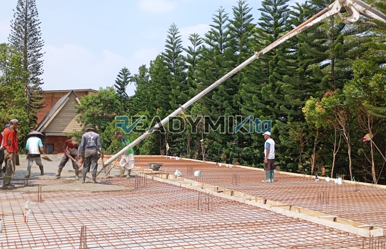

**Jasa Cor Readymix di Cinangka Depok Murah** - Hai Mitra Readymix Kita! Sedang merencanakan pembangunan di Cinangka Depok? Mencari solusi beton cor yang cepat, kuat, dan terpercaya? Nah, Anda sudah berada di tempat yang tepat! Kami dari Readymix Kita hadir sebagai penyedia beton readymix berkualitas tinggi, siap mendukung proyek konstruksi Anda di Cinangka Depok Murah. Dengan layanan yang terpercaya dan harga bersaing, kami adalah mitra ideal untuk memastikan fondasi bangunan Anda kokoh dan tahan lama.



## Mengapa Memilih Beton Cor Readymix untuk Proyek Anda?

Apa sih yang membuat beton Cor Readymix begitu populer di kalangan profesional konstruksi? Sederhananya, beton Cor Readymix adalah campuran beton siap pakai yang diproduksi secara presisi di pabrik modern, menggunakan bahan-bahan unggulan. Kemudian, beton ini diangkut langsung ke lokasi proyek Anda menggunakan truk mixer khusus. Ini menawarkan sejumlah keuntungan signifikan dibandingkan metode konvensional:

1. **Hemat Waktu dan Sumber Daya**

   Proses pencampuran beton di lokasi proyek seringkali memakan waktu dan tenaga yang tidak sedikit. Dengan beton Cor Readymix, Anda bisa menghemat keduanya karena pencampuran sudah dilakukan sebelumnya di pabrik.

2. **Kualitas Terjamin Konsisten**

   Beton Cor Readymix dibuat dengan takaran yang presisi dan menggunakan teknologi canggih. Ini berarti kualitas beton yang Anda dapatkan selalu konsisten dari batch ke batch, meminimalkan risiko kegagalan struktur akibat variasi kualitas.

3. **Kemampuan Produksi Skala Besar**

   Apapun skala proyek Anda – dari pembangunan rumah sederhana hingga proyek infrastruktur besar – beton Cor Readymix mampu memenuhi kebutuhan volume beton Anda dengan cepat dan efisien.

4. **Dukungan untuk Pembangunan Berkelanjutan**

   Proses produksi beton Cor Readymix yang lebih terkontrol membantu mengurangi limbah material di lokasi konstruksi, sehingga lebih ramah lingkungan.

## Mengapa Harus Memilih ReadymixKita di Cinangka Depok Murah?

Di tengah banyak pilihan penyedia jasa pengecoran, **ReadymixKita** menonjol dengan pengalaman dan komitmen kami terhadap kualitas. Kami bukan hanya sekadar supplier beton; kami adalah mitra terpercaya Anda dalam membangun Cinangka Depok Murah yang lebih kuat dan berkelanjutan. Apa yang membedakan kami?

1. **Reputasi Teruji dan Pengalaman Bertahun-tahun**

   Kami telah lama beroperasi di industri konstruksi, membangun reputasi sebagai penyedia beton yang andal dan terpercaya. Kami memahami seluk-beluk setiap proyek, mulai dari bangunan residensial hingga proyek-proyek komersial besar.

2. **Pilihan Mutu Beton yang Lengkap**

   Kami menyediakan beragam kelas mutu beton, mulai dari K-225 yang ideal untuk kebutuhan standar hingga K-500 yang dirancang untuk proyek konstruksi berat. Konsultasikan dengan tim ahli kami untuk memilih mutu beton yang paling sesuai dengan kebutuhan spesifik proyek Anda.

3. **Peralatan Modern untuk Efisiensi Maksimal**

   Kami berinvestasi dalam peralatan pengecoran modern, termasuk pompa beton (concrete pump), untuk memastikan proses pengecoran berjalan lancar, cepat, dan merata.

4. **Tim Profesional yang Siap Membantu**

   Tim kami terdiri dari para ahli yang berpengalaman dan siap memberikan panduan ahli dari tahap perencanaan hingga eksekusi di lapangan. Kami juga fleksibel dan siap menyesuaikan jadwal pengiriman dengan kebutuhan proyek Anda.

## Layanan Kami yang Terfokus di Cinangka Depok

Sebagai penyedia jasa yang berakar di Cinangka Depok, kami memahami tantangan konstruksi unik di wilayah ini. Mulai dari kepadatan penduduk hingga kondisi tanah yang beragam, kami siap memberikan solusi yang tepat. Berikut layanan khusus kami:

1. **Pengiriman Tepat Waktu ke Seluruh Cinangka Depok**

   Lokasi pabrik kami yang strategis memungkinkan kami menjamin pengiriman beton tepat waktu ke seluruh wilayah Cinangka Depok dan sekitarnya.

2. **Konsultasi Gratis untuk Kebutuhan Proyek Anda**

   Bingung memilih jenis beton yang paling sesuai? Tim kami siap memberikan konsultasi gratis untuk membantu Anda menentukan mutu beton dan metode pengecoran yang optimal untuk proyek Anda.

3. **Penawaran Spesial untuk Pelanggan Lokal di Cinangka Depok Murah**

   Sebagai wujud komitmen kami terhadap masyarakat Cinangka Depok, kami menawarkan tarif khusus dan diskon menarik untuk proyek-proyek lokal.

## Harga Kompetitif dan Promo Menarik di Cinangka Depok

Kami percaya bahwa kualitas tidak harus mahal. **ReadymixKita** berkomitmen untuk menyediakan beton cor readymix berkualitas tinggi dengan harga yang terjangkau.

1. **Harga Bersaing Tanpa Mengurangi Kualitas**

   Kami menawarkan harga yang kompetitif tanpa mengorbankan kualitas bahan baku dan proses produksi. Kami juga transparan dalam memberikan informasi harga, termasuk biaya pengiriman dan penggunaan concrete pump.

2. **Promo dan Diskon Menggiurkan**

   Seringkali kami menawarkan promo dan diskon menarik untuk pemesanan dalam jumlah besar atau untuk proyek jangka panjang. Pantau terus website kami atau hubungi tim kami untuk informasi lebih lanjut.

3. **Kepuasan Pelanggan adalah Prioritas Kami**

   Kami menjamin kepuasan Anda. Jika ada masalah selama proses pengecoran, tim kami akan segera turun tangan untuk mencari solusi hingga proyek Anda selesai dengan sempurna.

## Informasi Harga Jasa Cor Readymix di Cinangka Depok



Jangan biarkan kualitas material menjadi penghalang kesuksesan proyek Anda! Segera hubungi kami untuk mendapatkan penawaran terbaik dan solusi pengecoran yang tepat untuk kebutuhan Anda di Cinangka Depok Murah.

Kami siap memberikan layanan survei lokasi dan konsultasi gratis untuk memastikan proyek Anda berjalan lancar dan optimal. Pesan sekarang dan rasakan kemudahan membangun dengan beton berkualitas dari ReadymixKita!

Dengan memilih jasa Pengecoran dg Cor Readymix dari ReadymixKita, Anda berinvestasi pada kekuatan, keawetan, dan keberhasilan proyek Anda di Cinangka Depok. [Jasa Cor Readymix di Abadijaya Depok Murah](/readymix/jasa-cor-readymix-di-abadijaya-depok-murah/) — Temukan solusi pengecoran yang ideal untuk proyek Anda bersama kami. Hubungi kami sekarang untuk memulai!