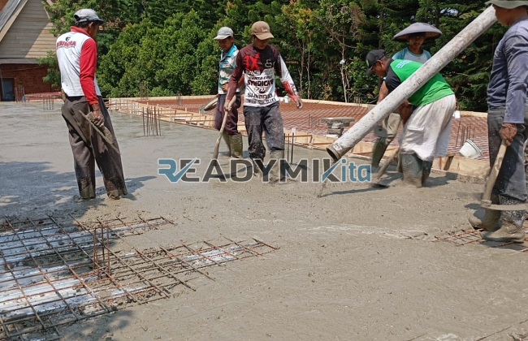

**Jasa Cor Readymix di Cinere Depok Murah** - Hai Mitra Readymix Kita! Proyek konstruksi di Cinere Depok sedang berjalan? Atau mungkin baru sebatas rencana? Nah, Anda sudah berada di tempat yang tepat! Kami menghadirkan solusi pengecoran readymix yang cepat, berkualitas, dan tentunya dengan harga yang bersaing. Dengan layanan kami, Anda bisa fokus pada pengembangan proyek tanpa kompromi soal kekuatan dan ketahanan bangunan.



## Mengapa Beton Readymix Jadi Pilihan Tepat?

Apa sih sebenarnya beton *Cor Readymix* itu? Singkatnya, ini adalah campuran beton yang dibuat secara presisi di pabrik kami, menggunakan bahan-bahan pilihan. Kemudian, beton siap pakai ini langsung diangkut ke lokasi proyek Anda menggunakan truk mixer khusus.  Keuntungan menggunakan beton readymix dibandingkan dengan metode tradisional itu banyak, lho!

1. **Hemat Waktu & Tenaga:** Proses pencampuran beton di lokasi proyek seringkali memakan waktu dan sumber daya yang tidak sedikit. Dengan readymix, waktu pengerjaan proyek Anda bisa dipangkas signifikan.
2. **Kualitas Terjamin Konsisten:**  Formulasi yang tepat dan teknologi modern memastikan setiap batch beton yang kami produksi memiliki kualitas yang seragam dan memenuhi standar konstruksi.
3. **Kapasitas Fleksibel:**  Baik untuk proyek kecil maupun skala besar, beton readymix mampu memenuhi kebutuhan Anda dengan cepat dan efisien.
4. **Dukungan Ramah Lingkungan:** Proses produksi yang terkontrol meminimalkan limbah material di lokasi proyek, berkontribusi pada praktik konstruksi yang lebih berkelanjutan.

## Apa yang Membuat ReadymixKita Unggul di Cinere Depok?

Di antara banyaknya penyedia jasa pengecoran di Cinere Depok, **ReadymixKita** menawarkan keunggulan yang membedakan kami:

1. **Pengalaman & Kepercayaan:** Kami telah lama berkecimpung di industri konstruksi, memahami seluk-beluknya, dan telah berhasil menyelesaikan berbagai proyek di Cinere Depok dan sekitarnya.
2. **Pilihan Mutu Beton yang Lengkap:** Kami menyediakan berbagai kelas mutu beton, mulai dari K-225 (untuk konstruksi standar) hingga K-500 (untuk beban berat).  Pilih sesuai kebutuhan spesifik proyek Anda!
3. **Teknologi Pengecoran Modern:**  Kami dilengkapi dengan peralatan canggih, termasuk *concrete pump*, untuk memastikan pengecoran yang cepat, merata, dan tepat sasaran.
4. **Tim Ahli yang Siap Membantu:**  Tim profesional kami siap mendampingi Anda dari tahap perencanaan hingga penyelesaian di lokasi.  Kami juga menawarkan solusi fleksibel yang disesuaikan dengan jadwal proyek Anda.

## Layanan Kami yang Disesuaikan untuk Cinere Depok

Sebagai penyedia lokal, kami paham betul tantangan konstruksi di Cinere Depok. Kondisi lahan yang bervariasi, mulai dari area datar hingga kontur berbukit, tidak akan menjadi masalah! **ReadymixKita** memberikan solusi khusus:

1. **Pengiriman Tepat Waktu:** Kami memastikan beton sampai di lokasi proyek Anda tepat waktu, karena kami sadar betapa pentingnya ketepatan waktu dalam konstruksi.
2. **Konsultasi Teknis Gratis:**  Bingung memilih jenis beton yang tepat? Jangan khawatir! Tim kami siap memberikan konsultasi gratis untuk membantu Anda menentukan solusi terbaik.
3. **Penawaran Spesial untuk Proyek Lokal:**  Klien di Cinere Depok berhak mendapatkan penawaran harga spesial dan diskon menarik untuk proyek-proyek skala besar.

## Investasi Cerdas: Harga Terjangkau & Promo Menarik

Kami memahami bahwa efisiensi anggaran adalah prioritas utama. Oleh karena itu, **ReadymixKita** berkomitmen untuk:

1. **Harga yang Bersaing:**  Kami menawarkan harga yang kompetitif tanpa mengorbankan kualitas. Yuk, bandingkan dengan penyedia lain!
2. **Promo & Diskon:**  Manfaatkan promo menarik untuk pemesanan dalam jumlah besar atau proyek jangka panjang.
3. **Jaminan Kepuasan:** Kami berkomitmen penuh untuk memberikan layanan terbaik. Jika ada masalah, tim kami siap membantu sampai tuntas!

## Informasi Harga Jasa Cor Readymix di Cinere Depok



Jangan lewatkan kesempatan untuk mempercepat proyek Anda dengan beton readymix berkualitas! Hubungi kami sekarang juga untuk mendapatkan penawaran terbaik!

Kami juga menyediakan layanan survei lokasi dan konsultasi gratis untuk memastikan kebutuhan Anda terpenuhi dengan tepat.  Pesan sekarang dan rasakan sendiri keunggulan konstruksi yang kokoh, tahan lama, dan memuaskan. [Jasa Cor Readymix di Abadijaya Depok Murah](/readymix/jasa-cor-readymix-di-abadijaya-depok-murah/) dapat menjadi solusi untuk Anda.

Jangan tunda lagi! Dengan menggunakan beton readymix dari **ReadymixKita**, Anda akan mendapatkan kombinasi sempurna antara efisiensi, kualitas, dan pelayanan profesional. Segera hubungi kami untuk solusi pengecoran terbaik di Cinere Depok! Bersama ReadymixKita, karya Anda akan berdiri kokoh dan awet!