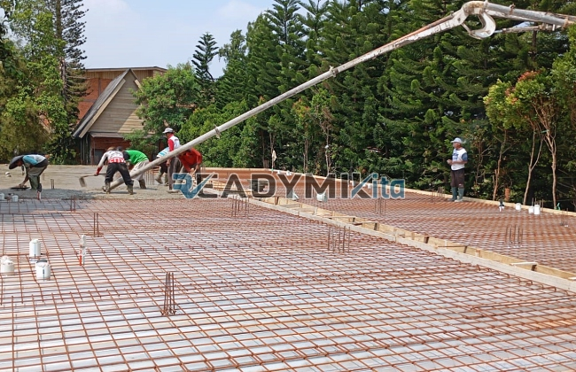

**Jasa Cor Readymix di Ciparigi Bogor Murah** - Hai Mitra Readymix Kita! Mencari solusi pengecoran yang handal untuk proyek Anda di Ciparigi Bogor? Bangunan kokoh dimulai dari pondasi yang kuat. Itulah kenapa kami hadir! Kami dari Readymix Kita, penyedia beton cor readymix terpercaya di Jabodetabek, siap mendukung kesuksesan konstruksi Anda. Yuk, simak bagaimana readymix bisa jadi andalan proyek Anda!



## Mengapa Memilih Pengecoran dengan Readymix?

Apa sih kelebihan beton cor readymix dibandingkan cara konvensional? Singkatnya, readymix adalah campuran beton yang diproduksi di pabrik dengan kontrol kualitas ketat. Lalu, diangkut langsung ke lokasi proyek menggunakan truk mixer khusus. Penggunaan readymix menawarkan sejumlah keuntungan signifikan:

1. **Hemat Waktu dan Biaya Tenaga**

   Pencampuran di lokasi proyek seringkali memakan banyak waktu dan tenaga kerja. Dengan readymix, Anda bisa langsung fokus pada tahapan pembangunan lainnya – pencampuran sudah ditangani pabrik!

2. **Kualitas Terjamin Konsisten**

   Readymix diproduksi dengan takaran yang presisi dan diawasi kualitasnya secara berkala, memastikan mutu beton yang seragam untuk seluruh proyek Anda. Ini meminimalkan risiko kegagalan struktur.

3. **Kapasitas Fleksibel untuk Berbagai Skala Proyek**

   Baik proyek kecil seperti renovasi rumah, maupun proyek besar seperti pembangunan gedung bertingkat, readymix mampu menyediakan volume beton sesuai kebutuhan Anda dengan cepat.

4. **Dukungan Ramah Lingkungan**

   Proses produksi readymix yang terstandardisasi mengurangi potensi limbah material di lokasi proyek, berkontribusi pada praktik konstruksi yang lebih berkelanjutan.

## Mengapa ReadymixKita adalah Pilihan Terbaik di Ciparigi Bogor?

Di tengah banyaknya penyedia jasa pengecoran, **ReadymixKita** menawarkan keunggulan khusus yang membuat kami menjadi mitra ideal di Ciparigi Bogor:

1. **Pengalaman dan Reputasi Terpercaya**

   Berbekal pengalaman bertahun-tahun di industri konstruksi, kami mengerti seluk-beluk kebutuhan proyek Anda – mulai dari pembangunan rumah tinggal hingga proyek infrastruktur skala besar.

2. **Variasi Mutu Beton yang Luas**

   Kami menyediakan beragam kelas mutu beton, mulai dari K-225 (untuk aplikasi standar) hingga K-500 (untuk konstruksi yang membutuhkan kekuatan ekstra). Pilihan mutu beton kami disesuaikan agar sesuai dengan spesifikasi proyek Anda.

3. **Didukung Teknologi Pengecoran Modern**

   Kami dilengkapi dengan peralatan canggih, termasuk *concrete pump* (pompa beton), untuk mempercepat dan meratakan proses pengecoran, memastikan hasil yang optimal.

4. **Tim Ahli yang Siap Membantu**

   Tim profesional kami siap memberikan pendampingan mulai dari tahap perencanaan hingga pelaksanaan di lokasi proyek. Kami fleksibel dan dapat menyesuaikan layanan dengan jadwal Anda.

## Pelayanan Khusus untuk Konstruksi di Ciparigi Bogor

Sebagai penyedia jasa yang berfokus pada wilayah ini, kami memahami betul karakteristik konstruksi di Ciparigi Bogor. Kondisi geografis yang bervariasi, mulai dari area perkotaan padat hingga lahan berbukit, memerlukan solusi pengecoran yang adaptif. **ReadymixKita** menawarkan:

1. **Pengiriman Tepat Waktu dan Efisien**

   Kami menjamin ketepatan waktu pengiriman beton berkat lokasi pabrik yang strategis di Ciparigi Bogor dan jaringan distribusi yang handal.

2. **Konsultasi Teknis Gratis**

   Kami menyediakan layanan konsultasi tanpa biaya untuk membantu Anda memilih jenis beton yang paling sesuai dengan kebutuhan proyek Anda dan menentukan metode pengecoran yang optimal.

3. **Program Penawaran Spesial untuk Pelanggan Lokal**

   Pengembang dan kontraktor di wilayah Ciparigi Bogor berhak mendapatkan penawaran khusus, termasuk tarif menarik dan diskon untuk proyek-proyek berskala besar.

## Harga Readymix Terjangkau dan Promo Menarik di Ciparigi Bogor

Kami sadar bahwa anggaran adalah pertimbangan penting dalam setiap proyek konstruksi. **ReadymixKita** berkomitmen untuk menyediakan:

1. **Harga Kompetitif dan Transparan**

   Kami menawarkan harga yang kompetitif tanpa mengorbankan kualitas beton. Informasi harga, termasuk biaya pengiriman dan penggunaan pompa beton, disampaikan dengan jelas.

2. **Promo dan Diskon Eksklusif**

   Nikmati berbagai promo menarik, seperti diskon untuk pemesanan volume besar atau untuk proyek yang berjalan dalam jangka waktu tertentu.

3. **Jaminan Kepuasan Pelanggan**

   Kami menjamin kepuasan Anda atas kualitas beton dan layanan kami. Jika ada kendala, tim kami siap memberikan solusi hingga proyek Anda selesai dengan memuaskan.

## Tabel Harga Jasa Cor Readymix di Ciparigi Bogor



Jangan biarkan kualitas proyek Anda terganggu karena material yang kurang memadai. Hubungi kami sekarang juga untuk mendapatkan solusi pengecoran terbaik di Ciparigi Bogor!

Kami juga menyediakan layanan survei lokasi gratis untuk memastikan rekomendasi kami tepat sasaran. Pesan readymix dari kami sekarang dan rasakan perbedaan kualitas yang akan membuat bangunan Anda kokoh, awet, dan jadi kebanggaan Anda! [Jasa Cor Readymix di Babakan Bogor Murah](/readymix/jasa-cor-readymix-di-babakan-bogor-murah/) bisa menjadi referensi tambahan untuk melihat keunggulan bahan baku kami. Jangan tunda lagi! Bangun impian Anda dengan **ReadymixKita** di Ciparigi Bogor.