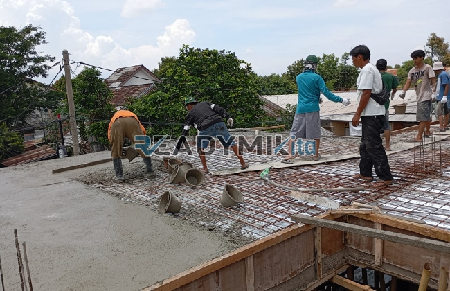

**Jasa Cor Readymix di Cipayung Depok Murah** - Hai Mitra Readymix Kita! Ada rencana pembangunan di Cipayung Depok? Mencari solusi beton cor yang cepat, praktis, dan berkualitas? Nah, Anda sudah berada di tempat yang tepat! Kami, Readymix Kita, hadir sebagai mitra terpercaya dalam menyediakan beton ready mix dan layanan sewa concrete pump di wilayah Cipayung Depok dan sekitarnya. Yuk, simak apa saja keunggulan yang kami tawarkan!



## Mengapa Beton Readymix adalah Pilihan Tepat?

Mitra, sudahkah Anda mempertimbangkan beton readymix untuk proyek Anda? Beton Cor Readymix adalah campuran beton yang diproduksi secara akurat di pabrik kami, dengan kualitas terjamin. Kemudian, diangkut langsung ke lokasi proyek Anda menggunakan truk mixer khusus. Dengan begitu, Anda mendapatkan beton siap pakai kapan saja dan di mana saja. Nah, apa saja kelebihannya dibandingkan metode tradisional?

1. **Hemat Waktu dan Biaya**

   Proses pembuatan beton di lokasi proyek seringkali memakan waktu dan tenaga yang signifikan. Dengan readymix, Anda memangkas waktu pengerjaan secara drastis – pencampuran sudah dilakukan secara otomatis di pabrik kami.

2. **Kualitas Terjamin dan Konsisten**

   Kami menggunakan takaran yang presisi dan material berkualitas tinggi dalam setiap batch beton Cor Readymix. Ini memastikan konsistensi kualitas, meminimalkan risiko kegagalan konstruksi akibat kesalahan dalam pencampuran.

3. **Kapasitas Produksi Fleksibel**

   Baik proyek kecil maupun besar, readymix mampu memenuhi kebutuhan Anda. Kami dapat menyediakan volume beton sesuai pesanan, tanpa khawatir keterbatasan kapasitas.

4. **Berkontribusi pada Lingkungan yang Lebih Baik**

   Proses produksi yang terkelola dengan baik di pabrik readymix kami menghasilkan limbah material yang lebih sedikit dibandingkan dengan pembuatan beton konvensional di lokasi proyek.

## Keunggulan Memilih ReadymixKita di Cipayung Depok Murah

Di antara sekian banyak penyedia jasa readymix, kenapa harus memilih **ReadymixKita** di wilayah Cipayung Depok? Kami menawarkan lebih dari sekadar beton cor berkualitas!

1. **Pengalaman dan Kepercayaan Pelanggan**

   Bertahun-tahun berkecimpung di industri ini menjadikan kami ahli dalam memahami kebutuhan proyek konstruksi apapun – mulai dari bangunan rumah, gedung komersial, hingga infrastruktur penting.

2. **Pilihan Mutu Beton yang Lengkap**

   Kami menyediakan beragam kelas mutu beton, mulai dari K-225 yang cocok untuk pekerjaan standar hingga K-500 untuk konstruksi yang membutuhkan kekuatan ekstra. Pilihan disesuaikan dengan kebutuhan spesifik proyek Anda.

3. **Didukung Peralatan Pengecoran Modern**

   Kami menggunakan peralatan modern seperti concrete pump untuk mempercepat dan meratakan proses pengecoran, memastikan hasil yang optimal dan efisien.

4. **Tim Ahli yang Siap Membantu**

   Tim profesional kami siap memberikan panduan dan support dari tahap perencanaan hingga penyelesaian proyek. Kami juga fleksibel dan siap menyesuaikan jadwal pengiriman dengan kebutuhan Anda.

## Solusi Pengecoran Tepat Sasaran untuk Area Cipayung Depok

Kami paham betul karakteristik wilayah Cipayung Depok. Kondisi medan yang beragam, mulai dari area padat perkotaan hingga kontur perbukitan, membutuhkan solusi pengecoran yang tepat. **ReadymixKita** hadir dengan layanan khusus:

1. **Pengiriman Tepat Waktu**

   Dengan lokasi pabrik strategis dan armada yang handal, kami menjamin pengiriman beton tepat waktu ke lokasi proyek Anda di Cipayung Depok dan sekitarnya.

2. **Konsultasi Gratis untuk Proyek Anda**

   Butuh bantuan memilih jenis beton yang paling sesuai? Tim kami siap memberikan konsultasi gratis untuk memastikan Anda mendapatkan solusi terbaik.

3. **Penawaran Istimewa untuk Pelanggan Lokal**

   Sebagai wujud komitmen kami terhadap pembangunan di Cipayung Depok, kami menawarkan tarif khusus dan diskon menarik untuk proyek-proyek lokal.

## Harga Bersaing dan Promo Menguntungkan

Kami mengerti bahwa anggaran merupakan faktor penting dalam setiap proyek konstruksi. Di **ReadymixKita**, Anda akan menemukan:

1. **Harga yang Kompetitif**

   Kami menawarkan harga yang terjangkau tanpa mengorbankan kualitas beton. Informasi harga yang transparan, termasuk biaya pengiriman dan sewa concrete pump, akan kami sampaikan dengan jelas.

2. **Promo Menarik Sepanjang Tahun**

   Dapatkan diskon khusus untuk pemesanan dalam volume besar atau proyek yang berlangsung dalam jangka waktu tertentu.

3. **Kepuasan Pelanggan sebagai Prioritas Utama**

   Kami berkomitmen untuk memberikan pelayanan terbaik dan menjamin kepuasan Anda. Jika ada kendala selama proses pengecoran, tim kami akan segera memberikan solusi.

## Informasi Harga Jasa Cor Readymix di Cipayung Depok



Jangan biarkan kualitas material menjadi penghalang suksesnya proyek Anda! Segera hubungi kami untuk mendapatkan penawaran terbaik dan solusi pengecoran terpercaya di Cipayung Depok. Kami siap membantu mewujudkan bangunan impian Anda.

Lengkapi proyek Anda dengan kekuatan dan keandalan beton readymix dari **ReadymixKita**. Kami juga menyediakan layanan survei lokasi gratis untuk membantu Anda menentukan kebutuhan beton yang tepat. Pesan sekarang dan rasakan perbedaannya! [Jasa Cor Readymix di Abadijaya Depok Murah](/readymix/jasa-cor-readymix-di-abadijaya-depok-murah/) – solusi beton berkualitas untuk proyek Anda.