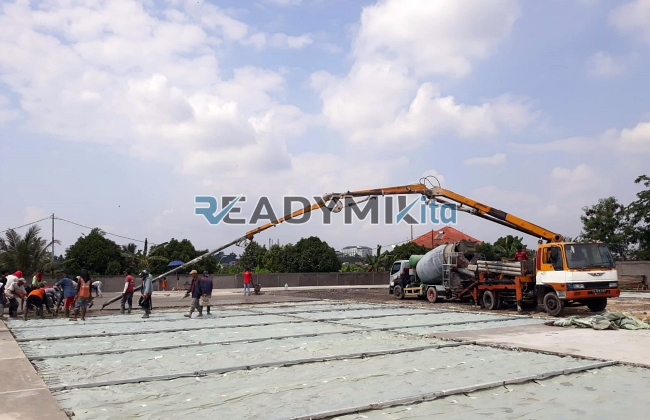

**Jasa Cor Readymix di Cipayung Jakarta Murah** - Hai Mitra Readymix Kita! Lagi merencanakan pembangunan di Cipayung Jakarta? Atau mungkin sedang mencari solusi beton cor yang praktis dan berkualitas? Nah, Anda sudah berada di tempat yang tepat! Kami dari Readymix Kita hadir sebagai mitra terpercaya untuk memenuhi kebutuhan pengecoran proyek Anda. Kualitas terjamin, pengiriman cepat, dan harga bersaing – itulah komitmen kami.



## Mengapa Memilih Beton Readymix untuk Proyek Anda?

Apa sebenarnya beton Cor Readymix itu? Sederhananya, ini adalah campuran beton yang sudah siap pakai, diproduksi secara presisi di pabrik kami dengan standar mutu tinggi. Beton ini kemudian diangkut langsung ke lokasi proyek menggunakan truk mixer khusus. Manfaatnya? Banyak sekali! Berikut beberapa alasan mengapa beton Cor Readymix adalah pilihan cerdas:

1. **Hemat Waktu dan Tenaga**

   Proses pencampuran beton di lokasi proyek seringkali memakan waktu dan banyak tenaga kerja. Dengan beton readymix, Anda langsung siap cor – waktu pengerjaan jadi lebih efisien dan biaya operasional berkurang.

2. **Kualitas Terjamin Konsisten**

   Penggunaan takaran material yang presisi dan peralatan modern di pabrik kami memastikan kualitas beton tetap konsisten. Ini meminimalkan risiko kegagalan struktur bangunan akibat campuran yang tidak tepat.

3. **Kapasitas Produksi Fleksibel**

   Baik proyek kecil maupun besar, beton Cor Readymix dapat mengakomodasi kebutuhan volume yang beragam dengan cepat dan efisien.

4. **Pilihan yang Lebih Ramah Lingkungan**

   Proses produksi beton readymix yang terkontrol meminimalkan limbah material di lokasi proyek, sehingga lebih mendukung praktik konstruksi berkelanjutan.

## ReadymixKita: Solusi Pengecoran Andal di Cipayung Jakarta

Di Cipayung Jakarta Murah, Anda akan menemukan banyak penyedia jasa pengecoran. Tapi, mengapa harus memilih **ReadymixKita**?

1. **Pengalaman dan Keandalan**

   Dengan pengalaman bertahun-tahun di dunia konstruksi, kami memahami betul seluk-beluk pengecoran untuk berbagai jenis proyek, mulai dari perumahan, gedung komersial, hingga infrastruktur.

2. **Pilihan Mutu Beton yang Lengkap**

   Kami menawarkan beragam mutu beton untuk menyesuaikan dengan kebutuhan proyek Anda, termasuk K-225, K-300, K-350 hingga K-500. Konsultasikan dengan tim kami untuk menentukan mutu yang paling tepat.

3. **Peralatan Pengecoran Modern**

   Kami dilengkapi dengan peralatan modern seperti pompa beton (concrete pump) yang handal untuk memastikan pengecoran cepat, merata, dan efisien.

4. **Tim Profesional dan Responsif**

   Tim ahli kami siap memberikan dukungan penuh, mulai dari perencanaan hingga pelaksanaan di lapangan. Kami juga fleksibel dalam menyesuaikan jadwal pengiriman agar sesuai dengan kebutuhan proyek Anda.

## Layanan Kami yang Disesuaikan untuk Cipayung Jakarta Murah

Kami memahami karakteristik wilayah Cipayung Jakarta Murah yang bervariasi – mulai dari area perkotaan padat hingga kontur tanah yang beragam. Itulah sebabnya kami menawarkan layanan yang disesuaikan:

1. **Pengiriman Tepat Waktu**

   Berkat lokasi pabrik kami yang strategis, kami dapat memastikan pengiriman beton readymix tepat waktu ke lokasi proyek Anda di Cipayung Jakarta Murah.

2. **Konsultasi Teknis Gratis**

   Kami menyediakan layanan konsultasi gratis untuk membantu Anda memilih jenis beton dan metode pengecoran yang paling sesuai dengan kebutuhan proyek serta anggaran yang Anda miliki.

3. **Penawaran Khusus untuk Proyek Lokal**

   Sebagai penyedia lokal, kami memberikan penawaran spesial dan diskon menarik bagi proyek-proyek konstruksi di wilayah Cipayung Jakarta Murah.

## Harga Bersaing dan Promo Spesial di Cipayung Jakarta Murah

Kami percaya bahwa kualitas tidak harus mahal. **ReadymixKita** berkomitmen untuk menawarkan:

1. **Harga yang Kompetitif**

   Harga yang kami tawarkan dirancang agar tetap terjangkau tanpa mengorbankan kualitas beton readymix yang kami hasilkan.

2. **Promo dan Diskon Menarik**

   Nikmati berbagai promo dan diskon menarik, terutama untuk pemesanan dalam jumlah besar atau proyek jangka panjang.

3. **Jaminan Kepuasan Pelanggan**

   Kami menjamin kepuasan Anda dengan layanan pengecoran kami. Jika terjadi masalah, tim kami akan segera membantu menyelesaikan hingga proyek Anda selesai dengan baik.

## Informasi Harga Cor Readymix di Cipayung Jakarta



Jangan tunda lagi! Pastikan proyek konstruksi Anda menggunakan material terbaik dengan harga yang bersaing. Hubungi kami sekarang juga untuk mendapatkan penawaran terbaik dan layanan pengecoran readymix yang profesional di Cipayung Jakarta Murah!

Kami juga siap menyediakan layanan survei lokasi gratis untuk memastikan kebutuhan beton readymix Anda terpenuhi dengan tepat. Pesan sekarang dan nikmati hasil konstruksi yang kuat, awet, dan memuaskan.

Kualitas konstruksi adalah fondasi keberhasilan proyek Anda. Dengan menggunakan jasa cor readymix dari ReadymixKita, Anda mendapatkan kombinasi sempurna antara kecepatan, mutu, dan pelayanan profesional. Segera hubungi kami untuk solusi pengecoran terbaik di Cipayung Jakarta Murah! Bersama ReadymixKita, bangunan Anda kokoh dan tahan lama. [Jasa Cor Readymix di Balaraja Tangerang Murah](/readymix/jasa-cor-readymix-di-balaraja-tangerang-murah/) menawarkan solusi serupa bagi Anda yang berlokasi di area tersebut.