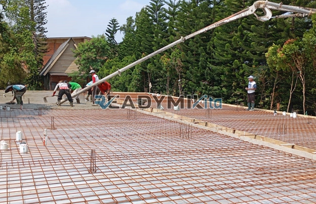

**Jasa Cor Readymix di Cipedak Jakarta Murah** - Hai Mitra Readymix Kita! Apakah Anda tengah merencanakan proyek konstruksi di Cipedak Jakarta? Mencari fondasi yang kokoh dan efisien? Nah, Anda telah menemukan solusi yang tepat! Kami hadir sebagai penyedia beton readymix terpercaya, siap mendukung kesuksesan proyek Anda. Jangan kompromi soal kualitas, karena fondasi yang kuat adalah kunci bangunan yang awet.



## Mengapa Memilih Beton Readymix? Keunggulannya Untuk Proyek Anda

Apa sebenarnya beton cor readymix itu? Sederhananya, ini adalah campuran beton yang diproduksi di pabrik modern dengan presisi tinggi, menggunakan bahan baku berkualitas premium. Kemudian, beton ini diantar langsung ke lokasi proyek Anda menggunakan truk mixer khusus. Yuk, kita lihat apa saja kelebihan menggunakan beton readymix dibandingkan metode tradisional:

1. **Hemat Waktu dan Tenaga:** Pengerjaan proyek jadi lebih cepat karena beton sudah siap pakai. Anda tidak perlu lagi repot mencampur di lokasi.
2. **Kualitas Terjamin:** Proses produksi yang terkontrol memastikan konsistensi mutu beton, meminimalkan risiko kegagalan konstruksi.
3. **Skala Produksi Fleksibel:**  Kebutuhan beton dalam jumlah besar? Atau proyek kecil? Kami bisa melayani keduanya dengan cepat dan efisien.
4. **Dukung Lingkungan:**  Proses produksi yang terkelola baik mengurangi limbah material di lokasi proyek, lebih ramah lingkungan lho!

## Apa yang Membuat ReadymixKita Unggul di Cipedak Jakarta?

Di antara banyaknya pilihan penyedia jasa pengecoran di Cipedak Jakarta, ReadymixKita menawarkan keunggulan yang membedakan kami:

1. **Pengalaman dan Kepercayaan:** Bertahun-tahun berkecimpung di industri konstruksi membuat kami memahami betul kebutuhan proyek Anda, mulai dari hunian pribadi hingga infrastruktur skala besar.
2. **Pilihan Mutu Beton yang Lengkap:** Kami menyediakan berbagai kelas mutu, seperti K-225 untuk kebutuhan standar dan K-500 untuk bangunan berat. Pemilihan mutu yang tepat akan memastikan kekuatan optimal.
3. **Peralatan Canggih:** Kami menggunakan teknologi terkini, termasuk *concrete pump*, untuk mempercepat dan meratakan proses pengecoran.
4. **Tim Profesional yang Siap Membantu:** Kami memiliki tim ahli yang siap mendampingi Anda dari perencanaan hingga penyelesaian proyek. Kami fleksibel dan adaptif terhadap jadwal Anda.

## Layanan Kami yang Dirancang Khusus untuk Cipedak Jakarta

Sebagai penyedia lokal, kami memahami betul tantangan konstruksi di Cipedak Jakarta. Kondisi medan yang beragam, mulai dari area perkotaan padat hingga daerah berbukit, membutuhkan solusi yang tepat. Berikut layanan khusus kami:

1. **Pengiriman Tepat Waktu:** Lokasi pabrik kami yang strategis di Cipedak Jakarta dan sekitarnya memastikan pengiriman beton sesuai jadwal yang Anda tentukan.
2. **Konsultasi Gratis:** Dapatkan saran ahli dari tim kami untuk memilih jenis beton dan metode pengecoran yang paling sesuai dengan proyek Anda.
3. **Penawaran Spesial untuk Proyek Lokal:** Pelanggan di Cipedak Jakarta berhak mendapatkan harga khusus dan diskon menarik untuk proyek skala besar.

## Harga Terjangkau dan Penawaran Menggiurkan di Cipedak Jakarta

Kami mengerti bahwa anggaran adalah pertimbangan penting. Itulah mengapa ReadymixKita berkomitmen untuk memberikan:

1. **Harga Bersaing:** Kami menawarkan harga yang kompetitif tanpa mengorbankan kualitas beton. Info harga yang transparan, termasuk biaya pengiriman dan penggunaan pompa beton, tersedia untuk Anda.
2. **Promo Menarik:** Nikmati diskon istimewa untuk pemesanan dalam jumlah besar atau proyek berjangka panjang.
3. **Jaminan Kepuasan:** Kami berkomitmen untuk memberikan hasil pengecoran yang sempurna. Jika ada masalah, tim kami siap membantu hingga tuntas.

## Daftar Harga Jasa Cor Readymix di Cipedak Jakarta



Jangan tunda lagi! Percayakan proyek Anda pada ahlinya. Hubungi kami sekarang untuk mendapatkan penawaran terbaik dan solusi pengecoran yang optimal di Cipedak Jakarta!

Selain itu, kami menyediakan layanan survei lokasi gratis dan konsultasi mendalam untuk memastikan semua kebutuhan Anda terpenuhi. Pesan sekarang dan rasakan perbedaan kualitas dan layanan dari ReadymixKita! [Jasa Cor Readymix di Bali Mester Jakarta Murah](/readymix/jasa-cor-readymix-di-bali-mester-jakarta-murah/) dapat menjadi referensi tambahan untuk layanan kami. 

Kami, ReadymixKita, berdedikasi untuk memberikan solusi konstruksi terbaik bagi setiap pelanggan. Dengan pengalaman, kualitas, dan pelayanan ramah, kami yakin dapat menjadi mitra yang tepat untuk mewujudkan proyek impian Anda. Segera hubungi kami dan buktikan sendiri keunggulan jasa pengecoran readymix di Cipedak Jakarta dari ReadymixKita. Mari bangun masa depan yang kokoh bersama!