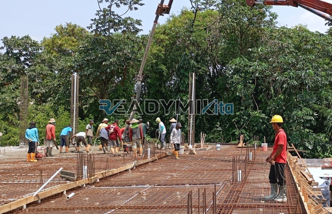

**Jasa Cor Readymix di Cipinang Besar Jakarta Murah** - Hai Mitra Readymix Kita! Sedang merencanakan proyek konstruksi di Cipinang Besar Jakarta? Apakah Anda mencari solusi pengecoran yang praktis, efisien, dan tentunya berkualitas? Nah, Anda sudah berada di tempat yang tepat! Kami dari Readymix Kita hadir sebagai solusi pengecoran readymix terpercaya, siap mendukung kesuksesan proyek Anda.



## Mengapa Memilih Pengecoran dengan Readymix?

Mungkin Anda bertanya-tanya, apa sebenarnya beton Cor Readymix itu? Sederhananya, ini adalah campuran beton siap pakai yang diproduksi secara presisi di pabrik dengan standar kualitas tinggi. Material ini kemudian diangkut langsung ke lokasi proyek Anda menggunakan truk mixer khusus. Dibandingkan metode konvensional, pengecoran dengan readymix menawarkan sejumlah keunggulan signifikan:

1. **Hemat Waktu dan Sumber Daya**

   Proses pencampuran beton di lokasi proyek seringkali memakan waktu dan tenaga yang besar. Dengan readymix, waktu pengerjaan bisa dipangkas drastis karena beton sudah siap pakai saat tiba di lokasi.

2. **Kualitas Terjamin Konsisten**

   Rumusan yang tepat dan penggunaan peralatan modern memastikan kualitas beton readymix selalu konsisten. Ini meminimalkan risiko kegagalan struktur akibat kesalahan pencampuran.

3. **Fleksibilitas Kapasitas Produksi**

   Readymix mampu memenuhi kebutuhan beton dalam jumlah besar dengan cepat, mulai dari proyek skala kecil hingga konstruksi berskala besar.

4. **Dukungan Ramah Lingkungan**

   Proses produksi readymix yang terkontrol mengurangi limbah material di lokasi proyek, sehingga lebih ramah lingkungan.

## Apa yang Membuat Kami Unggul di Cipinang Besar Jakarta?

Di antara banyaknya penyedia jasa pengecoran, **ReadymixKita** tampil beda dengan sejumlah keunggulan yang menjadikannya pilihan utama di Cipinang Besar Jakarta:

1. **Pengalaman dan Kepercayaan Pelanggan**

   Berbekal pengalaman bertahun-tahun di industri konstruksi, kami memahami seluk-beluk setiap proyek, mulai dari pembangunan rumah hingga infrastruktur skala besar.

2. **Pilihan Mutu Beton yang Lengkap**

   Kami menyediakan berbagai jenis mutu beton, mulai dari K-225 yang ideal untuk kebutuhan standar, hingga K-500 yang dirancang untuk konstruksi dengan beban berat. Kami selalu memastikan pilihan mutu beton sesuai dengan spesifikasi proyek Anda.

3. **Teknologi Pengecoran Modern**

   Kami memanfaatkan peralatan canggih seperti pompa beton (concrete pump) untuk mempercepat proses pengecoran dan memastikan distribusi beton yang merata.

4. **Tim Profesional yang Siap Membantu**

   Tim kami yang terdiri dari para profesional yang kompeten siap memberikan pendampingan mulai dari tahap perencanaan hingga implementasi di lapangan. Kami juga fleksibel menyesuaikan jadwal pekerjaan dengan kebutuhan Anda.

## Solusi Pengecoran yang Disesuaikan dengan Kondisi Cipinang Besar Jakarta

Sebagai penyedia jasa lokal, kami memahami betul karakteristik unik wilayah Cipinang Besar Jakarta. Kami juga menyadari bahwa area ini memiliki ragam kondisi medan, mulai dari area padat perkotaan hingga area dengan kontur tanah yang berbeda. **ReadymixKita** menawarkan solusi khusus untuk mengatasi tantangan ini:

1. **Pengiriman Tepat Waktu**

   Kami menjamin pengiriman beton readymix yang tepat waktu, berkat lokasi pabrik kami yang strategis di wilayah Cipinang Besar Jakarta dan sekitarnya.

2. **Konsultasi Proyek Gratis**

   Kami menawarkan layanan konsultasi gratis untuk membantu Anda menentukan jenis beton dan metode pengecoran yang paling sesuai dengan kebutuhan proyek Anda.

3. **Penawaran Spesial untuk Proyek Lokal**

   Khusus untuk klien di Cipinang Besar Jakarta, kami menghadirkan tarif spesial dan diskon menarik, terutama untuk proyek-proyek berskala besar.

## Harga Terjangkau dan Promo Menarik di Cipinang Besar Jakarta

Kami memahami bahwa efisiensi anggaran merupakan pertimbangan krusial dalam setiap proyek konstruksi. Oleh karena itu, **ReadymixKita** berkomitmen untuk memberikan:

1. **Harga Kompetitif**

   Kami menawarkan harga yang bersaing tanpa mengorbankan kualitas material dan layanan. Informasi lengkap mengenai harga, termasuk biaya pengiriman dan penggunaan concrete pump, dapat Anda peroleh secara transparan dari tim kami.

2. **Promo dan Diskon Spesial**

   Dapatkan diskon menarik untuk pemesanan dalam jumlah besar atau untuk proyek yang berlangsung dalam jangka waktu tertentu.

3. **Jaminan Kepuasan Pelanggan**

   Apabila Anda menemui kendala selama proses pengecoran, tim kami siap memberikan bantuan hingga proyek Anda terselesaikan dengan sempurna.

## Informasi Harga Jasa Cor Readymix di Cipinang Besar Jakarta



Jangan biarkan proyek Anda terhambat oleh kualitas material yang meragukan! Segera hubungi kami untuk mendapatkan solusi pengecoran terbaik di Cipinang Besar Jakarta.

Kami siap melakukan survei lokasi dan memberikan konsultasi gratis untuk memastikan kebutuhan Anda terpenuhi dengan optimal. Pesan sekarang dan rasakan manfaat dari konstruksi yang solid, tahan lama, dan memuaskan.

Di ReadymixKita, kami selalu berusaha memberikan layanan terbaik bagi setiap pelanggan. Dengan keahlian, kualitas, dan pelayanan yang ramah, kami yakin dapat menjadi mitra terpercaya dalam mewujudkan proyek impian Anda. Jangan ragu untuk menghubungi kami sekarang juga dan rasakan sendiri keunggulan jasa Pengecoran dengan Cor Readymix di Cipinang Besar Jakarta dari ReadymixKita. Bangun masa depan yang kokoh bersama kami! [Jasa Cor Readymix di Bali Mester Jakarta Murah](/readymix/jasa-cor-readymix-di-bali-mester-jakarta-murah/) — temukan juga layanan kami di area Jakarta lainnya!