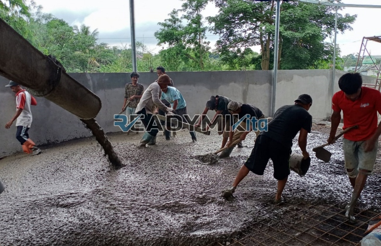

**Jasa Cor Readymix di Cipinang Muara Jakarta Murah** - Hai Mitra Readymix Kita! Sedang merencanakan pembangunan di Cipinang Muara Jakarta? Mencari solusi pengecoran yang praktis, cepat, dan terjamin kualitasnya? Nah, Anda sudah berada di tempat yang tepat! Kami dari Readymix Kita hadir sebagai penyedia jasa cor readymix terpercaya, siap mendukung kesuksesan proyek Anda.



## Mengapa Memilih Beton Readymix untuk Proyek Anda?

Pertimbangkan efisiensi dan kekuatan! Beton Cor Readymix adalah campuran beton siap pakai yang diproduksi secara presisi di pabrik modern, menggunakan bahan-bahan pilihan. Pengiriman langsung ke lokasi proyek dengan truk mixer memastikan kesegaran dan kemudahan aplikasi. Apa saja keunggulannya? Yuk, kita simak:

1. **Hemat Waktu & Biaya Tenaga**

   Lupakan proses mencampur manual yang memakan waktu dan tenaga. Dengan readymix, Anda langsung bisa fokus pada tahap pengecoran.

2. **Kualitas Terjamin & Konsisten**

   Proses produksi yang terkontrol ketat memastikan mutu beton seragam, mengurangi risiko kegagalan konstruksi.

3. **Fleksibilitas Kapasitas**

   Baik proyek kecil maupun skala besar, kami siap menyediakan volume beton sesuai kebutuhan Anda.

4. **Berkontribusi pada Lingkungan**

   Penggunaan readymix meminimalkan limbah material di lokasi proyek, mendukung praktik konstruksi berkelanjutan.

## Mengapa ReadymixKita di Cipinang Muara Jakarta?

Di antara banyaknya penyedia, **ReadymixKita** menonjol sebagai pilihan utama di Cipinang Muara Jakarta. Apa yang membedakan kami?

1. **Pengalaman Teruji & Reputasi Baik**

   Pengalaman bertahun-tahun di industri konstruksi menjadikan kami ahli dalam memenuhi beragam kebutuhan proyek, mulai dari perumahan hingga infrastruktur.

2. **Pilihan Mutu Beton yang Lengkap**

   Kami menyediakan berbagai grade beton, termasuk K-225 untuk konstruksi standar, K-300, K-350, hingga K-500 untuk proyek-proyek yang membutuhkan kekuatan ekstra.

3. **Didukung Teknologi Canggih**

   Penggunaan pompa beton (concrete pump) modern mempercepat proses pengecoran dan memastikan hasil yang lebih presisi dan rata.

4. **Tim Ahli yang Siap Membantu**

   Tim profesional kami siap memberikan dukungan teknis, mulai dari konsultasi perencanaan hingga pengawasan pelaksanaan di lapangan.

## Layanan Kami yang Disesuaikan untuk Cipinang Muara Jakarta

Kami memahami betul karakteristik wilayah Cipinang Muara Jakarta dan tantangan konstruksi yang mungkin dihadapi. Ini yang kami tawarkan:

1. **Pengiriman Tepat Waktu**

   Lokasi pabrik kami yang strategis memungkinkan kami menjamin pengiriman readymix tepat waktu ke seluruh area Cipinang Muara Jakarta.

2. **Konsultasi Ahli untuk Setiap Proyek**

   Kami menyediakan layanan konsultasi gratis untuk membantu Anda menentukan mutu beton dan metode pengecoran yang paling sesuai dengan kebutuhan proyek Anda.

3. **Penawaran Khusus untuk Proyek Lokal**

   Dapatkan harga spesial dan diskon menarik untuk proyek konstruksi di Cipinang Muara Jakarta.

## Harga Terjangkau & Penawaran Menarik di Cipinang Muara Jakarta

Kami percaya bahwa kualitas tidak harus mahal. **ReadymixKita** berkomitmen untuk memberikan:

1. **Harga Bersaing**

   Kami menawarkan harga yang kompetitif tanpa mengorbankan kualitas beton readymix maupun layanan yang kami berikan. Cek  untuk informasi lebih detail.

2. **Promo & Diskon Spesial**

   Nikmati penawaran menarik untuk pemesanan volume besar atau proyek jangka panjang.

3. **Kepuasan Pelanggan adalah Prioritas Kami**

   Kami memberikan garansi kepuasan untuk setiap layanan yang kami berikan. Jika ada kendala, tim kami siap membantu hingga tuntas.

## Spesifikasi & Mutu Beton Readymix yang Tersedia

Berikut adalah beberapa contoh mutu beton readymix yang kami sediakan:

*   **K-225:** Cocok untuk pondasi ringan, lantai kerja, dan area yang tidak membutuhkan kekuatan struktur tinggi.
*   **K-300:** Ideal untuk kolom, balok, dan bagian struktur utama yang membutuhkan kekuatan sedang.
*   **K-350:** Pilihan tepat untuk bangunan bertingkat, jalan, dan struktur yang membutuhkan kekuatan lebih tinggi.
*   **K-500:** Direkomendasikan untuk konstruksi berat seperti jembatan, gedung pencakar langit, dan area yang membutuhkan kekuatan maksimal.

## Aplikasi Beton Readymix: Luasnya Pilihan Penggunaan

Beton readymix dapat digunakan untuk berbagai aplikasi konstruksi, antara lain:

*   Pondasi bangunan
*   Kolom dan balok
*   Lantai dan trotoar
*   Jalan dan jembatan
*   Tembok penahan
*   Area parkir
*   Dan masih banyak lagi!

Yuk, segera hubungi kami untuk mendapatkan konsultasi gratis dan penawaran harga terbaik untuk proyek Anda di Cipinang Muara Jakarta! Jangan tunda lagi, berikan yang terbaik untuk bangunan Anda dengan Readymix Kita!

Kami berkomitmen memberikan pelayanan terbaik dan kualitas unggul. Bersama **ReadymixKita**, Anda dapat membangun fondasi yang kuat dan masa depan yang lebih baik. Segera hubungi kami untuk mewujudkan proyek impian Anda! [Jasa Cor Readymix di Babakan Bogor Murah](/readymix/jasa-cor-readymix-di-babakan-bogor-murah/) — temukan solusi serupa untuk proyek di area tetangga. [Jasa Cor Readymix di Balaraja Tangerang Murah](/readymix/jasa-cor-readymix-di-balaraja-tangerang-murah/) — lihat bagaimana kami mendukung proyek di wilayah lain.