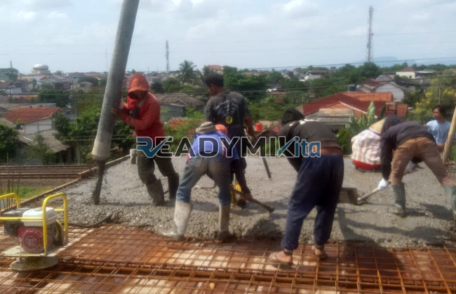

**Jasa Cor Readymix di Cipulir Jakarta Murah** - Hai Mitra Readymix Kita! Proyek konstruksi di Cipulir Jakarta sedang berjalan? Nah, Anda berada di tempat yang tepat! Kami hadir sebagai solusi pengecoran readymix terpercaya, memberikan kualitas terbaik dan layanan yang prima untuk memastikan kesuksesan proyek Anda. Kualitas adalah kunci, dan kami memahaminya.



## Mengapa Memilih Pengecoran dengan Readymix?

Apa itu beton readymix dan mengapa begitu populer di kalangan profesional konstruksi? Singkatnya, beton readymix adalah campuran beton yang dibuat di pabrik dengan kontrol kualitas ketat, lalu dikirim langsung ke lokasi proyek Anda. Proses ini menawarkan banyak keuntungan dibandingkan metode tradisional. Mari kita lihat lebih detail:

1. **Hemat Waktu & Tenaga**

   Lupakan proses mencampur manual yang memakan waktu dan tenaga! Dengan readymix, Anda dapat langsung fokus pada tahapan konstruksi lainnya. Beton sudah siap pakai begitu tiba di lokasi.

2. **Kualitas Terjamin Konsisten**

   Formulasi yang presisi dan pengawasan mutu yang ketat memastikan bahwa setiap batch beton readymix memiliki kualitas yang seragam. Ini meminimalkan risiko kegagalan struktur akibat material yang tidak sesuai.

3. **Fleksibilitas Volume**

   Mau proyek kecil atau besar? Readymix bisa menyesuaikan dengan kebutuhan Anda. Kami mampu menyediakan volume beton sesuai pesanan, tanpa sisa atau kekurangan material.

4. **Berkontribusi pada Lingkungan**

   Proses manufaktur yang terkontrol menghasilkan lebih sedikit limbah dibandingkan pencampuran manual di lokasi. Ini adalah pilihan yang lebih ramah lingkungan.

## Apa yang Membuat ReadymixKita Unggul di Cipulir Jakarta?

Banyak penyedia jasa readymix di luar sana, tetapi **ReadymixKita** menawarkan lebih dari sekadar beton berkualitas tinggi. Kami mengerti seluk-beluk konstruksi di Cipulir Jakarta dan berkomitmen untuk memberikan layanan terbaik bagi setiap mitra:

1. **Pengalaman & Kepercayaan**

   Bertahun-tahun berkecimpung di industri konstruksi menjadikan kami ahli dalam memenuhi berbagai kebutuhan pembangunan. Kami telah menyelesaikan banyak proyek di Cipulir Jakarta dan sekitarnya.

2. **Pilihan Mutu Beton yang Lengkap**

   Kami menyediakan berbagai kelas mutu beton, mulai dari K-225 hingga K-500, disesuaikan dengan spesifikasi proyek Anda.  Pilihannya mencakup beton untuk fondasi, kolom, balok, hingga lantai.

3. **Teknologi Canggih & Peralatan Modern**

   Kami dilengkapi dengan concrete pump yang canggih untuk memastikan pengecoran cepat, merata, dan efisien, bahkan di lokasi yang sulit dijangkau.

4. **Tim Profesional yang Siap Membantu**

   Dari konsultasi awal hingga pengawasan di lokasi, tim kami siap memberikan panduan dan dukungan teknis yang Anda butuhkan. Kami berkomitmen untuk kelancaran proyek Anda.

## Layanan Khusus Kami untuk Wilayah Cipulir Jakarta

Kami bukan hanya supplier beton, kami adalah mitra konstruksi yang memahami tantangan lokal. **ReadymixKita** memberikan layanan khusus untuk proyek di Cipulir Jakarta:

1. **Pengiriman Tepat Waktu**

   Kami tahu betapa pentingnya ketepatan waktu dalam konstruksi. Pengiriman beton readymix kami cepat dan terpercaya, memastikan proyek Anda berjalan sesuai jadwal.

2. **Konsultasi Teknis Gratis**

   Bingung memilih jenis beton yang tepat? Tim ahli kami siap memberikan konsultasi gratis untuk membantu Anda menentukan solusi terbaik untuk proyek Anda.

3. **Penawaran Khusus untuk Pelanggan Lokal**

   Sebagai penyedia jasa lokal di Cipulir Jakarta, kami menawarkan harga khusus dan penawaran menarik untuk proyek-proyek di wilayah ini.

## Harga Terjangkau & Promo Menarik di Cipulir Jakarta

Kami percaya bahwa kualitas tidak harus mahal. **ReadymixKita** berkomitmen untuk memberikan harga yang kompetitif tanpa mengorbankan mutu beton kami.

1. **Harga Transparan & Bersaing**

   Kami memberikan penawaran harga yang jelas dan terperinci, meliputi biaya beton, pengiriman, dan layanan tambahan seperti sewa concrete pump.

2. **Promo Diskon Spesial**

   Nikmati diskon menarik untuk pemesanan dalam jumlah besar atau proyek jangka panjang. Kami sering menawarkan promo spesial di wilayah Cipulir Jakarta!

3. **Jaminan Kepuasan Pelanggan**

   Kepuasan Anda adalah prioritas utama kami. Kami memberikan garansi kepuasan untuk semua layanan kami. Jika Anda tidak puas dengan produk atau layanan kami, kami siap membantu Anda.

## Informasi Harga Jasa Cor Readymix di Cipulir Jakarta



Jangan tunda lagi! Dapatkan beton readymix berkualitas dan layanan pengecoran profesional dari **ReadymixKita** di Cipulir Jakarta. Hubungi kami sekarang juga untuk mendapatkan penawaran terbaik dan konsultasi gratis!

Kami siap mendukung proyek Anda, dari perencanaan hingga penyelesaian. Bersama ReadymixKita, Anda akan mendapatkan solusi pengecoran yang handal, efisien, dan terjangkau. Proyek Anda sukses, kepuasan Anda prioritas kami! [Jasa Cor Readymix di Bale Kambang Jakarta Murah](/readymix/jasa-cor-readymix-di-bale-kambang-jakarta-murah/) dapat menjadi alternatif penjajakan informasi terkait produk serupa.