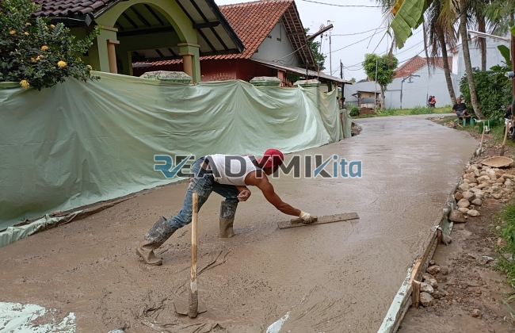

**Jasa Cor Readymix di Ciputat Tangerang Murah** - Hai Mitra Readymix Kita! Ingin membangun atau mengembangkan proyek di Ciputat Tangerang? Mencari solusi pengecoran yang cepat, praktis, dan terpercaya? Kami siap menjadi mitra Anda! **ReadymixKita** hadir sebagai penyedia jasa cor readymix berkualitas, melayani kebutuhan konstruksi di Ciputat Tangerang dan sekitarnya. Dengan layanan kami, Anda bisa fokus pada desain dan perencanaan, sementara kami urus kualitas pengecorannya.



## Mengapa Memilih Pengecoran dengan Readymix?

Pernahkah Anda bertanya-tanya, apa sih keunggulan beton *ready mix* dibandingkan cara tradisional? Nah, beton Cor Readymix adalah solusi modern yang diproduksi di pabrik dengan presisi tinggi, menggunakan material terbaik. Kemudian, dikirim langsung ke lokasi proyek Anda menggunakan truk mixer. Apa saja kelebihannya? Yuk, kita bahas:

1. **Waktu Pengerjaan Lebih Efisien**

   Proses pencampuran beton di lokasi bisa memakan banyak waktu dan tenaga. Dengan readymix, Anda hemat waktu karena beton sudah siap pakai saat tiba di lokasi.

2. **Kualitas Konsisten dan Terjamin**

   Formulasi campuran beton readymix dirancang dengan takaran yang akurat dan teknologi modern, menjamin kualitas yang seragam dan meminimalkan risiko kegagalan konstruksi.

3. **Fleksibilitas Volume Produksi**

   Baik untuk proyek kecil maupun besar, beton Cor Readymix dapat diproduksi sesuai kebutuhan volume yang Anda tentukan secara fleksibel.

4. **Kontribusi untuk Lingkungan yang Lebih Baik**

   Proses produksi yang terkontrol di pabrik readymix mengurangi potensi limbah material di lapangan, mendukung praktik konstruksi yang lebih ramah lingkungan.

## Apa yang Membuat ReadymixKita Unggul di Ciputat Tangerang?

Di tengah banyak pilihan penyedia jasa pengecoran di Ciputat Tangerang, **ReadymixKita** menonjol dengan beberapa keunggulan:

1. **Pengalaman dan Kepercayaan Pelanggan**

   Dengan pengalaman bertahun-tahun di industri ini, kami telah memahami seluk-beluk konstruksi dan kebutuhan beragam proyek, mulai dari hunian pribadi hingga proyek komersial skala besar.

2. **Pilihan Mutu Beton yang Lengkap**

   Kami menawarkan berbagai pilihan kelas mutu beton yang sesuai dengan kebutuhan spesifik proyek Anda, mulai dari K-225 untuk aplikasi standar hingga K-500 untuk konstruksi yang membutuhkan kekuatan ekstra.

3. **Teknologi Pengecoran Terdepan**

   Kami menggunakan peralatan modern seperti pompa beton (concrete pump) untuk memastikan pengecoran dilakukan dengan cepat, efisien, dan menghasilkan permukaan yang rata dan presisi.

4. **Tim Ahli yang Siap Membantu**

   Tim profesional kami siap memberikan pendampingan dari tahap perencanaan hingga pelaksanaan di lapangan, memastikan proyek berjalan sesuai harapan Anda. Kami fleksibel dan dapat menyesuaikan layanan dengan jadwal proyek Anda.

## Layanan Kami yang Ditujukan Khusus untuk Ciputat Tangerang

Sebagai penyedia jasa lokal, kami memahami betul karakteristik wilayah Ciputat Tangerang. Kondisi medan yang bervariasi – dari area padat perkotaan hingga perbukitan – memerlukan pendekatan khusus. Itulah mengapa kami menawarkan:

1. **Pengiriman Tepat Waktu**

   Kami menjamin pengiriman beton yang tepat waktu, memanfaatkan lokasi pabrik kami yang strategis di Ciputat Tangerang dan jaringan logistik yang efisien.

2. **Konsultasi Gratis untuk Proyek Anda**

   Dapatkan konsultasi gratis dari tim ahli kami untuk membantu Anda memilih jenis beton yang paling sesuai dengan kebutuhan proyek Anda.

3. **Penawaran Spesial untuk Pelanggan Lokal**

   Khusus untuk proyek-proyek yang berlokasi di Ciputat Tangerang, kami menawarkan harga spesial dan diskon menarik.

## Harga Bersaing dan Promo Menarik di Ciputat Tangerang

Kami memahami bahwa anggaran adalah pertimbangan penting dalam setiap proyek konstruksi. Karena itu, **ReadymixKita** berkomitmen untuk memberikan:

1. **Harga yang Kompetitif**

   Kami menawarkan harga yang terjangkau tanpa mengorbankan kualitas. Informasi harga yang transparan termasuk biaya pengiriman dan penggunaan alat tambahan seperti concrete pump.

2. **Penawaran Promo Terupdate**

   Nikmati berbagai promo menarik, seperti diskon untuk pemesanan volume besar atau proyek jangka panjang.

3. **Jaminan Kepuasan Pelanggan**

   Kami berkomitmen untuk memberikan layanan terbaik. Jika ada kendala saat pengecoran, tim kami siap membantu sampai proyek Anda selesai dengan memuaskan.

## Informasi Harga Jasa Cor Readymix di Ciputat Tangerang



Jangan tunda lagi! Pastikan proyek Anda dibangun dengan fondasi yang kuat dan tahan lama. Hubungi **ReadymixKita** sekarang juga untuk mendapatkan solusi pengecoran terbaik di Ciputat Tangerang!

Kami juga menyediakan layanan survei lokasi gratis dan konsultasi proyek. Segera pesan dan rasakan kemudahan serta kualitas layanan kami. Dengan ReadymixKita, proyek Anda jadi lebih lancar dan hasilnya memuaskan!