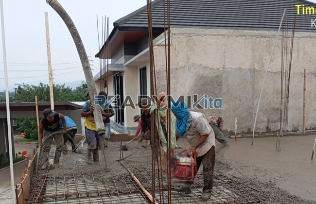

**Jasa Cor Readymix di Cisaat Sukabumi Murah** - Hai Mitra Readymix Kita! Ada rencana pembangunan di Cisaat Sukabumi? Mencari solusi beton cor yang cepat, praktis, dan kualitasnya terjamin? Nah, Anda sudah berada di tempat yang tepat! Kami dari Readymix Kita hadir sebagai penyedia jasa cor readymix terpercaya di Cisaat Sukabumi, siap mendukung kelancaran proyek Anda.



## Beton Readymix: Solusi Modern untuk Konstruksi Anda

Pertanyaan mendasar, apakah sebenarnya beton Cor Readymix itu? Sederhananya, beton Cor Readymix adalah campuran beton siap pakai yang diproduksi secara akurat di pabrik kami, menggunakan bahan-bahan berkualitas tinggi. Proses ini memastikan konsistensi dan kekuatan yang optimal. Kemudian, beton ini langsung diangkut ke lokasi proyek Anda menggunakan truk mixer khusus. Apa saja keunggulan yang ditawarkan beton cor readymix dibandingkan metode tradisional? Simak selengkapnya:

1. **Efisiensi Waktu dan Tenaga Kerja**

   Membuat campuran beton secara manual di lokasi proyek pasti memakan waktu dan tenaga. Dengan readymix, waktu pengerjaan proyek Anda jadi lebih singkat karena beton sudah siap pakai sejak tiba di lokasi.

2. **Kualitas yang Terjamin Konsisten**

   Proses pencampuran beton readymix dilakukan dengan presisi tinggi menggunakan teknologi modern. Hasilnya? Beton yang berkualitas konsisten, meminimalkan potensi masalah struktural akibat kesalahan takaran.

3. **Kapasitas Produksi Fleksibel**

   Baik untuk proyek kecil maupun berskala besar, beton Cor Readymix bisa memenuhi kebutuhan volume beton Anda dengan cepat dan efisien.

4. **Dampak Lingkungan yang Lebih Rendah**

   Karena produksi dilakukan di pabrik yang terkontrol, limbah material di lokasi konstruksi dapat diminimalkan secara signifikan, menjadikannya pilihan yang lebih ramah lingkungan.

## Mengapa ReadymixKita adalah Pilihan Terbaik di Cisaat Sukabumi?

Di tengah banyaknya penyedia jasa pengecoran, apa yang membuat **ReadymixKita** unggul di Cisaat Sukabumi? Kami menawarkan lebih dari sekadar beton; kami menawarkan solusi lengkap untuk kemudahan dan kualitas konstruksi Anda:

1. **Pengalaman dan Reputasi Terpercaya**

   Berbekal pengalaman bertahun-tahun di industri konstruksi, kami memahami seluk-beluk setiap proyek, mulai dari pembangunan rumah, gedung komersial, hingga infrastruktur skala besar.

2. **Pilihan Mutu Beton yang Lengkap**

   Kami menyediakan berbagai kelas mutu beton, mulai dari K-225 yang ideal untuk pekerjaan standar, hingga K-500 untuk konstruksi dengan tuntutan kekuatan tinggi. Dipastikan sesuai dengan kebutuhan proyek Anda.

3. **Teknologi Pengecoran Modern**

   Kami menggunakan peralatan canggih seperti *concrete pump* (pompa beton) untuk memastikan proses pengecoran berlangsung cepat, merata, dan efisien.

4. **Tim Ahli yang Profesional dan Responsif**

   Tim kami siap memberikan pendampingan ahli mulai dari perencanaan hingga eksekusi di lapangan. Kami juga fleksibel dalam menyesuaikan jadwal pengecoran dengan kebutuhan proyek Anda.

## Solusi Pengecoran yang Tepat untuk Kondisi Cisaat Sukabumi

Sebagai penyedia jasa lokal, kami memahami tantangan konstruksi di Cisaat Sukabumi. Kondisi geografis yang beragam, mulai dari kawasan perkotaan hingga area perbukitan, menuntut solusi pengecoran yang tepat. **ReadymixKita** hadir dengan layanan yang dirancang khusus:

1. **Pengiriman Tepat Waktu**

   Kami menjamin pengiriman beton tepat waktu ke lokasi proyek Anda di Cisaat Sukabumi dan sekitarnya. Lokasi pabrik kami yang strategis mendukung kelancaran pengiriman.

2. **Konsultasi Teknis Gratis**

   Kami menyediakan layanan konsultasi gratis untuk membantu Anda menentukan jenis beton dan metode pengecoran yang paling sesuai dengan kebutuhan proyek Anda.

3. **Penawaran Spesial untuk Proyek Lokal**

   Klien di wilayah Cisaat Sukabumi berhak mendapatkan harga spesial dan diskon menarik, terutama untuk proyek-proyek berkelanjutan.

## Harga Kompetitif dan Penawaran Menarik di Cisaat Sukabumi

Memahami anggaran proyek adalah prioritas kami. **ReadymixKita** berkomitmen untuk memberikan solusi berkualitas dengan harga yang terjangkau:

1. **Harga yang Bersaing**

   Kami menawarkan harga yang kompetitif tanpa mengorbankan kualitas beton. Transparansi adalah kunci; kami akan memberikan rincian harga yang jelas, termasuk biaya pengiriman dan penggunaan concrete pump.

2. **Promo dan Diskon Spesial**

   Dapatkan diskon menarik untuk pemesanan dalam jumlah besar atau proyek yang berjalan dalam jangka waktu tertentu.

3. **Kepuasan Pelanggan Terjamin**

   Kami berkomitmen untuk memberikan layanan terbaik. Jika terjadi kendala dalam proses pengecoran, tim kami siap memberikan solusi hingga proyek Anda selesai dengan memuaskan.

## Informasi Harga Jasa Cor Readymix di Cisaat Sukabumi



Jangan biarkan keterlambatan material menghambat proyek Anda! Segera hubungi kami untuk mendapatkan solusi pengecoran terbaik di Cisaat Sukabumi.

Kami juga menawarkan layanan survei lokasi gratis dan konsultasi teknis untuk memastikan kebutuhan Anda terpenuhi secara optimal. Pesan sekarang dan nikmati hasil konstruksi yang kuat, tahan lama, dan memuaskan.

Di ReadymixKita, kepuasan Anda adalah prioritas utama kami. Dengan pengalaman, kualitas, dan layanan profesional, kami yakin dapat menjadi mitra yang andal untuk mewujudkan proyek impian Anda. Jangan ragu untuk menghubungi kami dan rasakan keunggulan jasa Pengecoran dengan Cor Readymix di Cisaat Sukabumi dari ReadymixKita. Wujudkan masa depan Anda dengan fondasi yang kokoh bersama kami! [Jasa Cor Readymix di Babakan Bogor Murah](/readymix/jasa-cor-readymix-di-babakan-bogor-murah/) dapat menjadi solusi bagi Anda yang juga mencari material berkualitas.