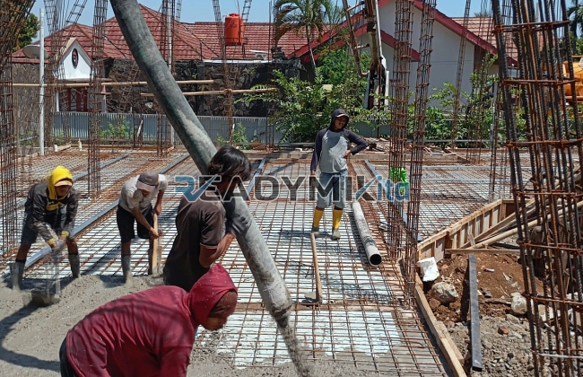

**Jasa Cor Readymix di Cisalak Pasar Depok Murah** - Hai Mitra Readymix Kita! Ada proyek konstruksi di Cisalak Pasar Depok yang butuh fondasi kuat dan pengerjaan cepat? Nah, Anda sudah berada di tempat yang tepat! Kami dari Readymix Kita siap membantu kelancaran proyek Anda dengan menyediakan layanan cor readymix berkualitas tinggi dan terjangkau. Pengecoran jadi lebih mudah, efisien, dan hasilnya pun lebih maksimal.



## Mengapa Memilih Beton Readymix untuk Proyek Anda?

Pernahkah Anda membayangkan proses pengecoran tanpa repot mencampur material di lokasi? Itulah kelebihan utama beton readymix! Singkatnya, beton readymix adalah campuran beton yang diproduksi di pabrik dengan formula tepat, lalu dikirim langsung ke lokasi proyek Anda dalam keadaan siap pakai. Nah, apa saja keunggulannya?

1. **Hemat Waktu dan Biaya**

   Lupakan proses pencampuran manual yang memakan waktu! Dengan readymix, Anda bisa langsung fokus pada tahap pembangunan lainnya. Ini berarti penghematan biaya tenaga kerja yang signifikan.

2. **Kualitas Terjamin Konsisten**

   Di pabrik, setiap batch beton readymix diuji secara ketat untuk memastikan kualitasnya sesuai standar. Konsistensi mutu ini krusial untuk kekuatan dan durabilitas bangunan Anda.

3. **Skalabilitas yang Fleksibel**

   Butuh volume beton yang besar? Atau hanya sedikit? Readymix bisa disesuaikan dengan kebutuhan proyek, baik skala kecil maupun besar.

4. **Minimalkan Limbah Material**

   Proses produksi readymix lebih terkontrol, sehingga meminimalkan limbah material di lokasi proyek. Ini lebih ramah lingkungan dan mengurangi biaya pembuangan sampah.

## Apa yang Membuat Readymix Kita Unggul di Cisalak Pasar Depok?

Di antara banyaknya penyedia jasa readymix, kenapa harus memilih Readymix Kita di area Cisalak Pasar Depok? Ini dia jawabannya:

1. **Pengalaman dan Kepercayaan yang Teruji**

   Kami sudah berpengalaman melayani berbagai proyek konstruksi, dari perumahan pribadi hingga proyek komersial berskala besar di Depok dan sekitarnya. Kepercayaan pelanggan adalah prioritas kami.

2. **Pilihan Mutu Beton yang Lengkap**

   Kami menyediakan berbagai kelas mutu beton, termasuk K-225, K-300, K-350, hingga K-500. Sesuaikan pilihan dengan kebutuhan proyek Anda agar hasilnya optimal.

3. **Didukung Peralatan Pengecoran Modern**

   Kami memiliki armada truk mixer dan pompa beton (concrete pump) yang terawat dengan baik. Ini memastikan pengiriman dan pengecoran beton dilakukan dengan cepat, tepat, dan merata.

4. **Tim Ahli yang Siap Membantu**

   Tim kami terdiri dari tenaga ahli yang berpengalaman dalam bidang konstruksi. Kami siap memberikan konsultasi, membantu perencanaan, dan memastikan seluruh proses pengecoran berjalan lancar.

## Layanan Kami yang Dirancang Khusus untuk Cisalak Pasar Depok

Kami memahami betul karakteristik wilayah Cisalak Pasar Depok, mulai dari kondisi jalan hingga aksesibilitas lokasi proyek. Itulah mengapa kami menawarkan layanan yang disesuaikan:

1. **Pengiriman Tepat Waktu ke Seluruh Cisalak Pasar Depok**

   Dengan jaringan logistik yang baik, kami menjamin pengiriman beton readymix tepat waktu ke lokasi proyek Anda di Cisalak Pasar Depok dan area sekitarnya.

2. **Konsultasi Gratis dan Solusi Terbaik**

   Bingung memilih jenis beton yang tepat? Jangan khawatir! Tim kami akan memberikan konsultasi gratis untuk membantu Anda menentukan solusi terbaik sesuai kebutuhan proyek.

3. **Penawaran Spesial untuk Pelanggan Lokal**

   Sebagai penyedia jasa lokal, kami memberikan penawaran khusus dan diskon menarik untuk pelanggan di wilayah Cisalak Pasar Depok.

## Harga Bersaing dan Promo Menarik di Cisalak Pasar Depok

Kami percaya bahwa kualitas terbaik tidak harus mahal. Readymix Kita menawarkan:

1. **Harga yang Kompetitif**

   Kami berkomitmen untuk memberikan harga yang bersaing tanpa mengorbankan kualitas beton readymix yang kami sediakan. Detail mengenai harga bisa Anda lihat di [tabel harga](#).

2. **Promo dan Diskon Spesial**

   Nikmati berbagai promo dan diskon menarik untuk pemesanan dalam jumlah besar atau proyek jangka panjang.

3. **Jaminan Kepuasan Pelanggan**

   Kepuasan Anda adalah prioritas utama kami. Jika ada masalah dalam proses pengecoran, kami akan segera menyelesaikannya sampai tuntas.

## Tabel Harga Jasa Cor Readymix di Cisalak Pasar Depok



Jangan biarkan proyek Anda terhambat karena masalah beton! Percayakan pengecoran Anda kepada ahlinya – Readymix Kita di Cisalak Pasar Depok. Hubungi kami sekarang untuk mendapatkan penawaran terbaik dan layanan yang memuaskan. Tim kami siap membantu Anda!

Kami juga menyediakan layanan survei lokasi gratis untuk memastikan kebutuhan beton Anda terpenuhi dengan akurat. Jadi, tunggu apa lagi? Pesan readymix sekarang dan wujudkan proyek impian Anda dengan fondasi yang kokoh dan berkualitas dari Readymix Kita. [Jasa Cor Readymix di Abadijaya Depok Murah](/readymix/jasa-cor-readymix-di-abadijaya-depok-murah/) — temukan solusi beton terbaik untuk proyek Anda di Depok!