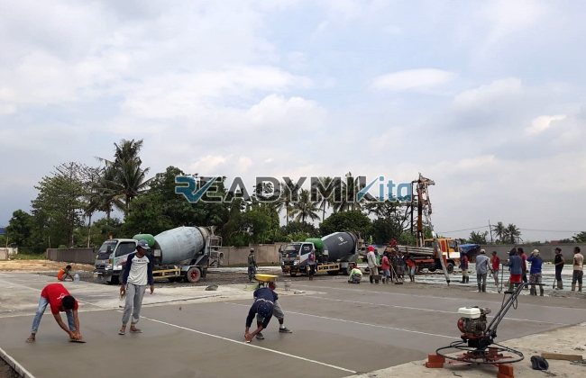

**Jasa Cor Readymix di Crane Dilindungi Sukabumi Murah** - Hai Mitra Readymix Kita! Punya proyek konstruksi di area Crane Dilindungi Sukabumi? Mungkin Anda sedang mencari cara untuk mempercepat pengerjaan, menurunkan biaya, atau memastikan kualitas beton yang prima? Nah, Anda sudah berada di tempat yang tepat! Kami dari Readymix Kita hadir sebagai solusi pengecoran beton readymix yang andal dan terpercaya di Crane Dilindungi Sukabumi dan sekitarnya. Gimana, yuk kita bahas lebih lanjut?



## Kenapa Memilih Beton Readymix untuk Proyek Anda?

Pernahkah Anda membayangkan proses pengecoran yang lebih efisien dan praktis? Beton Cor Readymix adalah jawabannya! Singkatnya, beton readymix adalah campuran beton siap pakai yang diproduksi di pabrik modern dengan standar kualitas ketat. Kemudian, beton ini diantarkan langsung ke lokasi proyek menggunakan truk mixer khusus. Apa saja kelebihannya dibandingkan cara tradisional? Simak yuk:

1. **Hemat Waktu dan Tenaga Kerja**

   Proses pencampuran di lokasi seringkali memakan waktu dan membutuhkan banyak tenaga. Dengan readymix, Anda bisa langsung fokus pada tahapan konstruksi lainnya karena beton sudah siap pakai.

2. **Kualitas Terjamin Konsisten**

   Formula beton readymix dirancang dengan presisi tinggi dan diproduksi menggunakan mesin modern. Hal ini menjamin konsistensi kualitas, mengurangi risiko kegagalan struktur akibat kesalahan takaran.

3. **Skalabilitas Produksi**

   Kebutuhan beton bisa bervariasi, apalagi untuk proyek besar. Beton readymix mampu memenuhi permintaan dalam jumlah besar dengan cepat dan efisien.

4. **Dukungan Ramah Lingkungan**

   Produksi readymix yang terkontrol meminimalkan limbah material, sehingga lebih ramah lingkungan dibandingkan metode manual.

## Apa yang Membuat ReadymixKita Unggul di Crane Dilindungi Sukabumi?

Di antara banyaknya penyedia jasa, kenapa harus memilih **ReadymixKita** untuk proyek Anda di Crane Dilindungi Sukabumi? Nah, ini dia beberapa alasan yang bisa jadi pertimbangan:

1. **Pengalaman dan Reputasi Terpercaya**

   Berbekal pengalaman bertahun-tahun di industri konstruksi, kami memahami betul seluk-beluk kebutuhan proyek, baik skala kecil maupun besar.

2. **Pilihan Mutu Beton yang Komprehensif**

   Kami menyediakan beragam kelas mutu beton, mulai dari K-225 hingga K-500, yang dapat disesuaikan dengan spesifikasi proyek Anda. Setiap mutu dijamin kualitasnya.

3. **Teknologi Pengecoran Modern**

   Kami menggunakan pompa beton (concrete pump) dan peralatan mutakhir lainnya untuk memastikan pengecoran berjalan lancar, cepat, dan merata.

4. **Tim Ahli yang Siap Membantu**

   Tim kami terdiri dari para profesional berpengalaman yang siap memberikan dukungan, mulai dari konsultasi perencanaan hingga implementasi di lapangan. Kami mengutamakan kepuasan Anda.

## Layanan Kami yang Terfokus di Area Crane Dilindungi Sukabumi

Sebagai penyedia jasa lokal, kami memahami betul karakteristik wilayah Crane Dilindungi Sukabumi. Kondisi geografis dan aksesibilitas menjadi perhatian utama kami. Itulah sebabnya, **ReadymixKita** menawarkan layanan yang disesuaikan dengan kebutuhan spesifik di daerah ini:

1. **Pengiriman Tepat Waktu**

   Kami menjamin pengiriman beton readymix yang tepat waktu, mengingat lokasi pabrik kami yang strategis dan jaringan distribusi yang efisien di Crane Dilindungi Sukabumi serta area sekitarnya.

2. **Konsultasi Ahli Gratis**

   Kami menyediakan layanan konsultasi gratis untuk membantu Anda memilih jenis beton dan metode pengecoran yang paling sesuai dengan kebutuhan proyek Anda.

3. **Penawaran Spesial untuk Proyek Lokal**

   Klien di wilayah Crane Dilindungi Sukabumi berhak mendapatkan penawaran khusus dan diskon menarik untuk proyek-proyek besar.

## Investasi Cerdas: Harga Terjangkau dengan Kualitas Tak Tertandingi

Kami percaya bahwa kualitas tidak harus mahal. **ReadymixKita** berkomitmen untuk memberikan solusi pengecoran beton readymix dengan harga yang kompetitif di Crane Dilindungi Sukabumi:

1. **Harga yang Bersaing**

   Kami menawarkan harga yang terjangkau tanpa mengorbankan kualitas bahan baku maupun proses produksi.

2. **Promo Menarik**

   Dapatkan berbagai promo menarik, seperti diskon untuk pemesanan volume besar atau proyek jangka panjang.

3. **Jaminan Kepuasan Pelanggan**

   Kami memberikan jaminan kepuasan pelanggan. Jika ada kendala dalam proses pengecoran, tim kami siap membantu hingga proyek Anda selesai dengan sempurna.

## Informasi Harga Jasa Cor Readymix di Crane Dilindungi Sukabumi



Jangan tunda lagi! Segera hubungi kami untuk mendapatkan penawaran harga terbaik dan solusi pengecoran beton readymix yang paling sesuai dengan kebutuhan proyek Anda di Crane Dilindungi Sukabumi.

Kami siap membantu Anda mewujudkan proyek konstruksi yang kokoh, tahan lama, dan berkualitas tinggi. Percayakan pengecoran beton Anda pada ahlinya. Pesan sekarang juga dan rasakan perbedaannya!

Ingat, memilih **ReadymixKita** berarti memilih efisiensi, kualitas, dan pelayanan profesional yang tak tertandingi. Bersama kami, setiap proyek Anda di Crane Dilindungi Sukabumi akan menjadi sukses! [Jasa Cor Readymix di Abadijaya Depok Murah](/readymix/jasa-cor-readymix-di-abadijaya-depok-murah/)