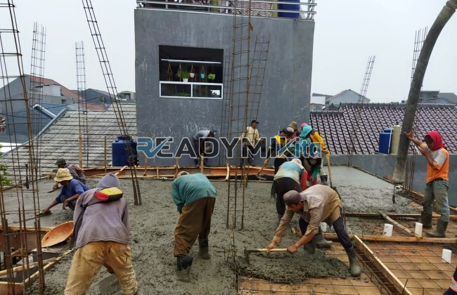

**Jasa Cor Readymix di Curug Bogor Murah** - Hai Mitra Readymix Kita! Mencari fondasi kokoh untuk proyek Anda di Curug Bogor? Kami hadir sebagai solusi unggulan! ReadymixKita adalah penyedia jasa cor readymix terpercaya yang siap mendukung kesuksesan konstruksi Anda, mulai dari proyek kecil hingga berskala besar. Gimana kalau kita mulai dengan membahas keuntungan menggunakan readymix untuk proyek Anda?



## Mengapa Memilih Layanan Pengecoran Readymix?

Beton cor readymix, atau sering disebut beton siap pakai, adalah campuran beton yang diproduksi secara akurat di pabrik dengan pengawasan kualitas ketat. Setelah jadi, material ini langsung dikirim ke lokasi proyek menggunakan truk mixer. Nah, apa sih yang bikin readymix jadi pilihan cerdas?

1. **Hemat Waktu & Biaya Operasional**

   Proses pencampuran di lokasi proyek cukup memakan waktu dan tenaga. Dengan readymix, Anda bisa langsung fokus pada tahapan konstruksi lain – efisien banget, kan?

2. **Kualitas Terjamin Konsisten**

   Readymix dibuat dengan takaran presisi dan pengujian kualitas menyeluruh. Artinya, Anda mendapatkan beton dengan mutu yang stabil dan mengurangi potensi risiko kegagalan struktur.

3. **Fleksibilitas Volume Produksi**

   Mau proyek kecil atau besar? Readymix siap mengakomodasi kebutuhan Anda. Kapasitas produksi kami cukup besar untuk memastikan suplai lancar setiap saat.

4. **Dampak Lingkungan yang Lebih Rendah**

   Proses produksi yang terkontrol meminimalkan limbah beton dan penggunaan sumber daya, menjadikan readymix pilihan yang lebih ramah lingkungan.

## Apa yang Membuat ReadymixKita Unggul di Curug Bogor?

Di antara banyaknya penyedia jasa, **ReadymixKita** hadir dengan segudang keunggulan khusus untuk Anda di Curug Bogor. Kami bukan sekadar supplier, tapi partner konstruksi yang andal.

1. **Pengalaman Bertahun-tahun**

   Dedikasi kami di industri konstruksi memberikan pemahaman mendalam tentang berbagai kebutuhan proyek. Baik itu pembangunan rumah tinggal, gedung komersial, atau infrastruktur penting, kami siap melayani.

2. **Pilihan Mutu Beton yang Lengkap**

   Kami menawarkan berbagai kelas mutu beton, termasuk K-225 (untuk aplikasi standar), K-300, K-350, hingga K-500 (untuk konstruksi berat). Pilih yang paling sesuai dengan spesifikasi proyek Anda.

3. **Peralatan Mutakhir & Terawat**

   Kami mengoperasikan armada concrete pump modern untuk memastikan proses pengecoran berjalan cepat, merata, dan tepat sasaran.

4. **Tim Ahli yang Siap Membantu**

   Tim kami terdiri dari para profesional berpengalaman yang siap memberikan konsultasi teknis, membantu perencanaan, dan memastikan kelancaran eksekusi di lapangan.

## Layanan Kami yang Disesuaikan untuk Kebutuhan Curug Bogor

Kami memahami betul tantangan konstruksi di wilayah Curug Bogor. Mulai dari kondisi geografis yang bervariasi hingga kebutuhan proyek yang unik, **ReadymixKita** siap memberikan solusi yang tepat.

1. **Pengiriman Tepat Waktu**

   Lokasi pabrik kami yang strategis di Curug Bogor memungkinkan pengiriman readymix yang cepat dan tepat waktu – sesuai jadwal proyek Anda.

2. **Konsultasi Proyek Gratis**

   Bingung memilih jenis beton yang tepat? Tim ahli kami siap memberikan konsultasi gratis untuk memastikan Anda mendapatkan solusi terbaik.

3. **Penawaran Khusus untuk Pelanggan Lokal**

   Sebagai bentuk apresiasi, kami memberikan harga spesial dan diskon menarik untuk proyek-proyek yang berlokasi di Curug Bogor.

## Investasi Cerdas dengan Harga Terjangkau

Kami percaya bahwa kualitas tidak harus mahal. **ReadymixKita** berkomitmen untuk menyediakan jasa pengecoran berkualitas dengan harga yang bersaing.

1. **Harga Kompetitif & Transparan**

   Kami menawarkan harga yang wajar dan bersaing di pasar tanpa mengurangi kualitas. Informasi harga yang jelas dan transparan akan kami sampaikan kepada Anda.

2. **Promo dan Diskon Menarik**

   Dapatkan penawaran spesial untuk pemesanan volume besar atau proyek jangka panjang. Jangan lewatkan kesempatan ini!

3. **Jaminan Kepuasan Pelanggan**

   Kepuasan Anda adalah prioritas utama kami. Jika ada kendala selama proses pengecoran, tim kami akan memberikan solusi terbaik.

## Informasi Harga Jasa Cor Readymix di Curug Bogor



Yuk, wujudkan proyek impian Anda dengan bahan bangunan terbaik! Jangan ragu untuk menghubungi kami sekarang juga untuk mendapatkan penawaran harga dan konsultasi gratis di Curug Bogor. 

Kami siap membantu Anda merencanakan dan melaksanakan proyek konstruksi yang sukses. Dengan ReadymixKita, Anda tidak hanya mendapatkan beton berkualitas, tapi juga layanan profesional yang terpercaya. Jadi, tunggu apa lagi? Segera hubungi tim kami dan rasakan sendiri perbedaannya! [Jasa Cor Readymix di Abadijaya Depok Murah](/readymix/jasa-cor-readymix-di-abadijaya-depok-murah/) bisa menjadi pilihan lain untuk Anda.