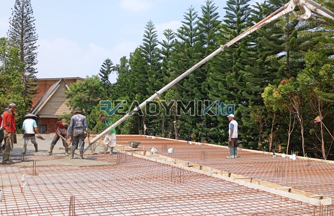

**Jasa Cor Readymix di Curug Depok Murah** - Hai Mitra Readymix Kita! Punya proyek konstruksi di wilayah Curug Depok dan butuh solusi cepat, praktis, serta berkualitas? Nah, Anda sudah berada di tempat yang tepat! Kami dari Readymix Kita hadir sebagai penyedia jasa cor readymix terpercaya, siap melayani kebutuhan pengecoran untuk berbagai skala proyek Anda. Permasalahan konstruksi seperti kualitas beton yang kurang konsisten atau proses pengerjaan yang lama? Lupakan saja! Di Curug Depok Murah, kami menawarkan solusi efisien untuk memastikan proyek Anda berjalan lancar.



## Mengapa Memilih Cor Readymix untuk Proyek Anda?

Apa sebenarnya beton Cor Readymix itu? Sederhananya, beton readymix adalah campuran beton yang diproduksi secara presisi di pabrik dengan bahan-bahan berkualitas tinggi. Material ini kemudian diangkut langsung ke lokasi proyek menggunakan truk mixer. Nah, memilih readymix memiliki segudang kelebihan dibandingkan metode tradisional. Mari kita lihat apa saja:

1. **Efisiensi Waktu dan Tenaga Kerja**

   Proses pencampuran beton di lokasi seringkali memakan waktu dan membutuhkan tenaga kerja yang signifikan. Dengan readymix, Anda menghemat waktu berharga karena pencampuran sudah dilakukan secara profesional di pabrik.

2. **Konsistensi Mutu yang Terjamin**

   Beton Cor Readymix dibuat dengan takaran yang presisi dan menggunakan teknologi modern, sehingga menghasilkan kualitas beton yang seragam dan handal. Ini meminimalkan risiko kegagalan struktur akibat kesalahan pencampuran.

3. **Kemampuan Produksi Skala Besar**

   Kebutuhan volume beton besar? Tidak masalah! Readymix mampu mengakomodasi proyek dengan skala kecil, menengah, hingga besar dalam waktu yang efisien.

4. **Dukungan untuk Pembangunan Berkelanjutan**

   Proses produksi readymix yang terkelola dengan baik meminimalkan limbah material di lokasi konstruksi, berkontribusi pada praktik pembangunan yang lebih ramah lingkungan.

## Keunggulan ReadymixKita di Curug Depok Murah

Di antara banyaknya penyedia jasa, mengapa harus memilih **ReadymixKita** untuk proyek Anda di Curug Depok Murah? Ini dia alasannya:

1. **Pengalaman dan Kepercayaan yang Teruji**

   Dengan pengalaman bertahun-tahun di industri konstruksi, kami sudah memahami betul seluk-beluk setiap proyek, mulai dari pembangunan rumah tinggal hingga gedung komersial dan infrastruktur.

2. **Pilihan Mutu Beton yang Lengkap**

   Kami menyediakan beragam kelas mutu beton, termasuk K-225, K-300, K-350, hingga K-500. Setiap mutu disesuaikan dengan spesifikasi dan kebutuhan proyek Anda.

3. **Didukung Peralatan Canggih**

   Kami mengoperasikan peralatan modern, termasuk pompa beton (concrete pump) yang handal, untuk memastikan pengecoran berlangsung cepat, merata, dan efisien.

4. **Tim yang Berdedikasi dan Profesional**

   Tim kami terdiri dari tenaga ahli yang siap mendampingi Anda dari tahap perencanaan hingga penyelesaian proyek. Kami fleksibel dan dapat menyesuaikan layanan dengan jadwal proyek Anda.

## Layanan Khusus untuk Kondisi di Curug Depok

Sebagai penyedia jasa lokal, kami memahami betul tantangan konstruksi yang unik di Curug Depok. Mulai dari akses jalan yang terbatas sampai kondisi tanah yang bervariasi, kami siap menghadapinya. Inilah layanan khusus yang kami tawarkan:

1. **Pengiriman Tepat Waktu**

   Lokasi pabrik kami yang strategis di sekitar Curug Depok memungkinkan kami memberikan pengiriman beton tepat waktu, memastikan kelancaran proyek Anda.

2. **Konsultasi Ahli**

   Kami menyediakan layanan konsultasi gratis untuk membantu Anda menentukan jenis beton dan metode pengecoran yang paling sesuai dengan kebutuhan proyek Anda.

3. **Penawaran Istimewa untuk Pelanggan Lokal**

   Bagi pelanggan di wilayah Curug Depok Murah, kami menawarkan harga spesial dan diskon menarik untuk proyek-proyek besar.

## Harga Terjangkau dan Penawaran Menarik di Curug Depok

Kami mengerti bahwa anggaran merupakan pertimbangan penting dalam setiap proyek. Karena itu, **ReadymixKita** berkomitmen untuk memberikan:

1. **Harga yang Bersaing**

   Kami menawarkan harga yang kompetitif tanpa mengurangi kualitas beton. Kami akan memberikan informasi harga yang transparan, termasuk biaya pengiriman dan penggunaan pompa beton.

2. **Promo dan Diskon**

   Manfaatkan diskon menarik untuk pemesanan dalam jumlah besar atau proyek dengan jangka waktu yang panjang.

3. **Jaminan Kepuasan Pelanggan**

   Apabila Anda menemukan kendala selama proses pengecoran, tim kami akan segera membantu hingga proyek Anda selesai dengan sempurna.

## Informasi Harga Jasa Cor Readymix di Curug Depok



Jangan biarkan proyek Anda terhambat karena masalah kualitas material atau keterlambatan pengiriman. Segera hubungi kami untuk mendapatkan layanan pengecoran readymix terbaik di Curug Depok Murah!

Kami siap memberikan layanan survei lokasi dan konsultasi gratis untuk memastikan semua kebutuhan Anda terpenuhi dengan tepat. Pesan sekarang juga dan rasakan kemudahan konstruksi yang solid, tahan lama, dan memuaskan.

Kualitas konstruksi adalah prioritas utama. Dengan ReadymixKita, Anda akan mendapatkan kombinasi kecepatan, mutu, dan layanan profesional yang tak tertandingi. Segera hubungi tim kami untuk solusi pengecoran terbaik di Curug Depok Murah. Bangun karya Anda dengan kuat dan tahan lama bersama ReadymixKita! [Jasa Cor Readymix di Babakan Bogor Murah](/readymix/jasa-cor-readymix-di-babakan-bogor-murah/) – Cek juga layanan kami di area Babakan Bogor untuk perbandingan solusi terbaik!