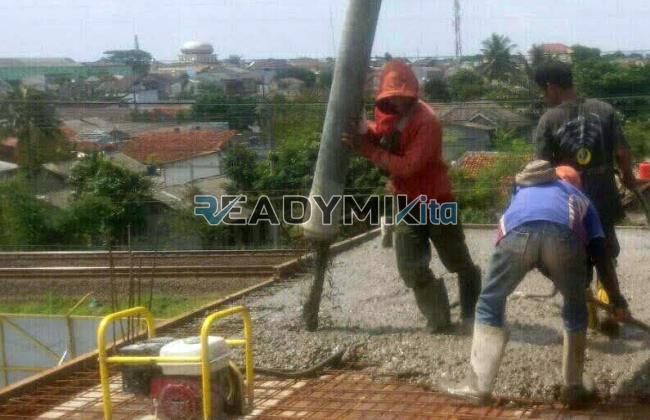

**Jasa Cor Readymix di Curug Tangerang Murah** - Hai Mitra Readymix Kita! Sedang merencanakan pembangunan di Curug Tangerang? Mencari solusi pengecoran yang cepat, praktis, dan terpercaya? Nah, Anda sudah berada di tempat yang tepat! Kami dari Readymix Kita hadir sebagai penyedia jasa cor readymix berkualitas tinggi yang siap mendukung setiap proyek konstruksi Anda di Curug Tangerang Murah. Kualitas terjamin, pengiriman tepat waktu, dan harga yang bersaing – itulah komitmen kami.



## Kenapa Memilih Beton Readymix untuk Proyek Anda?

Pernahkah Anda berpikir tentang bagaimana memudahkan proses pengecoran bangunan Anda? Beton Cor Readymix adalah jawabannya! Produk ini adalah campuran beton siap pakai yang diproduksi di pabrik dengan formulasi presisi, menggunakan bahan-bahan terbaik. Lalu, diangkut langsung ke lokasi proyek menggunakan truk mixer khusus. Daripada repot mencampur di lokasi, kenapa tidak pilih yang lebih praktis dan efisien? Berikut beberapa keuntungan utama menggunakan beton Cor Readymix:

1. **Efisiensi Waktu dan Biaya**

   Proses pencampuran di lokasi konstruksi memerlukan waktu, tenaga, dan peralatan yang cukup banyak. Dengan readymix, Anda hemat waktu dan biaya operasional karena beton sudah siap pakai saat tiba di lokasi. 

2. **Kualitas Terjamin Konsisten**

   Beton readymix diproduksi dengan kontrol kualitas yang ketat, memastikan setiap batch memiliki mutu yang seragam. Ini meminimalkan risiko kesalahan pencampuran yang bisa mengurangi kekuatan bangunan Anda.

3. **Fleksibilitas Volume Produksi**

   Apapun skala proyek Anda – dari pembangunan rumah kecil hingga infrastruktur besar – beton readymix dapat disesuaikan dengan kebutuhan volume yang tepat, tanpa sisa material yang terbuang.

4. **Minimalkan Dampak Lingkungan**

   Produksi terkontrol di pabrik mengurangi potensi limbah material di lokasi proyek, menjadikannya pilihan yang lebih ramah lingkungan.

## Apa yang Membuat ReadymixKita Berbeda di Curug Tangerang?

Di antara banyaknya pilihan penyedia jasa pengecoran di Curug Tangerang Murah, **ReadymixKita** menonjol karena komitmen kami terhadap kualitas dan kepuasan pelanggan. Kami bukan sekadar supplier, tapi juga mitra yang siap membantu Anda mewujudkan proyek impian.

1. **Pengalaman dan Keahlian Teruji**

   Bertahun-tahun berkecimpung di industri konstruksi membuat kami memahami seluk-beluk proyek, dari perencanaan hingga eksekusi. Kami siap memberikan solusi terbaik untuk setiap kebutuhan Anda.

2. **Pilihan Mutu Beton yang Lengkap**

   Kami menyediakan berbagai kelas mutu beton, mulai dari K-225 yang ekonomis hingga K-500 untuk struktur berat. Pilihan ini memungkinkan Anda menyesuaikan spesifikasi beton sesuai dengan kebutuhan proyek Anda.

3. **Didukung Teknologi Pengecoran Modern**

   Kami mengoperasikan peralatan canggih seperti concrete pump yang memastikan pengecoran cepat, merata, dan efisien, bahkan di area yang sulit dijangkau.

4. **Tim Profesional yang Responsif**

   Tim kami terdiri dari tenaga ahli yang berdedikasi untuk memberikan layanan terbaik. Kami siap memberikan konsultasi teknis, membantu perencanaan, dan memastikan proses pengecoran berjalan lancar.

## Layanan Khusus untuk Proyek di Wilayah Curug Tangerang

Kami bangga menjadi bagian dari perkembangan konstruksi di Curug Tangerang Murah. Kami memahami betul tantangan dan kebutuhan khusus di wilayah ini, termasuk kondisi topografi yang beragam. Oleh karena itu, kami menyediakan layanan yang dirancang khusus untuk Anda:

1. **Pengiriman Tepat Waktu**

   Lokasi pabrik kami yang strategis di Curug Tangerang memungkinkan kami menjamin pengiriman beton tepat waktu, meminimalkan keterlambatan proyek Anda.

2. **Konsultasi Teknis Gratis**

   Bingung memilih jenis beton yang tepat? Tim ahli kami siap memberikan konsultasi gratis untuk membantu Anda menentukan solusi terbaik sesuai dengan kebutuhan proyek Anda.

3. **Penawaran Spesial untuk Proyek Lokal**

   Kami memberikan penawaran harga spesial dan diskon menarik bagi klien di wilayah Curug Tangerang untuk proyek-proyek besar.

## Harga yang Bersaing dan Promo Menarik di Curug Tangerang

Kami percaya bahwa kualitas tidak harus mahal. **ReadymixKita** berkomitmen untuk memberikan harga readymix yang kompetitif di Curug Tangerang Murah tanpa mengorbankan kualitas.

1. **Harga Transparan dan Terjangkau**

   Kami menawarkan harga yang jelas dan terperinci, termasuk biaya pengiriman dan penggunaan concrete pump. Tidak ada biaya tersembunyi!

2. **Promo dan Diskon Berlimpah**

   Dapatkan diskon menarik untuk pemesanan volume besar atau proyek jangka panjang. Jangan lewatkan kesempatan untuk menghemat biaya konstruksi Anda!

3. **Jaminan Kepuasan Pelanggan**

   Kami menjamin Anda akan puas dengan layanan dan kualitas beton readymix kami. Jika ada kendala, tim kami akan segera membantu menyelesaikannya.

## Informasi Harga Jasa Cor Readymix di Curug Tangerang



Jangan biarkan kualitas material yang buruk menghambat kesuksesan proyek Anda. Segera hubungi kami untuk mendapatkan penawaran jasa cor readymix terbaik di Curug Tangerang Murah!

Kami siap menyediakan layanan survei lokasi dan konsultasi gratis untuk memastikan kebutuhan Anda terpenuhi dengan sempurna. Pesan sekarang dan rasakan kemudahan membangun dengan readymix berkualitas dari ReadymixKita! [Jasa Cor Readymix di Balaraja Tangerang Murah](/readymix/jasa-cor-readymix-di-balaraja-tangerang-murah/) – solusi pengecoran terpercaya untuk wilayah sekitarnya. Bangun masa depan yang kokoh dengan pondasi yang kuat bersama ReadymixKita!