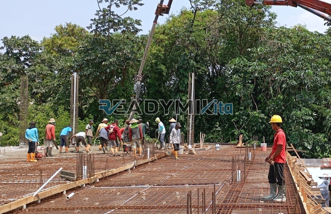

**Jasa Cor Readymix di Duren Sawit Jakarta Murah** - Hai Mitra Readymix Kita! Proyek konstruksi sedang berjalan di Duren Sawit Jakarta? Atau mungkin baru sebatas perencanaan? Kami siap membantu! Sebagai penyedia beton cor readymix terpercaya, Readymix Kita hadir untuk memastikan fondasi bangunan Anda kokoh dan tahan lama. Duren Sawit Jakarta yang dinamis ini membutuhkan solusi konstruksi yang handal – dan kami siap menjadi bagian dari kesuksesan proyek Anda.



## Mengapa Memilih Beton Readymix? Keunggulannya untuk Proyek Anda

Apa yang membuat beton readymix menjadi pilihan tepat? Sederhana: efisiensi dan kualitas. Beton Cor Readymix diproduksi secara presisi di pabrik modern dengan kontrol kualitas ketat, lalu diantar langsung ke lokasi proyek menggunakan truk mixer. Daripada repot mencampur sendiri di lokasi, Anda bisa langsung fokus pada tahapan konstruksi lainnya. Berikut beberapa benefit utama yang bisa Anda rasakan:

1. **Hemat Waktu dan Biaya Tenaga Kerja**

   Proses pencampuran di lokasi itu memakan waktu dan tenaga. Dengan readymix, waktu pengerjaan proyek Anda jadi jauh lebih singkat, menghemat biaya operasional.

2. **Kualitas Terjamin Konsisten**

   Formula beton readymix dibuat dengan presisi, menggunakan bahan baku standar. Hasilnya? Kualitas beton yang stabil dan minim risiko kesalahan pencampuran.

3. **Fleksibilitas Volume Produksi**

   Mau proyek kecil atau besar, readymix siap memenuhi kebutuhan Anda. Kapasitas produksi kami fleksibel dan dapat disesuaikan dengan volume yang Anda butuhkan.

4. **Dukungan Ramah Lingkungan**

   Proses produksi yang terkontrol di pabrik readymix menghasilkan limbah material yang lebih sedikit dibandingkan pencampuran konvensional di lokasi proyek.

## Mengapa ReadymixKita adalah Partner Terbaik Anda di Duren Sawit Jakarta?

Di antara banyaknya pilihan penyedia jasa cor readymix di Duren Sawit Jakarta, apa yang membedakan ReadymixKita? Kami tidak hanya menyediakan material, tapi juga solusi! Kami memahami seluk-beluk konstruksi di wilayah ini dan siap memberikan layanan terbaik untuk Anda:

1. **Pengalaman dan Reputasi Terpercaya**

   Berpengalaman bertahun-tahun di industri, kami tahu persis kebutuhan proyek konstruksi, mulai dari proyek rumahan sederhana hingga infrastruktur berskala besar.

2. **Pilihan Mutu Beton yang Lengkap**

   Kami menyediakan berbagai kelas mutu beton – K-225, K-300, K-350, hingga K-500 – memastikan Anda mendapatkan material yang sesuai dengan spesifikasi proyek.

3. **Didukung Peralatan Modern & Concrete Pump**

   Kami menggunakan peralatan pengecoran modern, termasuk concrete pump, untuk mempercepat proses penuangan dan memastikan hasil yang merata.

4. **Tim Ahli yang Siap Membantu**

   Tim kami terdiri dari tenaga ahli yang siap memberikan konsultasi dan dukungan teknis, mulai dari perencanaan hingga tahap finishing.

## Layanan Kami yang Dirancang Khusus untuk Kondisi di Duren Sawit Jakarta

Kami bukan hanya sekadar supplier beton. Kami memahami betul karakteristik wilayah Duren Sawit Jakarta – kepadatan penduduk, akses jalan yang beragam, dan tantangan geografis lainnya. Oleh karena itu, kami menawarkan layanan yang disesuaikan:

1. **Pengiriman Tepat Waktu**

   Kami berkomitmen memberikan layanan pengiriman yang tepat waktu, karena kami paham betapa pentingnya kelancaran pasokan material untuk keberhasilan proyek. Lokasi kami yang strategis di sekitar Duren Sawit Jakarta mendukung hal ini.

2. **Konsultasi Teknis Gratis**

   Bingung memilih jenis beton yang tepat? Jangan ragu! Tim ahli kami siap memberikan konsultasi gratis untuk membantu Anda menentukan solusi terbaik.

3. **Penawaran Spesial untuk Pelanggan Lokal**

   Sebagai bentuk apresiasi, kami menyiapkan penawaran khusus dan diskon menarik untuk proyek-proyek konstruksi di wilayah Duren Sawit Jakarta.

## Harga Beton Readymix Terjangkau di Duren Sawit Jakarta



Keputusan cerdas untuk konstruksi Anda ada di sini. Kami berkomitmen memberikan harga yang kompetitif tanpa mengorbankan kualitas. Jangan ragu untuk menghubungi kami guna mendapatkan informasi lebih lanjut mengenai penawaran terbaik.

Yuk, wujudkan proyek impian Anda dengan ReadymixKita! Kami siap menghadirkan solusi pengecoran terbaik yang sesuai dengan anggaran dan kebutuhan Anda di Duren Sawit Jakarta.

Dengan memastikan mutu material yang konsisten, kecepatan pengerjaan, dan layanan profesional, **ReadymixKita** adalah partner ideal untuk proyek konstruksi Anda. Jangan tunda lagi, hubungi kami sekarang juga untuk mendapatkan penawaran menarik dan wujudkan bangunan kokoh di Duren Sawit Jakarta!