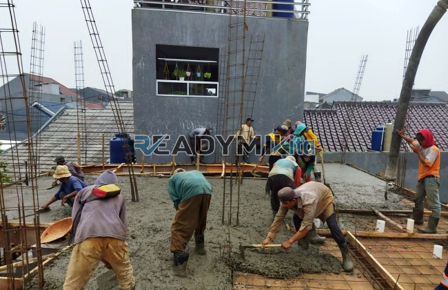

**Jasa Cor Readymix di Duren Seribu Depok Murah** - Hai Mitra Readymix Kita! Proyek konstruksi di Duren Seribu Depok sedang berjalan? Atau Anda merencanakan pembangunan baru? Nah, Anda sudah berada di tempat yang tepat! Kami dari Readymix Kita hadir sebagai solusi pengecoran readymix yang andal dan efisien untuk beragam kebutuhan proyek Anda di Duren Seribu Depok Murah.



## Mengapa Memilih Layanan Pengecoran Readymix?

Pertanyaan yang sering muncul: apa itu beton *Cor Readymix*? Sederhananya, ini adalah campuran beton yang sudah siap pakai, diproduksi secara presisi di pabrik kami dengan bahan baku berkualitas tinggi. Pengiriman langsung ke lokasi proyek menggunakan truk mixer memastikan kesegaran dan kemudahan pengerjaan. Apa saja kelebihannya dibanding cara konvensional? Mari kita simak:

1. **Hemat Waktu & Sumber Daya:** Proses pengecoran tradisional seringkali memakan waktu dan tenaga besar. Dengan readymix, Anda menghemat keduanya secara signifikan karena pencampuran sudah dilakukan di pabrik, siap pakai saat tiba di lokasi Anda.

2. **Kualitas Terjamin Konsisten:**  Di pabrik, setiap batch beton diproduksi dengan takaran akurat menggunakan teknologi modern. Ini menjamin kualitas yang konsisten, meminimalkan risiko kegagalan struktur akibat kesalahan takaran.

3. **Kapasitas Fleksibel:**  Baik untuk proyek kecil maupun besar, readymix mampu memenuhi kebutuhan volume beton Anda dengan cepat dan efisien.

4. **Dukungan Lingkungan:** Proses produksi readymix yang terkontrol membantu mengurangi limbah material konstruksi, menjadikannya pilihan yang lebih ramah lingkungan.

## Keunggulan ReadymixKita di Duren Seribu Depok Murah

Di antara banyaknya penyedia jasa, mengapa harus memilih **ReadymixKita** untuk kebutuhan pengecoran Anda di Duren Seribu Depok Murah? Ini dia alasannya:

1. **Pengalaman & Kepercayaan:**  Bertahun-tahun berkecimpung di industri konstruksi membuat kami memahami seluk-beluk setiap proyek, mulai dari pembangunan rumah tinggal, gedung komersial, hingga proyek infrastruktur skala besar.

2. **Pilihan Mutu Beton Lengkap:**  Kami menyediakan berbagai pilihan mutu beton, mulai dari K-225 untuk kebutuhan umum hingga K-500 untuk konstruksi yang membutuhkan kekuatan ekstra. Semuanya disesuaikan dengan spesifikasi proyek Anda.

3. **Peralatan Pengecoran Mutakhir:**  Kami dilengkapi dengan peralatan modern, termasuk *concrete pump*, untuk memastikan pengecoran berlangsung cepat, merata, dan efisien.

4. **Tim Profesional yang Siap Membantu:**  Tim kami terdiri dari tenaga ahli yang siap memberikan dukungan mulai dari tahap perencanaan hingga pelaksanaan di lapangan. Kami juga menawarkan fleksibilitas untuk menyesuaikan dengan jadwal proyek Anda.

## Layanan Kami yang Disesuaikan untuk Duren Seribu Depok

Sebagai penyedia lokal, kami memahami betul karakteristik unik wilayah Duren Seribu Depok. Kami siap mengatasi berbagai tantangan konstruksi yang mungkin Anda temui:

1. **Pengiriman Tepat Waktu:** Lokasi pabrik kami yang strategis memastikan pengiriman beton readymix tepat waktu ke lokasi proyek Anda di Duren Seribu Depok dan sekitarnya.

2. **Konsultasi Teknis Gratis:** Kami menyediakan layanan konsultasi gratis untuk membantu Anda memilih jenis beton dan metode pengecoran yang paling sesuai dengan kebutuhan proyek Anda.

3. **Penawaran Spesial untuk Proyek Lokal:**  Para pelanggan di wilayah Duren Seribu Depok berhak mendapatkan tarif khusus dan diskon menarik, terutama untuk proyek dengan volume besar.

## Investasi Cerdas: Harga Terjangkau dengan Kualitas Tinggi

Kami percaya bahwa kualitas tidak harus mahal. **ReadymixKita** berkomitmen untuk memberikan penawaran terbaik:

1. **Harga Kompetitif:**  Kami menawarkan harga yang bersaing tanpa mengorbankan kualitas beton readymix yang kami sediakan. Informasi lengkap mengenai biaya, termasuk ongkos kirim dan biaya tambahan (jika ada), akan kami berikan secara transparan.

2. **Promo Menarik:** Dapatkan diskon khusus untuk pemesanan dalam jumlah besar atau proyek berdurasi panjang. Yuk, hubungi kami untuk informasi lebih lanjut!

3. **Kepuasan Pelanggan Terjamin:** Kami memberikan garansi kepuasan. Jika ada masalah selama proses pengecoran, tim kami akan segera memberikan solusi hingga proyek Anda selesai dengan sempurna.

## Informasi Harga Jasa Cor Readymix di Duren Seribu Depok



Jangan biarkan kualitas material menjadi penghalang keberhasilan proyek Anda! Segera hubungi kami untuk solusi pengecoran readymix terbaik di Duren Seribu Depok Murah. 

Kami juga menawarkan layanan survei lokasi gratis untuk membantu Anda merencanakan proyek dengan lebih baik. Pesan sekarang dan nikmati hasil konstruksi yang solid, tahan lama, dan sesuai dengan harapan Anda. Apa yang Anda tunggu? Hubungi kami sekarang juga untuk penawaran terbaik! [Baca juga tentang keunggulan beton mutu tinggi di artikel kami.](https://readymixkita.com/beton-mutu-tinggi/)

Hindari risiko konstruksi yang kurang kokoh! Gunakan jasa pengecoran readymix dari ReadymixKita. Kami menawarkan kombinasi ideal antara efisiensi, kualitas, dan pelayanan profesional yang tak tertandingi. Segera hubungi tim kami untuk mendapatkan solusi pengecoran terbaik di Duren Seribu Depok Murah. Bersama ReadymixKita, bangunan impian Anda akan kokoh dan tahan lama! [Pelajari lebih lanjut tentang aplikasi beton readymix untuk berbagai jenis proyek.](https://readymixkita.com/aplikasi-readymix/)