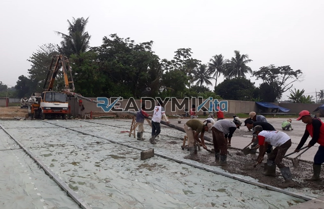

**Jasa Cor Readymix di Duren Tiga Jakarta Murah** - Hai Mitra Readymix Kita! Proyek konstruksi di Duren Tiga Jakarta sedang berjalan? Atau mungkin baru dalam tahap perencanaan? Nah, Anda sudah berada di tempat yang tepat! Kami dari Readymix Kita hadir sebagai solusi pengecoran readymix terpercaya, menawarkan kualitas unggul dan layanan yang disesuaikan dengan kebutuhan Anda. Beton readymix kami akan memastikan fondasi bangunan Anda kokoh dan tahan lama.



## Mengapa Memilih Cor Readymix untuk Proyek Anda?

Beton readymix, atau beton cor siap pakai, adalah pilihan cerdas bagi proyek konstruksi modern. Dibuat dengan presisi tinggi di pabrik kami menggunakan material terbaik, beton ini kemudian dikirim langsung ke lokasi proyek Anda menggunakan truk mixer. Apa yang membuat beton readymix begitu istimewa? Yuk, kita lihat keunggulannya:

1. **Efisiensi Waktu & Biaya**

   Lupakan proses pencampuran manual yang memakan waktu dan tenaga. Dengan readymix, Anda menghemat waktu dan biaya operasional proyek secara signifikan.

2. **Kualitas Terjamin Konsisten**

   Teknologi modern dan takaran yang akurat memastikan setiap batch beton readymix memiliki kualitas yang seragam. Ini meminimalkan risiko kesalahan dan kegagalan struktur.

3. **Skalabilitas Produksi**

   Apakah proyek Anda kecil atau besar? Beton readymix dapat diproduksi dalam volume yang sesuai dengan kebutuhan Anda, tanpa mengorbankan kualitas.

4. **Dukungan Keberlanjutan**

   Proses produksi terkontrol menghasilkan lebih sedikit limbah material, menjadikan beton readymix pilihan yang lebih ramah lingkungan.

## Kenapa Harus ReadymixKita di Duren Tiga Jakarta?

Di antara banyaknya penyedia jasa pengecoran di Duren Tiga Jakarta, mengapa memilih ReadymixKita? Kami menawarkan lebih dari sekadar beton readymix berkualitas. Berikut adalah keunggulan kami:

1. **Pengalaman & Keandalan**

   Dengan pengalaman bertahun-tahun di industri konstruksi, kami memahami seluk-beluk proyek Anda dan memberikan solusi yang tepat.

2. **Pilihan Mutu Beton yang Lengkap**

   Kami menyediakan berbagai pilihan mutu beton, mulai dari K-225 hingga K-500, memastikan Anda mendapatkan material yang sesuai dengan kebutuhan spesifik proyek Anda.

3. **Teknologi Pengecoran Terkini**

   Kami menggunakan peralatan modern, termasuk concrete pump, untuk mempercepat proses pengecoran dan memastikan hasil yang rata dan presisi.

4. **Tim Ahli yang Siap Membantu**

   Tim profesional kami siap memberikan dukungan dari tahap perencanaan hingga pelaksanaan di lapangan, dengan fleksibilitas yang disesuaikan dengan jadwal proyek Anda.

## Layanan Kami yang Dirancang untuk Duren Tiga Jakarta

Sebagai penyedia lokal, kami memahami betul kondisi konstruksi di Duren Tiga Jakarta. Kami menyesuaikan layanan kami untuk memenuhi tantangan unik di wilayah ini:

1. **Pengiriman Tepat Waktu**

   Kami menjamin pengiriman beton readymix yang tepat waktu, berkat lokasi pabrik kami yang strategis di Duren Tiga Jakarta dan armada pengiriman yang handal.

2. **Konsultasi Gratis**

   Dapatkan konsultasi gratis dari ahli kami untuk membantu Anda memilih jenis beton dan metode pengecoran yang paling ideal untuk proyek Anda.

3. **Penawaran Eksklusif Lokal**

   Klien di Duren Tiga Jakarta berhak menikmati penawaran harga spesial dan diskon untuk proyek-proyek tertentu.

## Harga Beton Readymix Terjangkau di Duren Tiga Jakarta

Kami percaya bahwa kualitas tidak harus mahal. **ReadymixKita** berkomitmen untuk memberikan harga yang kompetitif tanpa mengorbankan mutu beton readymix kami.

1. **Harga Transparan dan Bersaing**

   Kami menawarkan harga yang jelas dan bersaing, termasuk biaya pengiriman dan penggunaan concrete pump.

2. **Promo Menarik**

   Manfaatkan diskon khusus untuk pemesanan dalam jumlah besar atau proyek jangka panjang.

3. **Kepuasan Pelanggan Terjamin**

   Kami menjamin kualitas layanan kami. Jika Anda menemukan masalah, tim kami akan segera membantu hingga proyek Anda selesai dengan memuaskan.

## Informasi Harga Jasa Cor Readymix di Duren Tiga Jakarta



Jangan tunda lagi! Hubungi kami sekarang juga untuk mendapatkan penawaran terbaik dan solusi pengecoran readymix terpercaya di Duren Tiga Jakarta!

Kami siap menyediakan layanan survei lokasi dan konsultasi gratis untuk memastikan kebutuhan Anda terpenuhi secara optimal. Ingat, memilih ReadymixKita berarti memilih kualitas, efisiensi, dan pelayanan profesional. Dapatkan fondasi yang kuat dan tahan lama untuk bangunan Anda bersama kami! [Jasa Cor Readymix di Bale Kambang Jakarta Murah](/readymix/jasa-cor-readymix-di-bale-kambang-jakarta-murah/) bisa menjadi referensi tambahan untuk layanan serupa di sekitar Jakarta.