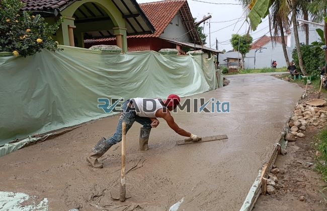

**Jasa Cor Readymix di Duri Kepa Jakarta Murah** - Hai Mitra Readymix Kita! Sedang merencanakan pembangunan di Duri Kepa Jakarta? Nah, Anda sudah berada di tempat yang tepat! Kami dari Readymix Kita hadir sebagai solusi pengecoran readymix berkualitas, siap mendukung proyek Anda dengan material terbaik dan layanan yang handal. Yuk, simak bagaimana kami dapat membantu mewujudkan konstruksi impian Anda di Duri Kepa Jakarta Murah!



## Mengapa Memilih Layanan Pengecoran Readymix?

Mitra, tahukah Anda apa itu beton Cor Readymix? Ini adalah campuran beton siap pakai yang diproduksi secara akurat di pabrik modern, menggunakan bahan-bahan pilihan.  Beton ini kemudian diangkut menggunakan truk mixer langsung ke lokasi proyek Anda. Dibandingkan metode tradisional, ada banyak keuntungan menggunakan beton readymix:

1. **Efisiensi Waktu & Biaya**

   Proses pengecoran dengan readymix jauh lebih cepat karena beton sudah siap pakai. Ini menghemat waktu dan tenaga Anda, serta mengurangi biaya operasional proyek.

2. **Kualitas Terjamin**

   Pencampuran di pabrik modern memastikan takaran material yang presisi dan konsisten. Hal ini menghasilkan beton dengan kualitas unggul, meminimalkan risiko kegagalan struktur.

3. **Fleksibilitas Kapasitas**

   Butuh sedikit atau banyak beton? Readymix dapat mengakomodasi kebutuhan proyek Anda, baik skala kecil maupun besar.

4. **Dampak Lingkungan Lebih Kecil**

   Proses produksi yang terkontrol meminimalkan limbah material di lokasi proyek, menjadikan readymix pilihan yang lebih ramah lingkungan.

## Keunggulan ReadymixKita di Duri Kepa Jakarta

Dari sekian banyak penyedia, kenapa harus memilih **ReadymixKita** untuk proyek Anda di Duri Kepa Jakarta? Ini alasannya:

1. **Pengalaman & Reputasi Baik**

   Dengan pengalaman bertahun-tahun di industri konstruksi, kami memahami seluk-beluk proyek-proyek di wilayah ini, mulai dari pembangunan rumah hingga infrastruktur besar.

2. **Pilihan Mutu Beton Lengkap**

   Kami menyediakan berbagai kelas mutu beton, mulai dari K-225 hingga K-500, sesuai dengan kebutuhan spesifik proyek Anda. Konsultasikan dengan tim kami untuk rekomendasi terbaik!

3. **Peralatan Canggih & Terawat**

   Kami dilengkapi dengan armada truk mixer modern dan pompa beton (concrete pump) untuk memastikan pengecoran cepat, efisien, dan merata.

4. **Tim Ahli yang Siap Membantu**

   Tim profesional kami siap memberikan panduan dan dukungan, mulai dari perencanaan hingga pelaksanaan pengecoran di lokasi. Kami juga fleksibel menyesuaikan dengan jadwal proyek Anda.

## Layanan Khusus untuk Kondisi Duri Kepa Jakarta

Sebagai penyedia lokal, kami memahami tantangan konstruksi di Duri Kepa Jakarta.  Beragam kondisi geografis—mulai dari area padat hingga kontur berbukit—menuntut solusi yang tepat. Itulah mengapa kami menyediakan:

1. **Pengiriman Tepat Waktu**

   Pabrik kami yang strategis di Duri Kepa Jakarta dan sekitarnya memastikan pengiriman beton tepat waktu, meminimalkan potensi keterlambatan proyek.

2. **Konsultasi Gratis & Terpersonalisasi**

   Kami menawarkan konsultasi gratis untuk membantu Anda memilih jenis beton dan metode pengecoran yang paling sesuai dengan kebutuhan proyek Anda.

3. **Penawaran Menarik untuk Proyek Lokal**

   Pelanggan di Duri Kepa Jakarta akan mendapatkan penawaran khusus dan diskon menarik untuk proyek-proyek besar dan berkelanjutan.

## Harga Terjangkau dan Promo Spesial di Duri Kepa Jakarta

Kami mengerti bahwa anggaran adalah hal penting dalam setiap proyek.  **ReadymixKita** hadir dengan solusi hemat biaya:

1. **Harga Kompetitif & Transparan**

   Kami menawarkan harga yang bersaing tanpa mengorbankan kualitas. Informasi harga, termasuk biaya pengiriman dan penggunaan concrete pump, disampaikan secara terbuka.

2. **Promo Menarik & Diskon**

   Manfaatkan diskon khusus untuk pemesanan volume besar atau proyek jangka panjang.

3. **Jaminan Kepuasan Pelanggan**

   Kami berkomitmen memberikan layanan terbaik. Jika ada kendala, tim kami siap membantu hingga proyek Anda selesai dengan memuaskan.

## Daftar Harga Jasa Cor Readymix di Duri Kepa Jakarta



Jangan tunda lagi! Pastikan proyek Anda dibangun dengan material berkualitas terbaik. Segera hubungi kami untuk mendapatkan solusi pengecoran readymix yang tepat di Duri Kepa Jakarta Murah!

Kami juga menyediakan layanan survei lokasi dan konsultasi gratis untuk membantu Anda menentukan kebutuhan beton yang tepat. Pesan sekarang dan nikmati hasil konstruksi yang kuat, tahan lama, dan memuaskan.  

ReadymixKita berdedikasi untuk memberikan pengalaman terbaik bagi setiap pelanggan. Dengan keahlian, mutu terjamin, dan layanan yang ramah, kami yakin akan menjadi mitra terpercaya Anda dalam mewujudkan proyek-proyek impian. Hubungi kami sekarang juga dan rasakan sendiri kualitas jasa Pengecoran dg Cor Readymix di Duri Kepa Jakarta dari ReadymixKita. Bangun masa depan yang kokoh bersama kami! [Jasa Cor Readymix di Bale Kambang Jakarta Murah](/readymix/jasa-cor-readymix-di-bale-kambang-jakarta-murah/) — untuk informasi lebih lanjut tentang layanan kami di wilayah Jakarta.