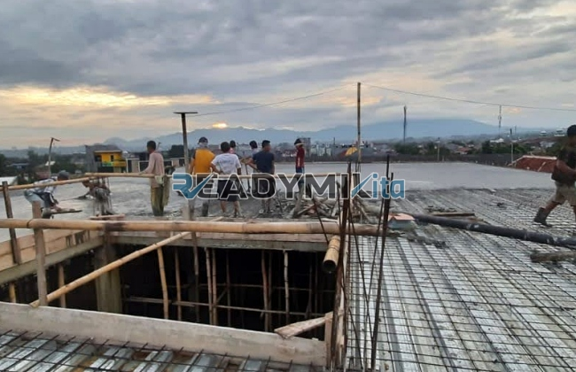

**Jasa Cor Readymix di Galur Jakarta Murah** - Hai Mitra Readymix Kita! Proyek konstruksi di Galur Jakarta sedang berjalan? Atau baru sebatas perencanaan? Nah, Anda sudah berada di tempat yang tepat! Kami dari Readymix Kita hadir sebagai solusi pengecoran readymix terpercaya, memberikan fondasi kuat untuk bangunan Anda. Di Galur Jakarta yang dinamis ini, efisiensi dan kualitas material jadi kunci utama kesuksesan proyek. Yuk, kita bahas lebih lanjut!



## Mengapa Memilih Beton Cor Readymix? Keunggulannya untuk Proyek Anda

Apa sebenarnya beton Cor Readymix itu? Sederhananya, ini adalah campuran beton siap pakai yang diproduksi secara presisi di pabrik modern, menggunakan bahan-bahan terbaik. Kemudian, dicampur dan diangkut langsung ke lokasi proyek menggunakan truk mixer khusus. Menggunakan readymix itu cerdas, nih! Ini dia beberapa keuntungan utamanya dibandingkan metode tradisional:

1. **Hemat Waktu dan Energi**

   Ngak perlu lagi repot dan lama membuat beton di lokasi. Pengerjaan jadi lebih cepat karena proses pencampuran sudah ditangani di pabrik.

2. **Kualitas Terjamin Konsisten**

   Dengan takaran yang akurat dan peralatan canggih, beton readymix menjamin kualitas yang stabil. Risiko kesalahan pencampuran yang bisa bikin struktur bermasalah, jadi berkurang drastis.

3. **Kapasitas Fleksibel untuk Segala Skala**

   Baik proyek kecil maupun besar, beton readymix siap memenuhi kebutuhan Anda dalam jumlah yang diinginkan dan tepat waktu.

4. **Lebih Peduli Lingkungan**

   Proses produksi yang terkontrol meminimalkan limbah material di lokasi proyek, berkontribusi pada konstruksi yang lebih hijau.

##  ReadymixKita: Solusi Pengecoran Terbaik di Galur Jakarta

Di antara banyaknya penyedia jasa, kenapa harus ReadymixKita di Galur Jakarta? Ini alasannya:

1. **Pengalaman dan Kepercayaan yang Teruji**

   Kami sudah lama berkecimpung di dunia konstruksi. Pengalaman ini membuat kami paham betul seluk-beluk proyek, mulai dari rumah tinggal sampai infrastruktur berskala besar.

2. **Pilihan Mutu Beton yang Lengkap**

   Kami menyediakan berbagai kelas mutu beton, termasuk K-225 untuk keperluan standar sampai K-500 untuk konstruksi yang membutuhkan kekuatan ekstra. Pilihan yang tepat untuk kebutuhan spesifik proyek Anda.

3. **Teknologi Pengecoran Modern**

   Kami menggunakan peralatan mutakhir, seperti concrete pump, untuk memastikan pengecoran lebih cepat, merata, dan efisien.

4. **Tim Ahli yang Siap Membantu**

   Tim profesional kami siap mendukung Anda mulai dari perencanaan hingga pelaksanaan di lokasi. Kami fleksibel dan bisa menyesuaikan layanan dengan jadwal proyek Anda.

## Layanan Kami yang Disesuaikan untuk Kondisi Galur Jakarta

Kami paham betul karakteristik konstruksi di Galur Jakarta. Baik itu area perkotaan padat atau kawasan perbukitan, kami siap memberikan solusi terbaik:

1. **Pengiriman Tepat Waktu**

   Lokasi pabrik kami yang strategis memungkinkan pengiriman beton readymix yang cepat dan tepat waktu ke seluruh wilayah Galur Jakarta dan sekitarnya.

2. **Konsultasi Gratis untuk Proyek Anda**

   Bingung memilih jenis beton yang tepat? Kami menyediakan layanan konsultasi gratis untuk membantu Anda menentukan solusi pengecoran yang paling sesuai.

3. **Penawaran Spesial untuk Proyek Lokal Galur Jakarta**

   Khusus untuk Anda yang berproyek di Galur Jakarta, kami menawarkan harga spesial dan diskon menarik untuk proyek-proyek besar.

## Harga Terjangkau dan Penawaran Menggiurkan di Galur Jakarta

Kami mengerti betul bahwa anggaran adalah hal penting dalam setiap proyek.  ReadymixKita berkomitmen untuk memberikan:

1. **Harga Kompetitif dan Transparan**

   Harga kami dirancang agar tetap terjangkau tanpa mengurangi kualitas.  Informasi harga, termasuk biaya pengiriman dan penggunaan alat seperti concrete pump, diberikan dengan jelas.

2. **Promo Menarik untuk Pemesanan Besar**

   Dapatkan diskon khusus untuk pemesanan dalam jumlah besar atau proyek yang berlangsung dalam jangka waktu panjang.

3. **Kepuasan Anda Adalah Prioritas Kami**

   Jika ada kendala dalam proses pengecoran, tim kami akan siap membantu sampai proyek Anda selesai dengan sempurna.

## Informasi Harga Jasa Cor Readymix di Galur Jakarta



Yuk, wujudkan proyek impian Anda dengan beton berkualitas! Segera hubungi kami untuk mendapatkan solusi pengecoran terbaik di Galur Jakarta. Jangan sampai kalah cepat dengan proyek lain, ya!

Kami juga siap melakukan survei lokasi dan memberikan konsultasi gratis untuk memastikan kebutuhan Anda terpenuhi secara optimal. Pesan sekarang dan rasakan hasil konstruksi yang kokoh, awet, dan memuaskan.

Percayakan pengecoran bangunan Anda kepada ahlinya. Dengan memilih layanan Pengecoran dg Cor Readymix dari ReadymixKita, Anda mendapatkan kombinasi kecepatan, kualitas, dan pelayanan profesional yang tak tertandingi.  Segera hubungi kami untuk solusi pengecoran terbaik di Galur Jakarta. Bersama ReadymixKita, bangunan Anda berdiri kokoh dan tahan lama! [Jasa Cor Readymix di Bale Kambang Jakarta Murah](/readymix/jasa-cor-readymix-di-bale-kambang-jakarta-murah/)