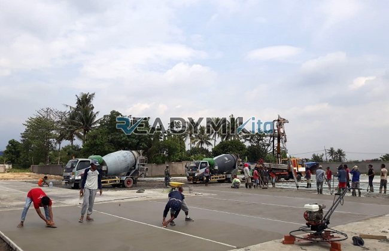

**Jasa Cor Readymix di Gambir Jakarta Murah** - Hai Mitra Readymix Kita! Ada proyek konstruksi di Gambir Jakarta? Mencari solusi cepat dan andal untuk kebutuhan beton cor? Nah, Anda sudah berada di tempat yang tepat! Kami dari Readymix Kita siap menjadi partner terpercaya Anda dalam menghadirkan fondasi yang kokoh dan awet untuk setiap bangunan di Gambir Jakarta Murah.



## Mengapa Memilih Beton Readymix untuk Proyek Anda?

Beton readymix, atau beton cor siap pakai, adalah solusi modern yang semakin populer di kalangan kontraktor dan pemilik proyek. Produk ini dibuat di pabrik dengan kontrol kualitas yang ketat, memastikan konsistensi dan kekuatan yang optimal. Apa saja keunggulan menggunakan beton readymix dibanding metode tradisional? Mari kita simak:

1. **Hemat Waktu & Tenaga Kerja**

   Proses pencampuran di lokasi proyek seringkali memakan waktu dan sumber daya yang signifikan. Dengan readymix, Anda langsung mendapatkan campuran beton siap pakai yang bisa langsung digunakan, mempercepat penyelesaian proyek Anda.

2. **Kualitas Terjamin & Konsisten**

   Pabrik readymix menggunakan teknologi modern dan bahan baku berkualitas tinggi, menghasilkan beton dengan mutu yang terstandarisasi. Ini meminimalkan risiko kegagalan konstruksi akibat campuran yang tidak tepat.

3. **Skalabilitas Produksi**

   Kapasitas produksi readymix sangat fleksibel. Kami bisa memenuhi kebutuhan proyek kecil maupun besar dengan cepat dan efisien. Ideal untuk proyek di Gambir Jakarta Murah yang beragam skala.

4. **Lebih Ramah Lingkungan**

   Proses produksi terkontrol di pabrik readymix mengurangi limbah material dan debu di lokasi proyek, berkontribusi pada lingkungan yang lebih bersih.

## Keunggulan Jasa Readymix Kita di Gambir Jakarta

Di antara banyaknya penyedia jasa, Readymix Kita menawarkan nilai lebih bagi proyek konstruksi Anda di Gambir Jakarta. Apa yang membedakan kami?

1. **Pengalaman & Reputasi Teruji**

   Bertahun-tahun berkecimpung di dunia konstruksi menjadikan kami paham betul kebutuhan dan tantangan proyek di Gambir Jakarta. Kepercayaan pelanggan adalah prioritas utama kami.

2. **Pilihan Mutu Beton yang Lengkap**

   Kami menyediakan berbagai kelas mutu beton, mulai dari K-225 untuk konstruksi ringan hingga K-500 untuk bangunan bertingkat tinggi. Konsultasikan dengan tim kami untuk memilih mutu beton yang paling sesuai dengan spesifikasi proyek Anda.

3. **Didukung Peralatan Canggih**

   Kami dilengkapi dengan *concrete pump* (pompa beton) modern yang mempermudah dan mempercepat proses pengecoran, bahkan di lokasi yang sulit dijangkau.

4. **Tim Profesional yang Siap Membantu**

   Tim kami terdiri dari teknisi ahli yang siap memberikan konsultasi dan bantuan teknis selama proses pengecoran. Kami bersedia menyesuaikan jadwal pengiriman dengan kebutuhan proyek Anda.

## Layanan Kami yang Dirancang untuk Kondisi Gambir Jakarta

Kami sadar betul akan karakteristik unik wilayah Gambir Jakarta, mulai dari kepadatan penduduk hingga kondisi jalan yang bervariasi. Itulah mengapa kami menawarkan layanan yang disesuaikan:

1. **Pengiriman Tepat Waktu & Efisien**

   Jaringan transportasi kami yang luas memastikan pengiriman beton tepat waktu ke lokasi proyek Anda di Gambir Jakarta Murah, mengatasi tantangan kemacetan dengan rute optimal.

2. **Konsultasi Gratis & Solusi Tepat**

   Tim ahli kami siap memberikan konsultasi gratis untuk membantu Anda memilih jenis beton yang paling sesuai dengan kebutuhan proyek Anda, serta memberikan solusi pengecoran yang optimal.

3. **Penawaran Spesial untuk Proyek Lokal**

   Kami menawarkan harga khusus dan diskon menarik bagi pelanggan di wilayah Gambir Jakarta, sebagai bentuk dukungan kami terhadap pembangunan lokal.

## Harga Terjangkau & Penawaran Menarik di Gambir Jakarta

Kami percaya bahwa kualitas tidak harus mahal. Readymix Kita berkomitmen untuk menyediakan beton readymix berkualitas tinggi dengan harga yang bersaing di Gambir Jakarta:

1. **Harga Kompetitif & Transparan**

   Kami menawarkan harga yang wajar dan transparan, tanpa biaya tersembunyi. Informasi harga lengkap tersedia di .

2. **Promo & Diskon Eksklusif**

   Nikmati berbagai promo menarik, seperti diskon untuk pemesanan volume besar atau proyek jangka panjang.

3. **Jaminan Kepuasan Pelanggan**

   Kami menjamin kualitas produk dan layanan kami. Jika Anda tidak puas, kami akan memberikan solusi terbaik untuk memastikan kepuasan Anda.

## Jangan Ragu, Hubungi Kami Sekarang Juga!

Butuh beton readymix berkualitas untuk proyek Anda di Gambir Jakarta Murah? Jangan tunda lagi! Segera hubungi tim kami untuk mendapatkan penawaran terbaik dan konsultasi gratis. Kami siap membantu Anda mewujudkan bangunan impian Anda.

Dengan Readymix Kita, Anda dapat fokus pada penyelesaian proyek Anda, sementara kami yang akan memastikan pasokan beton berkualitas tinggi tersedia tepat waktu. Percayakan kebutuhan beton Anda kepada ahlinya – Readymix Kita! Bangun dengan kuat dan aman bersama kami!

<table class="table">
  <caption>Spesifikasi Mutu Beton Readymix</caption>
  <thead>
    <tr><th>Mutu Beton</th><th>Kekuatan Kuat Tekan (MPa)</th><th>Aplikasi Umum</th></tr>
  </thead>
  <tbody>
    <tr><td>K-225</td><td>22.5</td><td>Pekerjaan beton struktural biasa, lantai rumah, trotoar</td></tr>
    <tr><td>K-300</td><td>30</td><td>Kolom, balok, lantai beton bertulang</td></tr>
    <tr><td>K-400</td><td>40</td><td>Konstruksi gedung bertingkat, jembatan</td></tr>
    <tr><td>K-500</td><td>50</td><td>Konstruksi berat, fondasi dalam</td></tr>
  </tbody>
</table>

[Jasa Cor Readymix di Balaraja Tangerang Murah](/readymix/jasa-cor-readymix-di-balaraja-tangerang-murah/) — Jika Anda juga sedang mencari solusi untuk proyek di Balaraja Tangerang, kami juga melayani pengiriman beton readymix berkualitas dengan harga terjangkau.