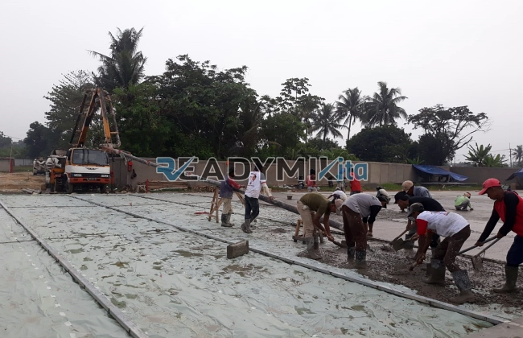

**Jasa Cor Readymix di Gunung Batu Bogor Murah** - Hai Mitra Readymix Kita! Punya rencana membangun di Gunung Batu Bogor? Atau sedang mengerjakan proyek yang butuh fondasi kuat dan tahan lama? Nah, Anda sudah berada di tempat yang tepat! Kami dari ReadymixKita hadir sebagai solusi pengecoran readymix terpercaya, siap mendukung kesuksesan proyek Anda dengan kualitas terbaik dan harga yang bersaing.



## Apa Itu Beton Readymix dan Kenapa Memilihnya?

Beton Cor Readymix adalah campuran beton siap pakai yang diproduksi secara presisi di pabrik modern dengan standar kualitas tinggi. Material ini kemudian diangkut langsung ke lokasi proyek Anda menggunakan truk molen. Lantas, apa saja keunggulan menggunakan readymix dibandingkan metode tradisional?

1. **Efisiensi Waktu & Biaya**

   Proses pengecoran jadi lebih cepat karena beton sudah siap pakai. Ini menghemat waktu kerja dan biaya tenaga kerja di lokasi proyek Anda.

2. **Kualitas Terjamin Konsisten**

   Dengan takaran material yang akurat dan kontrol kualitas ketat, beton readymix menghasilkan kekuatan dan durabilitas yang seragam. Artinya, minim risiko kegagalan struktur akibat campuran yang tidak tepat.

3. **Fleksibilitas Volume Produksi**

   Mau proyek kecil atau besar, readymix bisa disesuaikan. Kami melayani berbagai skala proyek tanpa mengubah kualitas.

4. **Dukungan Ramah Lingkungan**

   Proses produksi yang terkontrol mengurangi limbah material di lokasi proyek, berkontribusi pada praktik konstruksi berkelanjutan.

## Mengapa ReadymixKita adalah Pilihan Tepat di Gunung Batu Bogor?

Tentu saja, ada banyak penyedia jasa cor readymix di luar sana. Tapi, kenapa harus memilih **ReadymixKita** untuk proyek Anda di Gunung Batu Bogor? Kami punya beberapa alasan kuat:

1. **Pengalaman & Keahlian Terbukti**

   Kami telah berpengalaman melayani berbagai proyek konstruksi di Gunung Batu Bogor dan sekitarnya, mulai dari rumah tinggal, gedung komersial, hingga proyek infrastruktur skala besar.

2. **Pilihan Mutu Beton yang Lengkap**

   Kami menyediakan berbagai kelas mutu beton, seperti K-225, K-300, K-350, hingga K-500. Pilihan ini memungkinkan Anda memilih beton yang paling sesuai dengan kebutuhan dan persyaratan proyek Anda.

3. **Peralatan Pengecoran Modern**

   Kami dilengkapi dengan armada truk molen yang terawat dan pompa beton (concrete pump) modern yang handal untuk memastikan pengecoran cepat, efisien, dan merata.

4. **Tim Ahli yang Profesional**

   Tim kami terdiri dari tenaga ahli yang berpengalaman dan siap memberikan konsultasi teknis, membantu perencanaan, dan memastikan eksekusi pengecoran berjalan lancar.

## Layanan Kami yang Dirancang Khusus untuk Kondisi Gunung Batu Bogor

Sebagai penyedia jasa lokal, kami sangat memahami karakteristik wilayah Gunung Batu Bogor. Kami tahu betul tantangan konstruksi di sini, mulai dari kondisi tanah hingga aksesibilitas lokasi. Itulah mengapa kami menawarkan:

1. **Pengiriman Tepat Waktu**

   Lokasi pabrik kami yang strategis di Gunung Batu Bogor memungkinkan kami menjamin pengiriman beton tepat waktu, bahkan ke lokasi yang sulit dijangkau.

2. **Konsultasi Teknis Gratis**

   Kami menyediakan layanan konsultasi gratis untuk membantu Anda menentukan jenis beton yang paling cocok untuk proyek Anda, serta metode pengecoran yang paling efisien.

3. **Penawaran Spesial untuk Proyek Lokal**

   Klien di wilayah Gunung Batu Bogor berhak mendapatkan penawaran harga khusus dan diskon menarik untuk proyek-proyek tertentu.

## Harga Kompetitif & Penawaran Menarik di Gunung Batu Bogor

Kami mengerti bahwa biaya adalah faktor penting dalam setiap proyek konstruksi. **ReadymixKita** berkomitmen untuk memberikan harga yang terjangkau tanpa mengorbankan kualitas. Kami menawarkan:

1. **Harga Bersaing**

   Kami menawarkan harga yang kompetitif dan transparan, termasuk biaya pengiriman dan opsi tambahan seperti penyewaan concrete pump.

2. **Promo & Diskon Spesial**

   Dapatkan diskon menarik untuk pemesanan volume besar atau proyek jangka panjang. Jangan lewatkan juga promo-promo spesial lainnya yang kami tawarkan secara berkala.

3. **Jaminan Kepuasan Pelanggan**

   Kami bertanggung jawab penuh atas kualitas produk dan layanan kami. Jika Anda tidak puas dengan hasil pengecoran, tim kami akan segera memberikan solusi terbaik.

## Cek Daftar Harga Jasa Cor Readymix di Gunung Batu Bogor



Jangan tunda lagi! Pastikan proyek konstruksi Anda di Gunung Batu Bogor berjalan lancar dan sukses dengan beton readymix berkualitas dari **ReadymixKita**. 

Hubungi kami sekarang juga untuk konsultasi gratis dan penawaran harga terbaik. Kami siap membantu Anda merealisasikan proyek impian Anda! Percayakan keperluan cor beton Anda pada ahlinya – ReadymixKita, mitra terpercaya Anda di Gunung Batu Bogor. Bangunlah dengan kokoh, bangunlah bersama kami!

[Jasa Cor Readymix di Babakan Bogor Murah](/readymix/jasa-cor-readymix-di-babakan-bogor-murah/) — temukan solusi pengecoran terpercaya untuk proyek Anda di Babakan Bogor dengan harga yang kompetitif dan pelayanan terbaik.