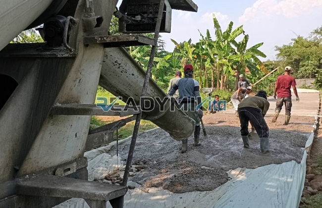

**Jasa Cor Readymix di Jambe Tangerang Murah** - Hai Mitra Readymix Kita! Punya proyek konstruksi di Jambe Tangerang dan butuh solusi pengecoran yang cepat, berkualitas, dan terpercaya? Nah, Anda sudah berada di tempat yang tepat! Kami dari Readymix Kita siap membantu mewujudkan proyek Anda dengan beton cor readymix terbaik di wilayah ini. Kami mengerti betul tantangan pembangunan di Jambe Tangerang, dan hadir sebagai solusi praktis yang hemat waktu dan biaya.



## Mengapa Memilih Pengecoran dengan Readymix?

Apa sih kelebihan beton cor readymix dibandingkan cara konvensional? Beton Cor Readymix adalah campuran beton siap pakai yang diproduksi di pabrik dengan formulasi presisi dan bahan baku pilihan. Setelah jadi, beton ini diangkut langsung ke lokasi proyek menggunakan truk mixer. Manfaatnya? Banyak sekali!

1. **Hemat Waktu dan Biaya Operasional**

   Lupakan kerepotan mencampur beton di lokasi proyek. Dengan readymix, waktu pengerjaan lebih efisien karena proses pencampuran sudah ditangani di pabrik. Ini berarti penghematan tenaga dan biaya operasional yang signifikan.

2. **Kualitas Lebih Terjamin**

   Proses pencampuran yang terkontrol di pabrik, menggunakan teknologi modern dan takaran yang tepat, menghasilkan beton dengan kualitas yang konsisten. Risiko kesalahan manusia dalam pencampuran bisa dihilangkan.

3. **Kapasitas Fleksibel untuk Berbagai Skala Proyek**

   Baik untuk proyek kecil maupun konstruksi berskala besar, beton Cor Readymix mampu menyediakan volume yang dibutuhkan dengan cepat.

4. **Berkontribusi pada Pembangunan Berkelanjutan**

   Proses produksi readymix yang lebih efisien membantu mengurangi limbah material dan dampak lingkungan selama proses konstruksi.

## Kenapa Harus Memilih ReadymixKita di Jambe Tangerang?

Di antara sekian banyak penyedia jasa pengecoran di Jambe Tangerang Murah, kenapa harus ReadymixKita? Ini dia alasannya:

1. **Reputasi Solid dan Pengalaman Teruji**

   Berbekal pengalaman bertahun-tahun di industri konstruksi, kami memahami betul seluk-beluk pengecoran dan kebutuhan unik setiap proyek.

2. **Pilihan Mutu Beton Lengkap**

   Kami menyediakan beragam pilihan mutu beton, mulai dari K-225 untuk proyek-proyek standar hingga K-500 untuk konstruksi yang membutuhkan kekuatan ekstra. Pilihan yang tepat untuk memastikan struktur yang kuat dan awet.

3. **Didukung Peralatan Modern dan Handal**

   Kami berinvestasi pada peralatan canggih seperti concrete pump untuk memastikan pengecoran berlangsung cepat, merata, dan presisi.

4. **Tim Ahli yang Siap Mendampingi Anda**

   Tim profesional kami siap memberikan konsultasi, panduan, dan dukungan penuh selama proses pengecoran, dari perencanaan hingga penyelesaian proyek. Kami juga fleksibel menyesuaikan jadwal dengan kebutuhan Anda.

## Layanan Kami yang Dirancang untuk Kondisi Jambe Tangerang

Sebagai penyedia jasa lokal, kami memahami betul karakteristik wilayah Jambe Tangerang. Dengan kondisi medan yang bervariasi, mulai dari area perkotaan hingga perbukitan, kami menawarkan solusi yang tepat:

1. **Pengiriman Tepat Waktu**

   Dengan jaringan logistik yang baik dan lokasi pabrik yang strategis di Jambe Tangerang, kami menjamin pengiriman beton tepat waktu sesuai jadwal proyek Anda.

2. **Konsultasi Gratis untuk Proyek Anda**

   Bingung memilih jenis beton yang tepat? Tim ahli kami siap memberikan konsultasi gratis untuk memastikan Anda mendapatkan solusi terbaik untuk proyek Anda.

3. **Penawaran Spesial untuk Proyek di Jambe Tangerang Murah**

   Khusus untuk pelanggan di Jambe Tangerang, kami menawarkan harga khusus dan diskon menarik untuk proyek-proyek besar.

## Harga yang Bersahabat dan Promo Menarik

Kami mengerti bahwa anggaran adalah pertimbangan penting dalam proyek konstruksi Anda. Oleh karena itu, ReadymixKita berkomitmen untuk memberikan:

1. **Harga yang Kompetitif**

   Kami menawarkan harga yang bersaing tanpa mengorbankan kualitas beton readymix yang kami sediakan. Untuk info lebih rinci mengenai harga, silakan lihat .

2. **Promo dan Diskon Spesial**

   Nikmati berbagai promo menarik untuk pemesanan dalam jumlah besar atau proyek-proyek jangka panjang.

3. **Jaminan Kepuasan Pelanggan**

   Kami berkomitmen untuk memberikan layanan terbaik dan memastikan kepuasan Anda sebagai pelanggan.

## Informasi Lebih Lanjut dan Hubungi Kami

Jangan tunda lagi! Pastikan proyek Anda menggunakan material berkualitas tinggi dengan harga yang terjangkau. Hubungi kami sekarang untuk konsultasi gratis dan penawaran terbaik untuk kebutuhan readymix di Jambe Tangerang Murah.

Kami siap membantu Anda mewujudkan proyek impian Anda dengan pondasi yang kuat dan tahan lama. Segera dapatkan penawaran terbaik dari ReadymixKita dan rasakan kemudahan dalam membangun! 
<table class="table">
  <caption>Ukuran &amp; Mutu Beton Readymix</caption>
  <thead>
    <tr><th>Ukuran Agregat (mm)</th><th>Mutu Beton (K)</th></tr>
  </thead>
  <tbody>
    <tr><td>5-20</td><td>K-225</td></tr>
    <tr><td>10-20</td><td>K-300</td></tr>
    <tr><td>20-40</td><td>K-400</td></tr>
    <tr><td>40-60</td><td>K-500</td></tr>
  </tbody>
</table>
 [Jasa Cor Readymix di Balaraja Tangerang Murah](/readymix/jasa-cor-readymix-di-balaraja-tangerang-murah/) menawarkan solusi serupa untuk proyek Anda di wilayah Balaraja. Hubungi kami sekarang!