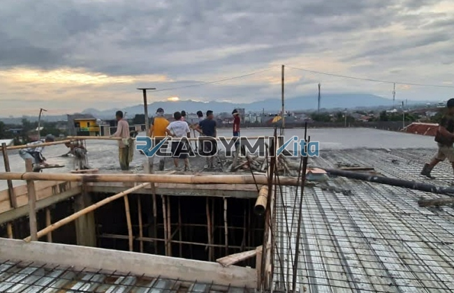

**Jasa Cor Readymix di Jati Pulo Jakarta Murah** - Hai Mitra Readymix Kita! Apakah Anda sedang merencanakan pembangunan di Jati Pulo Jakarta? Mencari material yang andal untuk fondasi kuat dan konstruksi berkualitas? Nah, Anda sudah berada di tempat yang tepat! Kami dari Readymix Kita hadir sebagai solusi pengecoran readymix terbaik untuk proyek Anda. Bangunan kokoh dimulai dari material yang tepat – mari wujudkan bersama!



## Mengapa Memilih Beton Readymix untuk Proyek Anda?

Beton Cor Readymix adalah campuran beton siap pakai yang diproduksi secara presisi di pabrik modern dengan standar kualitas tinggi. Proses pencampuran yang terkontrol, kemudian diangkut langsung ke lokasi proyek menggunakan truk mixer khusus. Apa saja keuntungannya? Berikut beberapa alasan mengapa beton readymix menjadi pilihan cerdas:

1. **Hemat Waktu & Efisien**

   Pengerjaan beton di lokasi proyek seringkali memakan waktu dan tenaga. Dengan readymix, Anda menghemat keduanya karena beton sudah siap pakai saat tiba di lokasi.

2. **Kualitas yang Terjamin Konsisten**

   Proses produksi yang terstandarisasi memastikan setiap batch beton memiliki kualitas yang seragam. Ini mengurangi risiko kesalahan pencampuran dan menjamin kekuatan struktur.

3. **Fleksibilitas Volume Produksi**

   Kebutuhan beton bervariasi antar proyek. Readymix mampu menyesuaikan volume produksi dengan cepat, melayani proyek kecil maupun berskala besar.

4. **Minimalkan Dampak Lingkungan**

   Produksi readymix yang terpusat mengurangi limbah material dan penggunaan energi di lokasi proyek, mendukung praktik konstruksi berkelanjutan.

## Keunggulan Jasa ReadymixKita di Jati Pulo Jakarta

Di antara banyaknya penyedia jasa, **ReadymixKita** menonjol sebagai mitra terpercaya untuk proyek konstruksi Anda di Jati Pulo Jakarta. Apa yang membuat kami berbeda?

1. **Pengalaman & Keahlian Teruji**

   Kami telah berpengalaman menangani berbagai jenis proyek konstruksi – mulai dari perumahan, gedung komersial, hingga proyek infrastruktur besar. Kami memahami betul kebutuhan unik setiap proyek.

2. **Pilihan Mutu Beton yang Lengkap**

   Kami menyediakan beragam pilihan mutu beton, termasuk K-225, K-300, K-350, hingga K-500. Sesuaikan mutu beton dengan spesifikasi proyek Anda untuk hasil optimal.

3. **Didukung Peralatan Modern & Terawat**

   Kami berinvestasi pada peralatan pengecoran terkini, termasuk concrete pump, untuk memastikan proses pengecoran berlangsung lancar, cepat, dan merata.

4. **Tim Profesional yang Siap Membantu**

   Tim kami terdiri dari tenaga ahli yang siap memberikan dukungan teknis dan konsultasi, mulai dari perencanaan hingga penyelesaian proyek Anda. Kami menawarkan pelayanan yang fleksibel dan adaptif.

## Pelayanan Lokal yang Kami Sediakan di Jati Pulo Jakarta

Sebagai penyedia jasa lokal, kami memahami betul karakteristik konstruksi di Jati Pulo Jakarta dan sekitarnya. Kami hadir untuk memberikan solusi tepat guna:

1. **Pengiriman Tepat Waktu**

   Kami menjamin pengiriman beton readymix yang tepat waktu ke lokasi proyek Anda di Jati Pulo Jakarta, berkat jaringan logistik yang efisien dan lokasi pabrik strategis.

2. **Layanan Konsultasi Gratis**

   Bingung memilih jenis beton yang tepat? Tim ahli kami siap memberikan konsultasi gratis untuk membantu Anda menentukan solusi terbaik untuk proyek Anda.

3. **Penawaran Spesial untuk Pelanggan Lokal**

   Khusus untuk pelanggan di wilayah Jati Pulo Jakarta, kami menawarkan harga spesial dan diskon menarik untuk proyek-proyek tertentu.

## Harga Bersaing & Penawaran Menarik di Jati Pulo Jakarta

Kami percaya bahwa kualitas tidak harus mahal. **ReadymixKita** berkomitmen untuk memberikan harga yang kompetitif, transparan, dan sesuai dengan anggaran proyek Anda:

1. **Harga Terjangkau**

   Kami menawarkan harga yang bersaing tanpa mengorbankan kualitas beton maupun layanan. Informasi harga lengkap, termasuk biaya pengiriman dan penggunaan concrete pump, tersedia secara jelas.

2. **Promo & Diskon Menarik**

   Dapatkan diskon khusus untuk pemesanan volume besar atau proyek jangka panjang. Jangan ragu untuk bertanya kepada tim kami mengenai promo terbaru.

3. **Jaminan Kepuasan Pelanggan**

   Kepuasan Anda adalah prioritas utama kami. Kami memberikan jaminan kualitas dan siap memberikan solusi jika terjadi kendala selama proses pengecoran.

## Daftar Harga Jasa Cor Readymix di Jati Pulo Jakarta



Yuk, jangan tunda lagi! Hubungi kami sekarang juga untuk mendapatkan penawaran terbaik dan solusi pengecoran readymix yang andal di Jati Pulo Jakarta. [Jasa Cor Readymix di Abadijaya Depok Murah](/readymix/jasa-cor-readymix-di-abadijaya-depok-murah/) bisa jadi portofolio proyek yang bisa kami lakukan.

Kami siap memberikan layanan survei lokasi dan konsultasi gratis untuk memastikan kebutuhan Anda terpenuhi dengan prima. Pesan sekarang dan nikmati kenyamanan mengecor dengan kualitas terjamin!

Pilih **ReadymixKita** untuk fondasi kokoh dan konstruksi berkualitas. Dengan kombinasi kualitas, kecepatan, dan layanan profesional – kami siap menjadi mitra terpercaya Anda di Jati Pulo Jakarta. Hubungi kami sekarang dan wujudkan bangunan impian Anda!